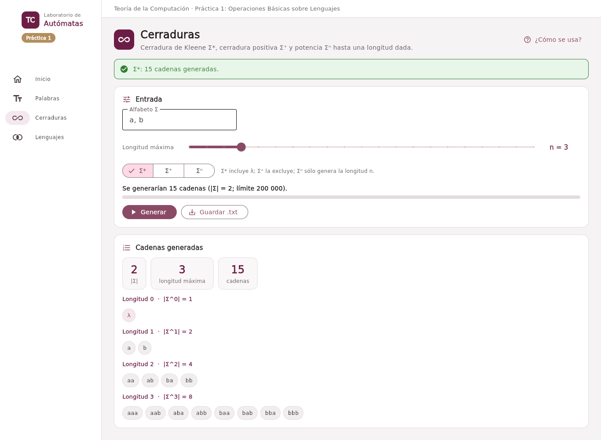
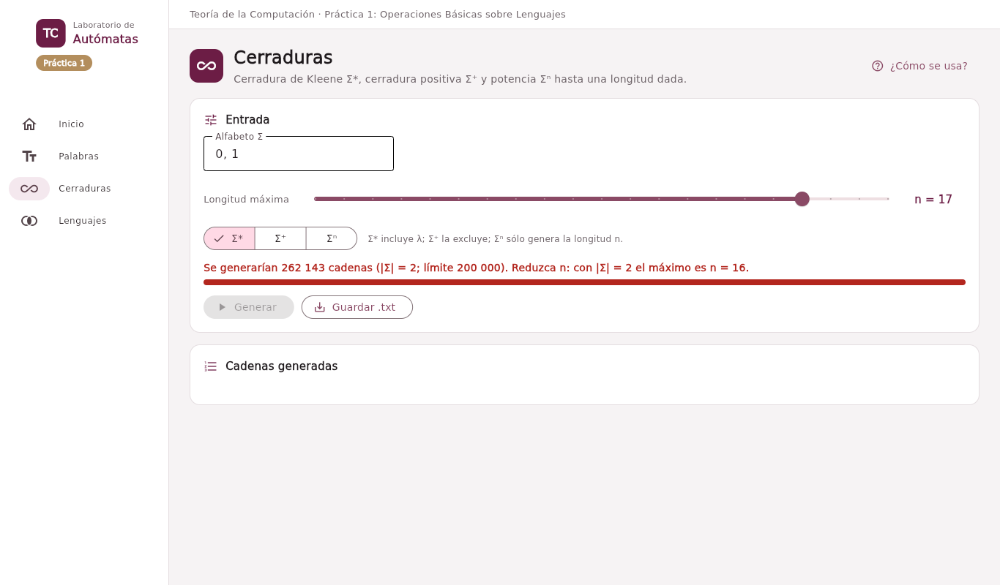

# Ejercicio 5. Aplicación con interfaz gráfica

## Arquitectura

La aplicación separa el **núcleo**, que no importa Flet, de la **interfaz**, que sólo traduce clics en llamadas al núcleo. Así las pruebas ejercitan toda la lógica sin abrir una ventana.

``` text
src/
├── app.py                  # punto de entrada: lista de secciones y arranque
├── nucleo/
│   ├── errores.py          # ErrorTC y sus subclases (mensajes para el usuario)
│   └── lenguajes.py        # Alfabeto, Palabra, Lenguaje, Enumerador, Informe
└── interfaz/
    ├── aplicacion.py       # ventana: menú lateral, barra superior, área de trabajo
    ├── componentes.py      # tarjetas, avisos, pastillas, métricas, ayuda numerada
    ├── tema.py · sesion.py # paleta institucional y estado compartido
    └── vistas/             # Inicio, Palabras, Cerraduras, Lenguajes
```

| Clase              | Responsabilidad                                                                                                                                                                           |
|--------------------|-------------------------------------------------------------------------------------------------------------------------------------------------------------------------------------------|
| `Alfabeto`         | Conjunto finito y no vacío de símbolos de un carácter; rechaza λ, comas, llaves y espacios. Responde si una palabra está en Σ*, cuenta Σⁿ sin generarlo y construye Σⁿ, Σ* y Σ⁺ acotados. |
| `Palabra`          | Cadena inmutable: longitud, concatenación (`+`), potencia, reflexión, prefijos, sufijos y subcadenas.                                                                                     |
| `Lenguaje`         | Conjunto finito de palabras con `|`, `&`, `-`, concatenación, potencia, reflexión y cerraduras acotadas.                                                                                  |
| `Enumerador`       | Recorre Σᵐⁱⁿ ∪ … ∪ Σᵐᵃˣ en orden canónico y verifica el límite *antes* de generar.                                                                                                        |
| `Informe`          | Texto exportable con encabezado, datos de la operación, total y resultados.                                                                                                               |
| `Vista` (interfaz) | Base de cada sección: encabezado, ayuda «¿Cómo se usa?», avisos y manejo uniforme de errores.                                                                                             |

Clases principales.

Todas las operaciones del núcleo devuelven objetos nuevos; ninguna modifica sus argumentos. Los errores de dominio (símbolo inválido, palabra fuera de Σ, límite excedido) son subclases de `ErrorTC` y la interfaz los muestra en una franja roja con el mensaje, sin interrumpir el programa.

## Diseño de la interfaz

La ventana tiene un menú lateral con las secciones y un área de trabajo. Cada sección empieza con un encabezado que dice qué hace y un botón **¿Cómo se usa?** que despliega los pasos numerados. Los resultados se calculan **mientras se escribe**: no hay que pulsar un botón para ver los prefijos de una palabra, y un símbolo que no pertenece a Σ se señala en el propio campo. Los resultados se muestran como pastillas (la palabra vacía, resaltada) acompañadas de métricas: la longitud, el número de resultados y el máximo teórico.

## Operación 1. Prefijos, sufijos y subcadenas

`Palabra.prefijos()` devuelve `[ω[:0], ω[:1], …, ω[:n]]`; `sufijos()`, los n + 1 finales; y `subcadenas()` recorre todas las longitudes y posiciones y conserva cada subcadena la primera vez que aparece. La sección **Palabras** permite además la reflexión y la potencia, y guarda cualquier resultado en `salidas/palabras-<operación>.txt`.

**Conteos.** Una palabra de longitud n tiene exactamente **n + 1 prefijos** (uno por cada punto de corte, de 0 a n) y n + 1 sufijos. Las subcadenas no vacías se determinan por un par de posiciones 0 ≤ i \< j ≤ n, de modo que hay a lo sumo n(n + 1)/2; con λ, el máximo es **n(n + 1)/2 + 1**, y se alcanza sólo cuando todos los símbolos son distintos. Para `abcb` hay 5 prefijos y 10 subcadenas distintas, una menos que la cota 11 porque `b` se repite.

**Convención sobre λ.** El programa incluye λ y la propia palabra entre los prefijos y los sufijos. Se sigue la definición: x es prefijo de ω si existe y tal que xy = ω; con y = ω se obtiene x = λ, y con y = λ, x = ω. Excluirlas haría que una palabra de longitud n tuviera n − 1 prefijos *propios*, que es otro concepto; el núcleo ofrece esa variante con `prefijos(propios=True)`.

## Operación 2. Cerradura de Kleene y cerradura positiva

La sección **Cerraduras** genera Σ\*, Σ⁺ o Σⁿ hasta la longitud que el usuario elige con un control deslizante. Antes de generar, `Alfabeto.cuantas` calcula el total con la fórmula

$$|\Sigma^0 \cup \Sigma^1 \cup \dots \cup \Sigma^n| = \sum_{i=0}^{n} |\Sigma|^i = \frac{|\Sigma|^{n+1} - 1}{|\Sigma| - 1} \quad (|\Sigma| > 1),$$

y la interfaz muestra ese número y una barra respecto del límite **mientras se mueve el control**. Si el total supera 200 000, el botón *Generar* se desactiva y el mensaje indica la longitud máxima permitida para ese alfabeto; el núcleo repite la verificación y lanza `LimiteExcedido` aunque se le llame desde otro programa.

``` python
self.total = alfabeto.cuantas(maximo, minimo)
if self.total > limite:
    raise LimiteExcedido(f"... produce {self.total} cadenas; el límite es {limite}.")
```

**Relación con la unidad.** Σ\* es infinito para todo alfabeto, así que ningún programa puede «calcularlo»; lo que se genera es un truncamiento finito. Cada nivel tiene \|Σⁿ\| = \|Σ\|ⁿ cadenas, de modo que el truncamiento crece exponencialmente en la longitud: con \|Σ\| = 2 se llega a n = 16 (131 071 cadenas), pero con \|Σ\| = 10 sólo a n = 5. El límite convierte esa propiedad teórica en una regla que el usuario ve antes de esperar. Σ⁺ con longitud 0 es vacío: la única cadena de longitud 0 es λ, y Σ⁺ la excluye.






## Pruebas automatizadas

`tests/test_lenguajes.py` (34 pruebas) cubre lo que pide el enunciado y algo más: la palabra vacía (λ = «» = «ε», sus prefijos, sufijos y subcadenas), un alfabeto de un solo símbolo, los prefijos y sufijos de una palabra de longitud 1, la diferencia Σ\* − Σ⁺ = {λ} y Σ⁺ = ∅ para longitud 0, los conteos n + 1 y n(n + 1)/2 + 1, el orden canónico, el límite exacto (n = 16 se permite y n = 17 no, con \|Σ\| = 2) y las operaciones entre lenguajes. `tests/test_interfaz.py` construye cada sección sin ventana y ejecuta sus acciones principales, por ejemplo escribir una palabra con un símbolo ajeno y comprobar que el campo muestra el error.

| Servicio | Intérprete  | Resultado de `pytest -q` |
|----------|-------------|--------------------------|
| `py311`  | Python 3.11 | 41 aprobadas, 3 omitidas |
| `py312`  | Python 3.12 | 41 aprobadas, 3 omitidas |
| `py313`  | Python 3.13 | 41 aprobadas, 3 omitidas |

Resultados de la suite en los tres entornos.

Las tres pruebas omitidas pertenecen a secciones de prácticas posteriores (editor, algoritmos y expresiones) y se saltan porque esta práctica no incluye esos módulos. No se observaron diferencias de comportamiento entre versiones.


