# Anexo A. Fichas de diseño de los autómatas

Cada ficha reúne el enunciado, la idea del diseño, lo que recuerda cada estado, la tabla de transiciones, las cadenas de prueba (tres válidas, tres inválidas y los casos frontera) y la captura de JFLAP con el *Multiple Run* de las tres válidas y las tres inválidas. Cuando el diseño natural del enunciado es no determinista, la ficha presenta el AFD que se obtuvo con la construcción de subconjuntos y la minimización, e indica qué estados del AFN representa cada estado del AFD. El archivo de cada autómata está en `automatas/lista2/` o `automatas/lista3/` con el nombre de la ficha.

## Lista 2

### Lista 2 · Ejercicio 097

**Enunciado.** Las palabras de Σ1 cuya longitud es un múltiplo de 3.

**Diseño.** Basta recordar la longitud módulo 3; λ tiene longitud 0, que es múltiplo de 3.

**Archivo.** `automatas/lista2/lista2-097.jff` · Σ = {0, 1, 2} · \|Q\| = 3

| δ      | 0   | 1   | 2   | Qué recuerda del prefijo leído   |
|--------|-----|-----|-----|----------------------------------|
| →\* r0 | r1  | r1  | r1  | la longitud leída es ≡ 0 (mod 3) |
| r1     | r2  | r2  | r2  | la longitud leída es ≡ 1 (mod 3) |
| r2     | r0  | r0  | r0  | la longitud leída es ≡ 2 (mod 3) |

Tabla de transiciones (→ inicial, \* aceptación, — sin transición).

| Cadena      | Longitud | Esperado | Obtenido | Tipo de caso |
|-------------|:--------:|----------|----------|--------------|
| λ           |    0     | acepta   | acepta   | válida       |
| `212200`    |    6     | acepta   | acepta   | válida       |
| `100022002` |    9     | acepta   | acepta   | válida       |
| `1`         |    1     | rechaza  | rechaza  | inválida     |
| `20`        |    2     | rechaza  | rechaza  | inválida     |
| `0100`      |    4     | rechaza  | rechaza  | inválida     |

Cadenas de prueba.

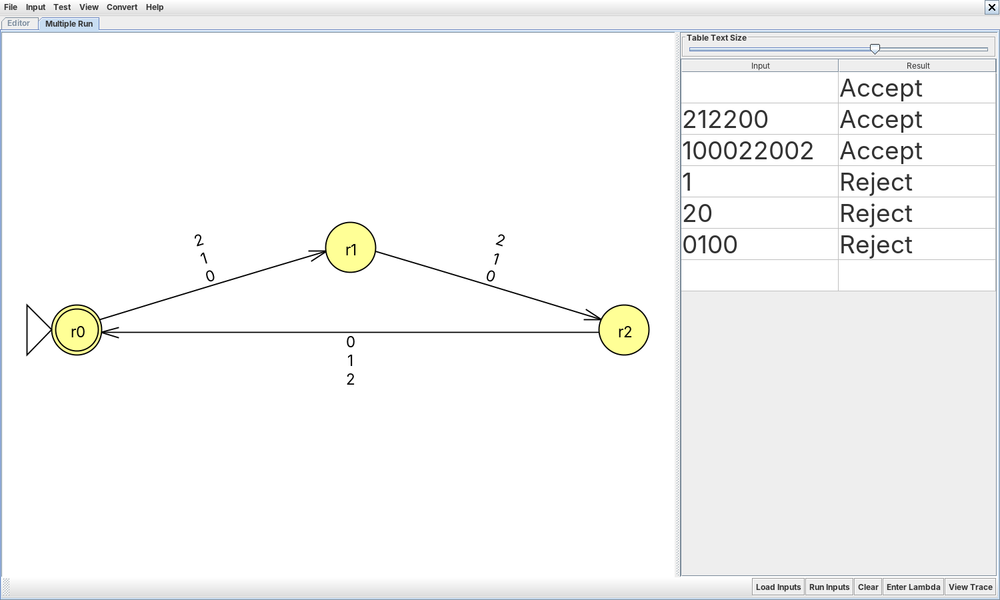

### Lista 2 · Ejercicio 099

**Enunciado.** Las palabras de Σ1 que terminan con la cadena 001001.

**Diseño.** Autómata de búsqueda de patrones (Knuth-Morris-Pratt): cada estado guarda el sufijo más largo leído que es prefijo de 001001; se acepta cuando ese sufijo es el patrón completo.

**Archivo.** `automatas/lista2/lista2-099.jff` · Σ = {0, 1, 2} · \|Q\| = 7

| δ         | 0     | 1      | 2   | Qué recuerda del prefijo leído                                                                |
|-----------|-------|--------|-----|-----------------------------------------------------------------------------------------------|
| → λ       | 0     | λ      | λ   | el sufijo más largo leído que es prefijo de 001001 es λ                                       |
| 0         | 00    | λ      | λ   | el sufijo más largo leído que es prefijo de 001001 es 0                                       |
| 00        | 00    | 001    | λ   | el sufijo más largo leído que es prefijo de 001001 es 00                                      |
| 001       | 0010  | λ      | λ   | el sufijo más largo leído que es prefijo de 001001 es 001                                     |
| 0010      | 00100 | λ      | λ   | el sufijo más largo leído que es prefijo de 001001 es 0010                                    |
| 00100     | 00    | 001001 | λ   | el sufijo más largo leído que es prefijo de 001001 es 00100                                   |
| \* 001001 | 0010  | λ      | λ   | el sufijo más largo leído que es prefijo de 001001 es 001001 (la cadena termina en el patrón) |

Tabla de transiciones (→ inicial, \* aceptación, — sin transición).

| Cadena      | Longitud | Esperado | Obtenido | Tipo de caso                                     |
|-------------|:--------:|----------|----------|--------------------------------------------------|
| `001001`    |    6     | acepta   | acepta   | válida                                           |
| `1001001`   |    7     | acepta   | acepta   | válida                                           |
| `120001001` |    9     | acepta   | acepta   | válida                                           |
| λ           |    0     | rechaza  | rechaza  | inválida                                         |
| `1`         |    1     | rechaza  | rechaza  | inválida                                         |
| `002`       |    3     | rechaza  | rechaza  | inválida                                         |
| `11111`     |    5     | rechaza  | rechaza  | frontera: justo por debajo de la longitud mínima |

Cadenas de prueba.

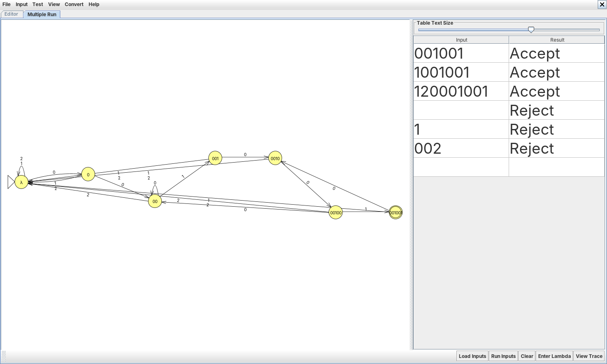

### Lista 2 · Ejercicio 102

**Enunciado.** Las palabras de Σ3 que contienen la cadena abbbab.

**Diseño.** Búsqueda de abbbab con el autómata de Knuth-Morris-Pratt; al completar el patrón el estado es absorbente.

**Archivo.** `automatas/lista2/lista2-102.jff` · Σ = {a, b} · \|Q\| = 7

| δ         | a      | b      | Qué recuerda del prefijo leído                                                     |
|-----------|--------|--------|------------------------------------------------------------------------------------|
| → λ       | a      | λ      | aún no aparece abbbab; el sufijo más largo leído que es prefijo de abbbab es λ     |
| a         | a      | ab     | aún no aparece abbbab; el sufijo más largo leído que es prefijo de abbbab es a     |
| ab        | a      | abb    | aún no aparece abbbab; el sufijo más largo leído que es prefijo de abbbab es ab    |
| abb       | a      | abbb   | aún no aparece abbbab; el sufijo más largo leído que es prefijo de abbbab es abb   |
| abbb      | abbba  | λ      | aún no aparece abbbab; el sufijo más largo leído que es prefijo de abbbab es abbb  |
| abbba     | a      | abbbab | aún no aparece abbbab; el sufijo más largo leído que es prefijo de abbbab es abbba |
| \* abbbab | abbbab | abbbab | ya apareció abbbab                                                                 |

Tabla de transiciones (→ inicial, \* aceptación, — sin transición).

| Cadena      | Longitud | Esperado | Obtenido | Tipo de caso                                     |
|-------------|:--------:|----------|----------|--------------------------------------------------|
| `abbbab`    |    6     | acepta   | acepta   | válida                                           |
| `abbbaba`   |    7     | acepta   | acepta   | válida                                           |
| `aabbbabab` |    9     | acepta   | acepta   | válida                                           |
| λ           |    0     | rechaza  | rechaza  | inválida                                         |
| `b`         |    1     | rechaza  | rechaza  | inválida                                         |
| `aab`       |    3     | rechaza  | rechaza  | inválida                                         |
| `baaab`     |    5     | rechaza  | rechaza  | frontera: justo por debajo de la longitud mínima |

Cadenas de prueba.

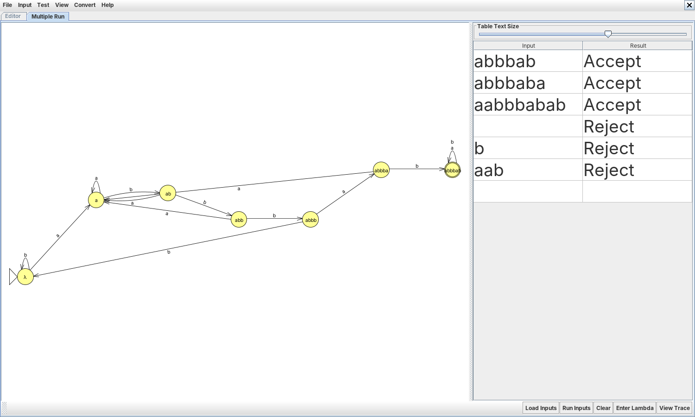

### Lista 2 · Ejercicio 103

**Enunciado.** Las palabras de Σ3 que contienen la cadena aabbba.

**Diseño.** Búsqueda de aabbba con el autómata de Knuth-Morris-Pratt; al completar el patrón el estado es absorbente.

**Archivo.** `automatas/lista2/lista2-103.jff` · Σ = {a, b} · \|Q\| = 7

| δ         | a      | b      | Qué recuerda del prefijo leído                                                     |
|-----------|--------|--------|------------------------------------------------------------------------------------|
| → λ       | a      | λ      | aún no aparece aabbba; el sufijo más largo leído que es prefijo de aabbba es λ     |
| a         | aa     | λ      | aún no aparece aabbba; el sufijo más largo leído que es prefijo de aabbba es a     |
| aa        | aa     | aab    | aún no aparece aabbba; el sufijo más largo leído que es prefijo de aabbba es aa    |
| aab       | a      | aabb   | aún no aparece aabbba; el sufijo más largo leído que es prefijo de aabbba es aab   |
| aabb      | a      | aabbb  | aún no aparece aabbba; el sufijo más largo leído que es prefijo de aabbba es aabb  |
| aabbb     | aabbba | λ      | aún no aparece aabbba; el sufijo más largo leído que es prefijo de aabbba es aabbb |
| \* aabbba | aabbba | aabbba | ya apareció aabbba                                                                 |

Tabla de transiciones (→ inicial, \* aceptación, — sin transición).

| Cadena      | Longitud | Esperado | Obtenido | Tipo de caso                                     |
|-------------|:--------:|----------|----------|--------------------------------------------------|
| `aabbba`    |    6     | acepta   | acepta   | válida                                           |
| `aabbbab`   |    7     | acepta   | acepta   | válida                                           |
| `aaaabbbab` |    9     | acepta   | acepta   | válida                                           |
| λ           |    0     | rechaza  | rechaza  | inválida                                         |
| `a`         |    1     | rechaza  | rechaza  | inválida                                         |
| `aab`       |    3     | rechaza  | rechaza  | inválida                                         |
| `aabab`     |    5     | rechaza  | rechaza  | frontera: justo por debajo de la longitud mínima |

Cadenas de prueba.

### Lista 2 · Ejercicio 106

**Enunciado.** Las palabras de Σ1 que incluyen la subcadena 1101001.

**Diseño.** Búsqueda de 1101001 con el autómata de Knuth-Morris-Pratt; al completar el patrón el estado es absorbente.

**Archivo.** `automatas/lista2/lista2-106.jff` · Σ = {0, 1, 2} · \|Q\| = 8

| δ          | 0       | 1       | 2       | Qué recuerda del prefijo leído                                                        |
|------------|---------|---------|---------|---------------------------------------------------------------------------------------|
| → λ        | λ       | 1       | λ       | aún no aparece 1101001; el sufijo más largo leído que es prefijo de 1101001 es λ      |
| 1          | λ       | 11      | λ       | aún no aparece 1101001; el sufijo más largo leído que es prefijo de 1101001 es 1      |
| 11         | 110     | 11      | λ       | aún no aparece 1101001; el sufijo más largo leído que es prefijo de 1101001 es 11     |
| 110        | λ       | 1101    | λ       | aún no aparece 1101001; el sufijo más largo leído que es prefijo de 1101001 es 110    |
| 1101       | 11010   | 11      | λ       | aún no aparece 1101001; el sufijo más largo leído que es prefijo de 1101001 es 1101   |
| 11010      | 110100  | 1       | λ       | aún no aparece 1101001; el sufijo más largo leído que es prefijo de 1101001 es 11010  |
| 110100     | λ       | 1101001 | λ       | aún no aparece 1101001; el sufijo más largo leído que es prefijo de 1101001 es 110100 |
| \* 1101001 | 1101001 | 1101001 | 1101001 | ya apareció 1101001                                                                   |

Tabla de transiciones (→ inicial, \* aceptación, — sin transición).

| Cadena       | Longitud | Esperado | Obtenido | Tipo de caso                                     |
|--------------|:--------:|----------|----------|--------------------------------------------------|
| `1101001`    |    7     | acepta   | acepta   | válida                                           |
| `11010010`   |    8     | acepta   | acepta   | válida                                           |
| `0021101001` |    10    | acepta   | acepta   | válida                                           |
| λ            |    0     | rechaza  | rechaza  | inválida                                         |
| `0`          |    1     | rechaza  | rechaza  | inválida                                         |
| `122`        |    3     | rechaza  | rechaza  | inválida                                         |
| `101012`     |    6     | rechaza  | rechaza  | frontera: justo por debajo de la longitud mínima |

Cadenas de prueba.

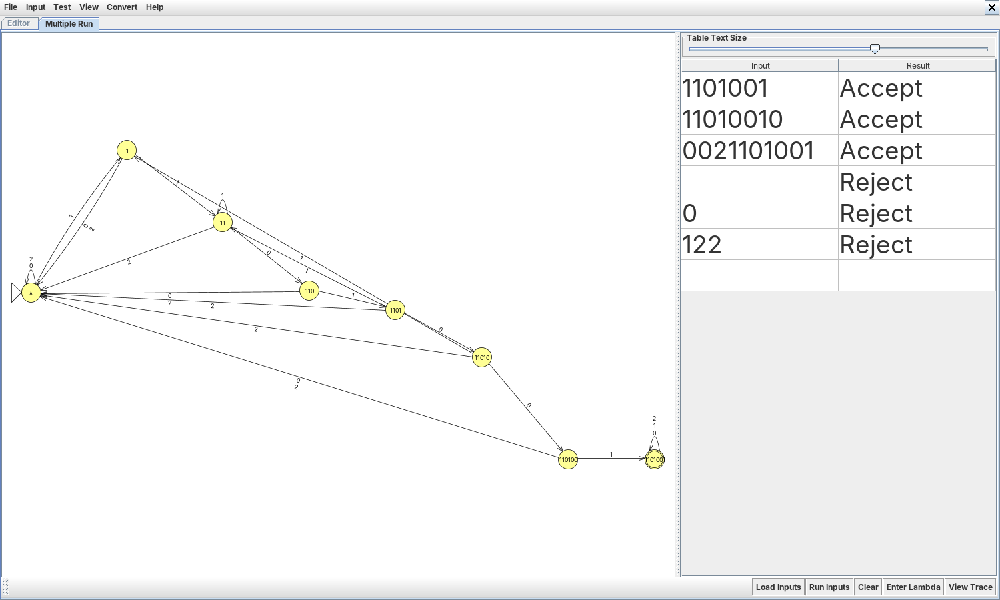

### Lista 2 · Ejercicio 107

**Enunciado.** Las palabras de Σ1 que incluyen al menos una vez 0101 y al menos una vez 021.

**Diseño.** Producto de los autómatas que buscan 0101 y 021: cada estado es un par (avance en 0101, avance en 021).

**Archivo.** `automatas/lista2/lista2-107.jff` · Σ = {0, 1, 2} · \|Q\| = 13

| δ              | 0           | 1           | 2           | Qué recuerda del prefijo leído                |
|----------------|-------------|-------------|-------------|-----------------------------------------------|
| → (λ, λ)       | (0, 0)      | (λ, λ)      | (λ, λ)      | en el primer autómata λ, en el segundo λ      |
| (0, 0)         | (0, 0)      | (01, λ)     | (λ, 02)     | en el primer autómata 0, en el segundo 0      |
| (01, λ)        | (010, 0)    | (λ, λ)      | (λ, λ)      | en el primer autómata 01, en el segundo λ     |
| (λ, 02)        | (0, 0)      | (λ, 021)    | (λ, λ)      | en el primer autómata λ, en el segundo 02     |
| (010, 0)       | (0, 0)      | (0101, λ)   | (λ, 02)     | en el primer autómata 010, en el segundo 0    |
| (λ, 021)       | (0, 021)    | (λ, 021)    | (λ, 021)    | en el primer autómata λ, en el segundo 021    |
| (0101, λ)      | (0101, 0)   | (0101, λ)   | (0101, λ)   | en el primer autómata 0101, en el segundo λ   |
| (0, 021)       | (0, 021)    | (01, 021)   | (λ, 021)    | en el primer autómata 0, en el segundo 021    |
| (0101, 0)      | (0101, 0)   | (0101, λ)   | (0101, 02)  | en el primer autómata 0101, en el segundo 0   |
| (01, 021)      | (010, 021)  | (λ, 021)    | (λ, 021)    | en el primer autómata 01, en el segundo 021   |
| (0101, 02)     | (0101, 0)   | (0101, 021) | (0101, λ)   | en el primer autómata 0101, en el segundo 02  |
| (010, 021)     | (0, 021)    | (0101, 021) | (λ, 021)    | en el primer autómata 010, en el segundo 021  |
| \* (0101, 021) | (0101, 021) | (0101, 021) | (0101, 021) | en el primer autómata 0101, en el segundo 021 |

Tabla de transiciones (→ inicial, \* aceptación, — sin transición).

| Cadena       | Longitud | Esperado | Obtenido | Tipo de caso                                     |
|--------------|:--------:|----------|----------|--------------------------------------------------|
| `0101021`    |    7     | acepta   | acepta   | válida                                           |
| `01012021`   |    8     | acepta   | acepta   | válida                                           |
| `0101002120` |    10    | acepta   | acepta   | válida                                           |
| λ            |    0     | rechaza  | rechaza  | inválida                                         |
| `1`          |    1     | rechaza  | rechaza  | inválida                                         |
| `010`        |    3     | rechaza  | rechaza  | inválida                                         |
| `0210101`    |    7     | acepta   | acepta   | frontera: aceptada más corta                     |
| `111100`     |    6     | rechaza  | rechaza  | frontera: justo por debajo de la longitud mínima |

Cadenas de prueba.

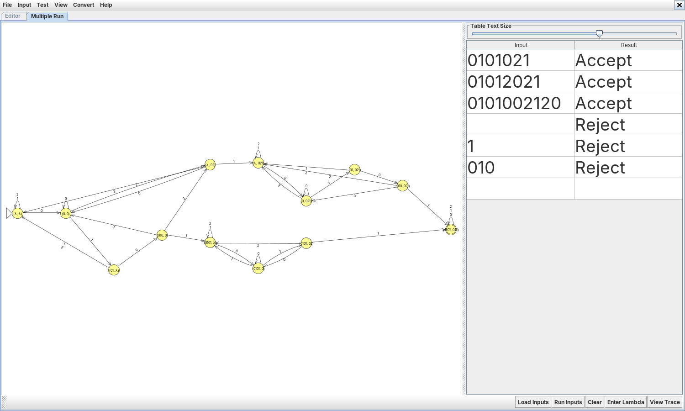

### Lista 2 · Ejercicio 109

**Enunciado.** Las palabras de Σ2 que incluyen abbcb y cbaabb, que sí se pueden traslapar.

**Diseño.** Producto de los dos buscadores de patrones: como pueden traslaparse, cada patrón se busca de forma independiente.

**Archivo.** `automatas/lista2/lista2-109.jff` · Σ = {0, 1, a, b, c} · \|Q\| = 22

| δ                  | 0               | 1               | a               | b               | c               | Qué recuerda del prefijo leído                    |
|--------------------|-----------------|-----------------|-----------------|-----------------|-----------------|---------------------------------------------------|
| → (λ, λ)           | (λ, λ)          | (λ, λ)          | (a, λ)          | (λ, λ)          | (λ, c)          | en el primer autómata λ, en el segundo λ          |
| (a, λ)             | (λ, λ)          | (λ, λ)          | (a, λ)          | (ab, λ)         | (λ, c)          | en el primer autómata a, en el segundo λ          |
| (λ, c)             | (λ, λ)          | (λ, λ)          | (a, λ)          | (λ, cb)         | (λ, c)          | en el primer autómata λ, en el segundo c          |
| (ab, λ)            | (λ, λ)          | (λ, λ)          | (a, λ)          | (abb, λ)        | (λ, c)          | en el primer autómata ab, en el segundo λ         |
| (λ, cb)            | (λ, λ)          | (λ, λ)          | (a, cba)        | (λ, λ)          | (λ, c)          | en el primer autómata λ, en el segundo cb         |
| (abb, λ)           | (λ, λ)          | (λ, λ)          | (a, λ)          | (λ, λ)          | (abbc, c)       | en el primer autómata abb, en el segundo λ        |
| (a, cba)           | (λ, λ)          | (λ, λ)          | (a, cbaa)       | (ab, λ)         | (λ, c)          | en el primer autómata a, en el segundo cba        |
| (abbc, c)          | (λ, λ)          | (λ, λ)          | (a, λ)          | (abbcb, cb)     | (λ, c)          | en el primer autómata abbc, en el segundo c       |
| (a, cbaa)          | (λ, λ)          | (λ, λ)          | (a, λ)          | (ab, cbaab)     | (λ, c)          | en el primer autómata a, en el segundo cbaa       |
| (abbcb, cb)        | (abbcb, λ)      | (abbcb, λ)      | (abbcb, cba)    | (abbcb, λ)      | (abbcb, c)      | en el primer autómata abbcb, en el segundo cb     |
| (ab, cbaab)        | (λ, λ)          | (λ, λ)          | (a, λ)          | (abb, cbaabb)   | (λ, c)          | en el primer autómata ab, en el segundo cbaab     |
| (abbcb, cba)       | (abbcb, λ)      | (abbcb, λ)      | (abbcb, cbaa)   | (abbcb, λ)      | (abbcb, c)      | en el primer autómata abbcb, en el segundo cba    |
| (abbcb, λ)         | (abbcb, λ)      | (abbcb, λ)      | (abbcb, λ)      | (abbcb, λ)      | (abbcb, c)      | en el primer autómata abbcb, en el segundo λ      |
| (abbcb, c)         | (abbcb, λ)      | (abbcb, λ)      | (abbcb, λ)      | (abbcb, cb)     | (abbcb, c)      | en el primer autómata abbcb, en el segundo c      |
| (abb, cbaabb)      | (λ, cbaabb)     | (λ, cbaabb)     | (a, cbaabb)     | (λ, cbaabb)     | (abbc, cbaabb)  | en el primer autómata abb, en el segundo cbaabb   |
| (abbcb, cbaa)      | (abbcb, λ)      | (abbcb, λ)      | (abbcb, λ)      | (abbcb, cbaab)  | (abbcb, c)      | en el primer autómata abbcb, en el segundo cbaa   |
| (a, cbaabb)        | (λ, cbaabb)     | (λ, cbaabb)     | (a, cbaabb)     | (ab, cbaabb)    | (λ, cbaabb)     | en el primer autómata a, en el segundo cbaabb     |
| (λ, cbaabb)        | (λ, cbaabb)     | (λ, cbaabb)     | (a, cbaabb)     | (λ, cbaabb)     | (λ, cbaabb)     | en el primer autómata λ, en el segundo cbaabb     |
| (abbc, cbaabb)     | (λ, cbaabb)     | (λ, cbaabb)     | (a, cbaabb)     | (abbcb, cbaabb) | (λ, cbaabb)     | en el primer autómata abbc, en el segundo cbaabb  |
| (abbcb, cbaab)     | (abbcb, λ)      | (abbcb, λ)      | (abbcb, λ)      | (abbcb, cbaabb) | (abbcb, c)      | en el primer autómata abbcb, en el segundo cbaab  |
| (ab, cbaabb)       | (λ, cbaabb)     | (λ, cbaabb)     | (a, cbaabb)     | (abb, cbaabb)   | (λ, cbaabb)     | en el primer autómata ab, en el segundo cbaabb    |
| \* (abbcb, cbaabb) | (abbcb, cbaabb) | (abbcb, cbaabb) | (abbcb, cbaabb) | (abbcb, cbaabb) | (abbcb, cbaabb) | en el primer autómata abbcb, en el segundo cbaabb |

Tabla de transiciones (→ inicial, \* aceptación, — sin transición).

| Cadena        | Longitud | Esperado | Obtenido | Tipo de caso                                     |
|---------------|:--------:|----------|----------|--------------------------------------------------|
| `cbaabbcb`    |    8     | acepta   | acepta   | válida                                           |
| `0cbaabbcb`   |    9     | acepta   | acepta   | válida                                           |
| `acacbaabbcb` |    11    | acepta   | acepta   | válida                                           |
| λ             |    0     | rechaza  | rechaza  | inválida                                         |
| `1`           |    1     | rechaza  | rechaza  | inválida                                         |
| `b0c`         |    3     | rechaza  | rechaza  | inválida                                         |
| `cbbcccb`     |    7     | rechaza  | rechaza  | frontera: justo por debajo de la longitud mínima |

Cadenas de prueba.

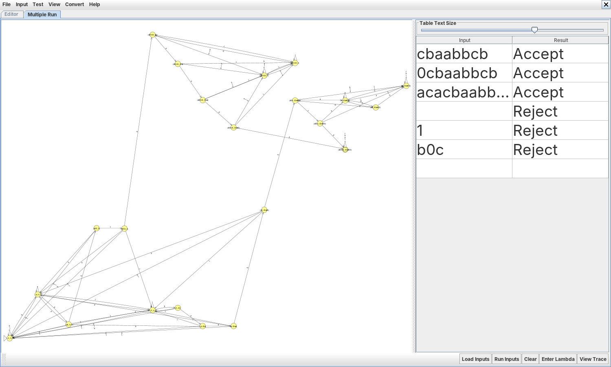

### Lista 2 · Ejercicio 111

**Enunciado.** Las palabras de Σ1 que contienen exactamente tres veces la subcadena 01002.

**Diseño.** Cada estado combina el número de apariciones de 01002 (0 a 3, y muerto si pasa de 3) con el avance en el patrón; 01002 no puede traslaparse consigo mismo.

**Archivo.** `automatas/lista2/lista2-111.jff` · Σ = {0, 1, 2} · \|Q\| = 21

| δ         | 0      | 1      | 2      | Qué recuerda del prefijo leído                  |
|-----------|--------|--------|--------|-------------------------------------------------|
| → 0·λ     | 0·0    | 0·λ    | 0·λ    | van 0 apariciones; el sufijo útil leído es λ    |
| 0·0       | 0·0    | 0·01   | 0·λ    | van 0 apariciones; el sufijo útil leído es 0    |
| 0·01      | 0·010  | 0·λ    | 0·λ    | van 0 apariciones; el sufijo útil leído es 01   |
| 0·010     | 0·0100 | 0·01   | 0·λ    | van 0 apariciones; el sufijo útil leído es 010  |
| 0·0100    | 0·0    | 0·01   | 1·λ    | van 0 apariciones; el sufijo útil leído es 0100 |
| 1·λ       | 1·0    | 1·λ    | 1·λ    | van 1 apariciones; el sufijo útil leído es λ    |
| 1·0       | 1·0    | 1·01   | 1·λ    | van 1 apariciones; el sufijo útil leído es 0    |
| 1·01      | 1·010  | 1·λ    | 1·λ    | van 1 apariciones; el sufijo útil leído es 01   |
| 1·010     | 1·0100 | 1·01   | 1·λ    | van 1 apariciones; el sufijo útil leído es 010  |
| 1·0100    | 1·0    | 1·01   | 2·λ    | van 1 apariciones; el sufijo útil leído es 0100 |
| 2·λ       | 2·0    | 2·λ    | 2·λ    | van 2 apariciones; el sufijo útil leído es λ    |
| 2·0       | 2·0    | 2·01   | 2·λ    | van 2 apariciones; el sufijo útil leído es 0    |
| 2·01      | 2·010  | 2·λ    | 2·λ    | van 2 apariciones; el sufijo útil leído es 01   |
| 2·010     | 2·0100 | 2·01   | 2·λ    | van 2 apariciones; el sufijo útil leído es 010  |
| 2·0100    | 2·0    | 2·01   | 3·λ    | van 2 apariciones; el sufijo útil leído es 0100 |
| \* 3·λ    | 3·0    | 3·λ    | 3·λ    | van 3 apariciones; el sufijo útil leído es λ    |
| \* 3·0    | 3·0    | 3·01   | 3·λ    | van 3 apariciones; el sufijo útil leído es 0    |
| \* 3·01   | 3·010  | 3·λ    | 3·λ    | van 3 apariciones; el sufijo útil leído es 01   |
| \* 3·010  | 3·0100 | 3·01   | 3·λ    | van 3 apariciones; el sufijo útil leído es 010  |
| \* 3·0100 | 3·0    | 3·01   | muerto | van 3 apariciones; el sufijo útil leído es 0100 |
| muerto    | muerto | muerto | muerto | ya hay más de 3 apariciones de 01002            |

Tabla de transiciones (→ inicial, \* aceptación, — sin transición).

| Cadena               | Longitud | Esperado | Obtenido | Tipo de caso                                     |
|----------------------|:--------:|----------|----------|--------------------------------------------------|
| `010020100201002`    |    15    | acepta   | acepta   | válida                                           |
| `0100201002001002`   |    16    | acepta   | acepta   | válida                                           |
| `010020010020101002` |    18    | acepta   | acepta   | válida                                           |
| λ                    |    0     | rechaza  | rechaza  | inválida                                         |
| `0`                  |    1     | rechaza  | rechaza  | inválida                                         |
| `111`                |    3     | rechaza  | rechaza  | inválida                                         |
| `01122210022010`     |    14    | rechaza  | rechaza  | frontera: justo por debajo de la longitud mínima |

Cadenas de prueba.

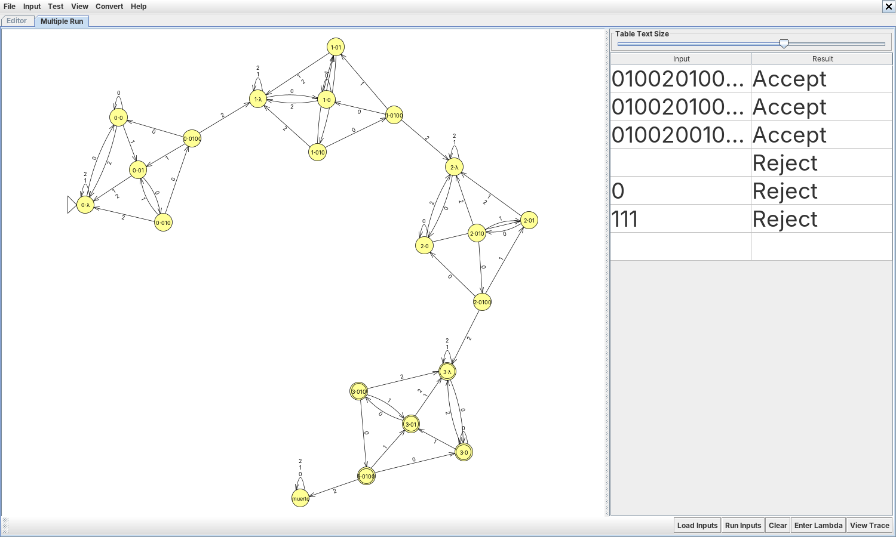

### Lista 2 · Ejercicio 112

**Enunciado.** Las palabras de Σ1 que contienen dos veces 010 sin traslaparse (01010 no pertenece, 010010 sí).

**Diseño.** Se interpreta «al menos dos apariciones disjuntas». Tras completar 010 la búsqueda reinicia desde λ, de modo que la siguiente aparición no reutiliza el último 0.

**Archivo.** `automatas/lista2/lista2-112.jff` · Σ = {0, 1, 2} · \|Q\| = 7

| δ     | 0   | 1    | 2   | Qué recuerda del prefijo leído                |
|-------|-----|------|-----|-----------------------------------------------|
| → 0·λ | 0·0 | 0·λ  | 0·λ | van 0 apariciones; el sufijo útil leído es λ  |
| 0·0   | 0·0 | 0·01 | 0·λ | van 0 apariciones; el sufijo útil leído es 0  |
| 0·01  | 1·λ | 0·λ  | 0·λ | van 0 apariciones; el sufijo útil leído es 01 |
| 1·λ   | 1·0 | 1·λ  | 1·λ | van 1 apariciones; el sufijo útil leído es λ  |
| 1·0   | 1·0 | 1·01 | 1·λ | van 1 apariciones; el sufijo útil leído es 0  |
| 1·01  | 2+  | 1·λ  | 1·λ | van 1 apariciones; el sufijo útil leído es 01 |
| \* 2+ | 2+  | 2+   | 2+  | ya hay 2 apariciones de 010                   |

Tabla de transiciones (→ inicial, \* aceptación, — sin transición).

| Cadena      | Longitud | Esperado | Obtenido | Tipo de caso                                     |
|-------------|:--------:|----------|----------|--------------------------------------------------|
| `010010`    |    6     | acepta   | acepta   | válida                                           |
| `0100010`   |    7     | acepta   | acepta   | válida                                           |
| `001001012` |    9     | acepta   | acepta   | válida                                           |
| λ           |    0     | rechaza  | rechaza  | inválida                                         |
| `2`         |    1     | rechaza  | rechaza  | inválida                                         |
| `122`       |    3     | rechaza  | rechaza  | inválida                                         |
| `20101`     |    5     | rechaza  | rechaza  | frontera: justo por debajo de la longitud mínima |

Cadenas de prueba.

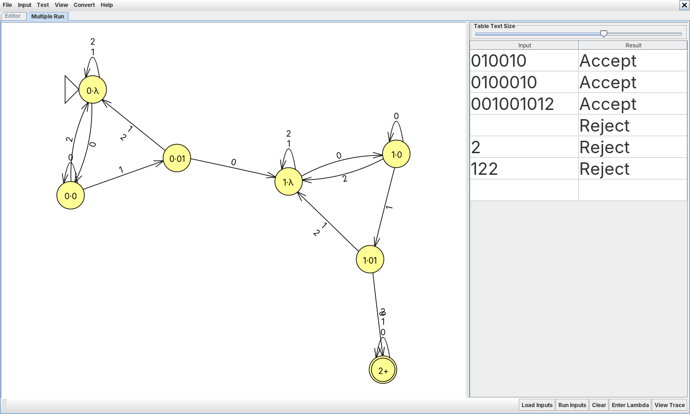

### Lista 2 · Ejercicio 113

**Enunciado.** Las palabras de Σ1 que contienen dos veces 010, que sí se pueden traslapar.

**Diseño.** Igual que 112, pero tras completar 010 el autómata conserva el borde 0, que puede iniciar la siguiente aparición (01010).

**Archivo.** `automatas/lista2/lista2-113.jff` · Σ = {0, 1, 2} · \|Q\| = 7

| δ     | 0   | 1    | 2   | Qué recuerda del prefijo leído                |
|-------|-----|------|-----|-----------------------------------------------|
| → 0·λ | 0·0 | 0·λ  | 0·λ | van 0 apariciones; el sufijo útil leído es λ  |
| 0·0   | 0·0 | 0·01 | 0·λ | van 0 apariciones; el sufijo útil leído es 0  |
| 0·01  | 1·0 | 0·λ  | 0·λ | van 0 apariciones; el sufijo útil leído es 01 |
| 1·0   | 1·0 | 1·01 | 1·λ | van 1 apariciones; el sufijo útil leído es 0  |
| 1·01  | 2+  | 1·λ  | 1·λ | van 1 apariciones; el sufijo útil leído es 01 |
| 1·λ   | 1·0 | 1·λ  | 1·λ | van 1 apariciones; el sufijo útil leído es λ  |
| \* 2+ | 2+  | 2+   | 2+  | ya hay 2 apariciones de 010                   |

Tabla de transiciones (→ inicial, \* aceptación, — sin transición).

| Cadena     | Longitud | Esperado | Obtenido | Tipo de caso                                     |
|------------|:--------:|----------|----------|--------------------------------------------------|
| `01010`    |    5     | acepta   | acepta   | válida                                           |
| `010010`   |    6     | acepta   | acepta   | válida                                           |
| `01010101` |    8     | acepta   | acepta   | válida                                           |
| λ          |    0     | rechaza  | rechaza  | inválida                                         |
| `1`        |    1     | rechaza  | rechaza  | inválida                                         |
| `012`      |    3     | rechaza  | rechaza  | inválida                                         |
| `0100`     |    4     | rechaza  | rechaza  | frontera: justo por debajo de la longitud mínima |

Cadenas de prueba.

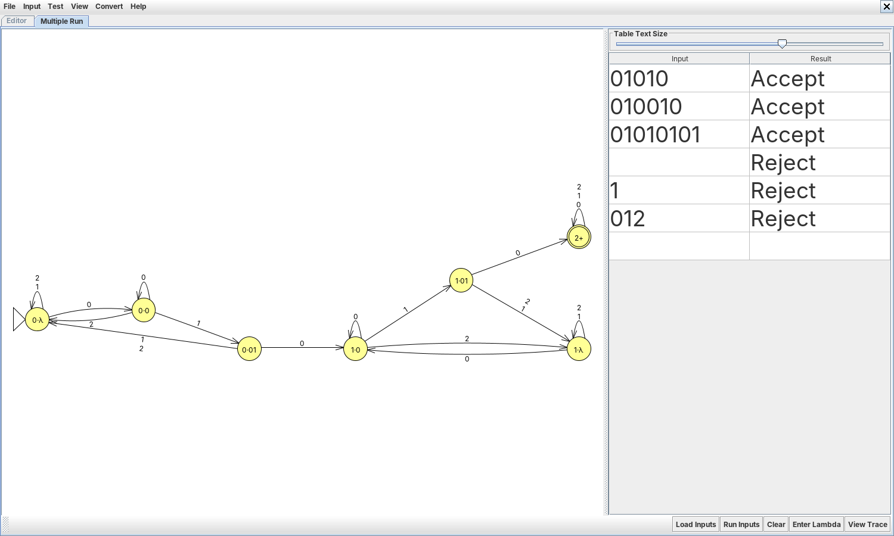

### Lista 2 · Ejercicio 116

**Enunciado.** L = {w ∈ Σ2\* : w = aⁿbᵐcⁿ⁺¹, m, n ∈ N}.

El lenguaje no es regular (lema de bombeo); no existe AFD.

### Lista 2 · Ejercicio 118

**Enunciado.** L = {w ∈ Σ3\* : w = axabya, x, y ∈ Σ3\*}.

**Diseño.** La primera a no puede ser la del ab interior (debe haber una a inicial propia), y la a final debe ir después de la b.

**Archivo.** `automatas/lista2/lista2-118.jff` · Σ = {a, b} · \|Q\| = 6

| δ       | a      | b      | Qué recuerda del prefijo leído                                 |
|---------|--------|--------|----------------------------------------------------------------|
| → ini   | a      | muerto | no se ha leído nada                                            |
| a       | a·a    | a      | empieza con a; aún no hay una a utilizable para el ab interior |
| muerto  | muerto | muerto | la cadena no empieza con a                                     |
| a·a     | a·a    | ab     | el último símbolo es una a que puede iniciar el ab interior    |
| ab      | ab·a   | ab     | ya apareció el ab interior; el último símbolo no es a          |
| \* ab·a | ab·a   | ab     | ya apareció el ab interior y el último símbolo es a            |

Tabla de transiciones (→ inicial, \* aceptación, — sin transición).

| Cadena    | Longitud | Esperado | Obtenido | Tipo de caso                                     |
|-----------|:--------:|----------|----------|--------------------------------------------------|
| `aaba`    |    4     | acepta   | acepta   | válida                                           |
| `aabba`   |    5     | acepta   | acepta   | válida                                           |
| `aabbaaa` |    7     | acepta   | acepta   | válida                                           |
| λ         |    0     | rechaza  | rechaza  | inválida                                         |
| `a`       |    1     | rechaza  | rechaza  | inválida                                         |
| `bbb`     |    3     | rechaza  | rechaza  | inválida                                         |
| `bab`     |    3     | rechaza  | rechaza  | frontera: justo por debajo de la longitud mínima |

Cadenas de prueba.

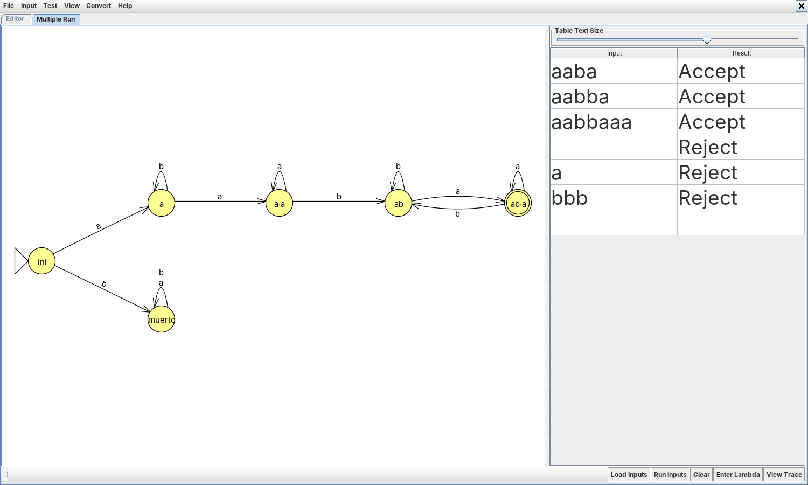

### Lista 2 · Ejercicio 120

**Enunciado.** Las palabras de Σ1 tales que el primer carácter y el último son distintos.

**Diseño.** Se recuerda el primer símbolo y si el último coincide con él.

**Archivo.** `automatas/lista2/lista2-120.jff` · Σ = {0, 1, 2} · \|Q\| = 7

| δ      | 0   | 1   | 2   | Qué recuerda del prefijo leído                |
|--------|-----|-----|-----|-----------------------------------------------|
| → ini  | 0…= | 1…= | 2…= | no se ha leído nada                           |
| 0…=    | 0…= | 0…≠ | 0…≠ | empieza con 0 y el último símbolo es igual    |
| 1…=    | 1…≠ | 1…= | 1…≠ | empieza con 1 y el último símbolo es igual    |
| 2…=    | 2…≠ | 2…≠ | 2…= | empieza con 2 y el último símbolo es igual    |
| \* 0…≠ | 0…= | 0…≠ | 0…≠ | empieza con 0 y el último símbolo es distinto |
| \* 1…≠ | 1…≠ | 1…= | 1…≠ | empieza con 1 y el último símbolo es distinto |
| \* 2…≠ | 2…≠ | 2…≠ | 2…= | empieza con 2 y el último símbolo es distinto |

Tabla de transiciones (→ inicial, \* aceptación, — sin transición).

| Cadena  | Longitud | Esperado | Obtenido | Tipo de caso                                     |
|---------|:--------:|----------|----------|--------------------------------------------------|
| `21`    |    2     | acepta   | acepta   | válida                                           |
| `012`   |    3     | acepta   | acepta   | válida                                           |
| `20001` |    5     | acepta   | acepta   | válida                                           |
| λ       |    0     | rechaza  | rechaza  | inválida                                         |
| `0`     |    1     | rechaza  | rechaza  | inválida                                         |
| `222`   |    3     | rechaza  | rechaza  | inválida                                         |
| `01`    |    2     | acepta   | acepta   | frontera: aceptada más corta                     |
| `1`     |    1     | rechaza  | rechaza  | frontera: justo por debajo de la longitud mínima |

Cadenas de prueba.

### Lista 2 · Ejercicio 121

**Enunciado.** Las palabras de Σ1 de longitud 3n tales que cada bloque de longitud 3 tiene al menos un 0.

**Diseño.** Se lleva la posición dentro del bloque y si el bloque ya contiene un 0. λ (n = 0) se acepta.

**Archivo.** `automatas/lista2/lista2-121.jff` · Σ = {0, 1, 2} · \|Q\| = 6

| δ      | 0      | 1      | 2      | Qué recuerda del prefijo leído                             |
|--------|--------|--------|--------|------------------------------------------------------------|
| →\* b0 | b1+0   | b1     | b1     | posición 0 dentro del bloque; aún no hay un 0 en el bloque |
| b1+0   | b2+0   | b2+0   | b2+0   | posición 1 dentro del bloque; ya hay un 0 en el bloque     |
| b1     | b2+0   | b2     | b2     | posición 1 dentro del bloque; aún no hay un 0 en el bloque |
| b2+0   | b0     | b0     | b0     | posición 2 dentro del bloque; ya hay un 0 en el bloque     |
| b2     | b0     | muerto | muerto | posición 2 dentro del bloque; aún no hay un 0 en el bloque |
| muerto | muerto | muerto | muerto | un bloque terminó sin 0                                    |

Tabla de transiciones (→ inicial, \* aceptación, — sin transición).

| Cadena   | Longitud | Esperado | Obtenido | Tipo de caso |
|----------|:--------:|----------|----------|--------------|
| λ        |    0     | acepta   | acepta   | válida       |
| `011`    |    3     | acepta   | acepta   | válida       |
| `012220` |    6     | acepta   | acepta   | válida       |
| `2`      |    1     | rechaza  | rechaza  | inválida     |
| `02`     |    2     | rechaza  | rechaza  | inválida     |
| `0202`   |    4     | rechaza  | rechaza  | inválida     |

Cadenas de prueba.

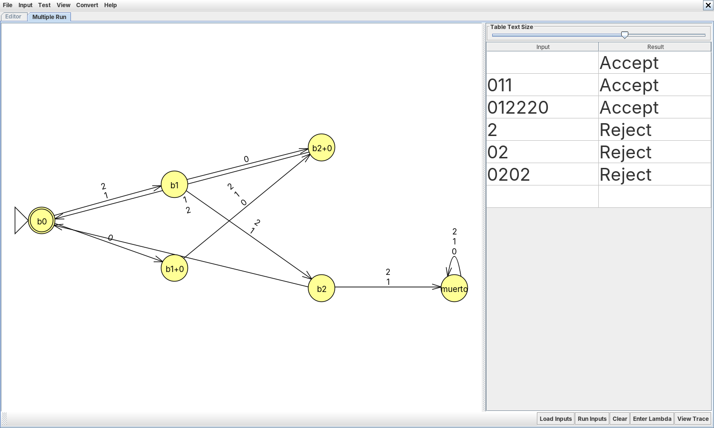

### Lista 2 · Ejercicio 122

**Enunciado.** Las palabras de Σ1 tales que cualquier cadena de tres símbolos consecutivos tiene un 0.

**Diseño.** Basta contar cuántos símbolos distintos de 0 hay al final; tres seguidos invalidan la cadena.

**Archivo.** `automatas/lista2/lista2-122.jff` · Σ = {0, 1, 2} · \|Q\| = 4

| δ           | 0       | 1       | 2       | Qué recuerda del prefijo leído            |
|-------------|---------|---------|---------|-------------------------------------------|
| →\* 0 sin 0 | 0 sin 0 | 1 sin 0 | 1 sin 0 | los últimos 0 símbolos son distintos de 0 |
| \* 1 sin 0  | 0 sin 0 | 2 sin 0 | 2 sin 0 | los últimos 1 símbolos son distintos de 0 |
| \* 2 sin 0  | 0 sin 0 | muerto  | muerto  | los últimos 2 símbolos son distintos de 0 |
| muerto      | muerto  | muerto  | muerto  | hubo tres símbolos seguidos sin 0         |

Tabla de transiciones (→ inicial, \* aceptación, — sin transición).

| Cadena   | Longitud | Esperado | Obtenido | Tipo de caso |
|----------|:--------:|----------|----------|--------------|
| λ        |    0     | acepta   | acepta   | válida       |
| `1`      |    1     | acepta   | acepta   | válida       |
| `100`    |    3     | acepta   | acepta   | válida       |
| `112`    |    3     | rechaza  | rechaza  | inválida     |
| `0122`   |    4     | rechaza  | rechaza  | inválida     |
| `122010` |    6     | rechaza  | rechaza  | inválida     |

Cadenas de prueba.

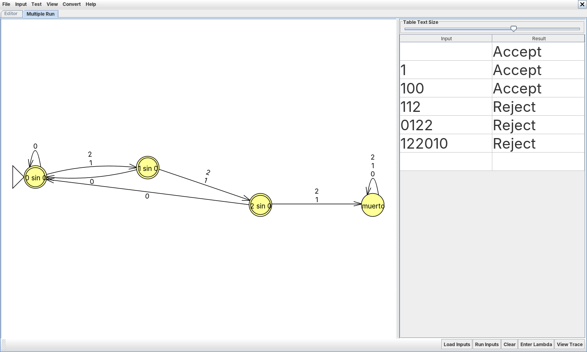

### Lista 2 · Ejercicio 123

**Enunciado.** Las palabras de Σ3 de la forma wxw donde w ∈ Σ3² y x ∈ Σ3\*.

**Diseño.** Se memoriza w (los dos primeros símbolos) y, para cada w, tres situaciones: la cadena termina en w, el último símbolo es la primera letra de w, u otra. Tras los dos primeros símbolos el estado es «otra» aunque la cadena termine en w, porque las dos copias de w no pueden traslaparse (se exige longitud ≥ 4).

**Archivo.** `automatas/lista2/lista2-123.jff` · Σ = {a, b} · \|Q\| = 15

| δ        | a     | b     | Qué recuerda del prefijo leído                                                    |
|----------|-------|-------|-----------------------------------------------------------------------------------|
| → ini    | a     | b     | no se ha leído nada                                                               |
| a        | aa:∅  | ab:∅  | el primer símbolo es a                                                            |
| b        | ba:∅  | bb:∅  | el primer símbolo es b                                                            |
| aa:∅     | aa:a… | aa:∅  | w = aa; el final leído no sirve para la copia final de w (o la longitud aún es 2) |
| ab:∅     | ab:a… | ab:∅  | w = ab; el final leído no sirve para la copia final de w (o la longitud aún es 2) |
| ba:∅     | ba:∅  | ba:b… | w = ba; el final leído no sirve para la copia final de w (o la longitud aún es 2) |
| bb:∅     | bb:∅  | bb:b… | w = bb; el final leído no sirve para la copia final de w (o la longitud aún es 2) |
| aa:a…    | aa:aa | aa:∅  | w = aa; el último símbolo es a, que puede iniciar la copia final de w             |
| ab:a…    | ab:a… | ab:ab | w = ab; el último símbolo es a, que puede iniciar la copia final de w             |
| ba:b…    | ba:ba | ba:b… | w = ba; el último símbolo es b, que puede iniciar la copia final de w             |
| bb:b…    | bb:∅  | bb:bb | w = bb; el último símbolo es b, que puede iniciar la copia final de w             |
| \* aa:aa | aa:aa | aa:∅  | w = aa y la cadena (de longitud ≥ 4) termina en aa                                |
| \* ab:ab | ab:a… | ab:∅  | w = ab y la cadena (de longitud ≥ 4) termina en ab                                |
| \* ba:ba | ba:∅  | ba:b… | w = ba y la cadena (de longitud ≥ 4) termina en ba                                |
| \* bb:bb | bb:∅  | bb:bb | w = bb y la cadena (de longitud ≥ 4) termina en bb                                |

Tabla de transiciones (→ inicial, \* aceptación, — sin transición).

| Cadena    | Longitud | Esperado | Obtenido | Tipo de caso                                     |
|-----------|:--------:|----------|----------|--------------------------------------------------|
| `bbbb`    |    4     | acepta   | acepta   | válida                                           |
| `abbab`   |    5     | acepta   | acepta   | válida                                           |
| `bbbbabb` |    7     | acepta   | acepta   | válida                                           |
| λ         |    0     | rechaza  | rechaza  | inválida                                         |
| `a`       |    1     | rechaza  | rechaza  | inválida                                         |
| `bab`     |    3     | rechaza  | rechaza  | inválida                                         |
| `abab`    |    4     | acepta   | acepta   | frontera: aceptada más corta                     |
| `aaa`     |    3     | rechaza  | rechaza  | frontera: justo por debajo de la longitud mínima |

Cadenas de prueba.

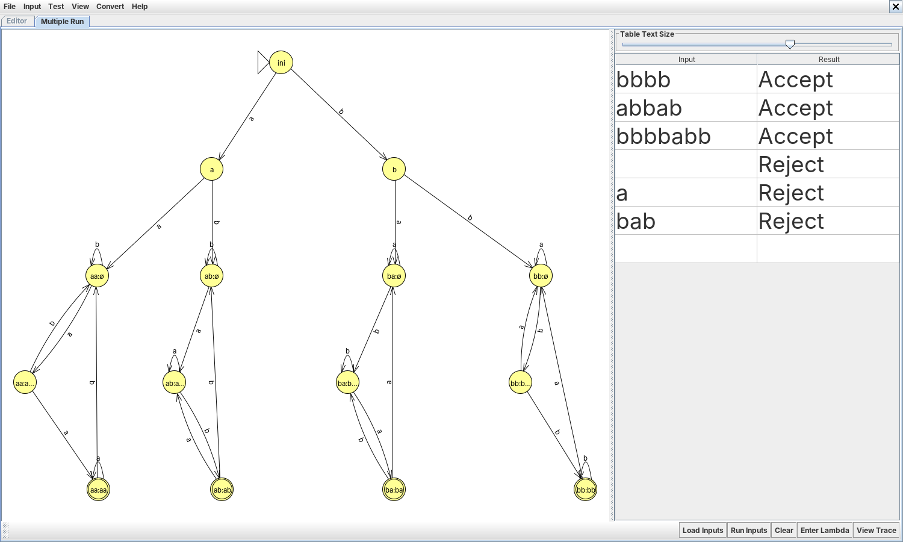

### Lista 2 · Ejercicio 124

**Enunciado.** Mecanismo de tres palancas con canicas (Σ = {0, 1}); se acepta si la última canica sale por A.

**Diseño.** Ver el análisis del mecanismo.

**Archivo.** `automatas/lista2/lista2-124.jff` · Σ = {0, 1} · \|Q\| = 13

| δ       | 0    | 1    | Qué recuerda del prefijo leído                                                                                       |
|---------|------|------|----------------------------------------------------------------------------------------------------------------------|
| → III   | DIIa | IDDa | palancas izquierda=I, derecha=I, central=I (I: desvía a la izquierda, D: a la derecha); aún no cae ninguna canica    |
| \* DIIa | IIDa | DDDa | palancas izquierda=D, derecha=I, central=I (I: desvía a la izquierda, D: a la derecha); la última canica salió por A |
| \* IDDa | DDDa | IIDr | palancas izquierda=I, derecha=D, central=D (I: desvía a la izquierda, D: a la derecha); la última canica salió por A |
| \* IIDa | DIDa | IDIr | palancas izquierda=I, derecha=I, central=D (I: desvía a la izquierda, D: a la derecha); la última canica salió por A |
| \* DDDa | IDIr | DIDr | palancas izquierda=D, derecha=D, central=D (I: desvía a la izquierda, D: a la derecha); la última canica salió por A |
| IIDr    | DIDa | IDIr | palancas izquierda=I, derecha=I, central=D (I: desvía a la izquierda, D: a la derecha); la última canica salió por R |
| \* DIDa | IIIr | DDIr | palancas izquierda=D, derecha=I, central=D (I: desvía a la izquierda, D: a la derecha); la última canica salió por A |
| IDIr    | DDIa | IIIr | palancas izquierda=I, derecha=D, central=I (I: desvía a la izquierda, D: a la derecha); la última canica salió por R |
| DIDr    | IIIr | DDIr | palancas izquierda=D, derecha=I, central=D (I: desvía a la izquierda, D: a la derecha); la última canica salió por R |
| IIIr    | DIIa | IDDa | palancas izquierda=I, derecha=I, central=I (I: desvía a la izquierda, D: a la derecha); la última canica salió por R |
| DDIr    | IDDa | DIIr | palancas izquierda=D, derecha=D, central=I (I: desvía a la izquierda, D: a la derecha); la última canica salió por R |
| \* DDIa | IDDa | DIIr | palancas izquierda=D, derecha=D, central=I (I: desvía a la izquierda, D: a la derecha); la última canica salió por A |
| DIIr    | IIDa | DDDa | palancas izquierda=D, derecha=I, central=I (I: desvía a la izquierda, D: a la derecha); la última canica salió por R |

Tabla de transiciones (→ inicial, \* aceptación, — sin transición).

| Cadena  | Longitud | Esperado | Obtenido | Tipo de caso |
|---------|:--------:|----------|----------|--------------|
| `0`     |    1     | acepta   | acepta   | válida       |
| `01`    |    2     | acepta   | acepta   | válida       |
| `0010`  |    4     | acepta   | acepta   | válida       |
| λ       |    0     | rechaza  | rechaza  | inválida     |
| `1010`  |    4     | rechaza  | rechaza  | inválida     |
| `00101` |    5     | rechaza  | rechaza  | inválida     |

Cadenas de prueba.

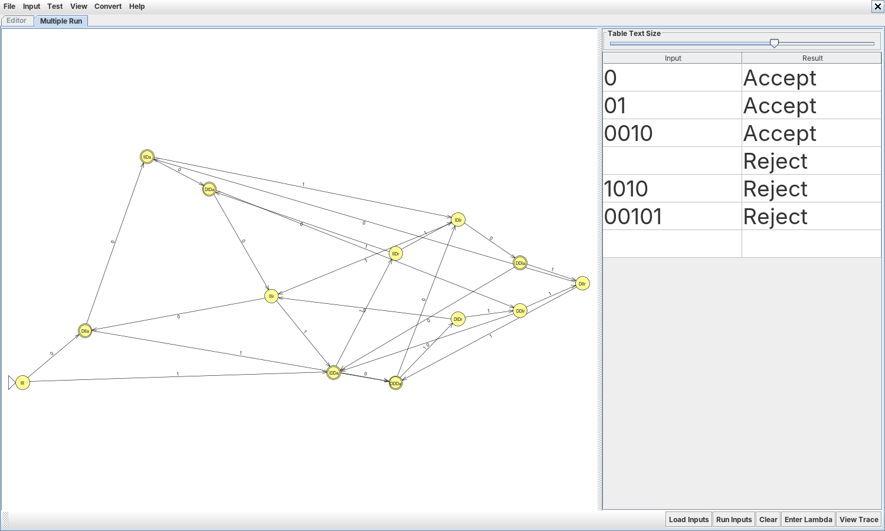

### Lista 2 · Ejercicio 125

**Enunciado.** Sea A = (Q, Σ, δ, A0, F) un AFD. ¿Cuál es el lenguaje de A’ = (Q, Σ, δ, A0, Q  F)?

**Diseño.** Como ejemplo se complementa el AFD de 139 (número par de ceros).

**Archivo.** `automatas/lista2/lista2-125.jff` · Σ = {0, 1} · \|Q\| = 2

| δ        | 0     | 1     | Qué recuerda del prefijo leído       |
|----------|-------|-------|--------------------------------------|
| → par    | impar | par   | se ha leído un número par de ceros   |
| \* impar | par   | impar | se ha leído un número impar de ceros |

Tabla de transiciones (→ inicial, \* aceptación, — sin transición).

| Cadena | Longitud | Esperado | Obtenido | Tipo de caso |
|--------|:--------:|----------|----------|--------------|
| `0`    |    1     | acepta   | acepta   | válida       |
| `01`   |    2     | acepta   | acepta   | válida       |
| `1101` |    4     | acepta   | acepta   | válida       |
| λ      |    0     | rechaza  | rechaza  | inválida     |
| `1`    |    1     | rechaza  | rechaza  | inválida     |
| `100`  |    3     | rechaza  | rechaza  | inválida     |

Cadenas de prueba.

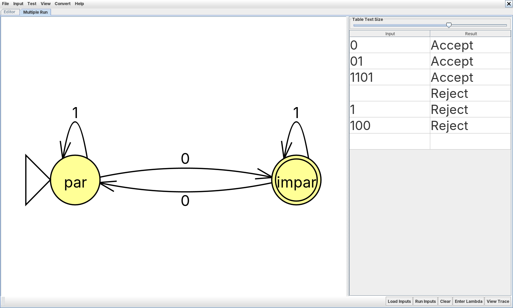

### Lista 2 · Ejercicio 126

**Enunciado.** Sea A un AFD. ¿Cuál es el lenguaje del autómata si F = ∅?

**Diseño.** Ejemplo: el AFD de 139 con F = ∅.

**Archivo.** `automatas/lista2/lista2-126.jff` · Σ = {0, 1} · \|Q\| = 2

| δ     | 0     | 1     | Qué recuerda del prefijo leído |
|-------|-------|-------|--------------------------------|
| → par | impar | par   | número par de ceros            |
| impar | par   | impar | número impar de ceros          |

Tabla de transiciones (→ inicial, \* aceptación, — sin transición).

| Cadena | Longitud | Esperado | Obtenido | Tipo de caso |
|--------|:--------:|----------|----------|--------------|
| λ      |    0     | rechaza  | rechaza  | inválida     |
| `1`    |    1     | rechaza  | rechaza  | inválida     |
| `001`  |    3     | rechaza  | rechaza  | inválida     |

Cadenas de prueba.

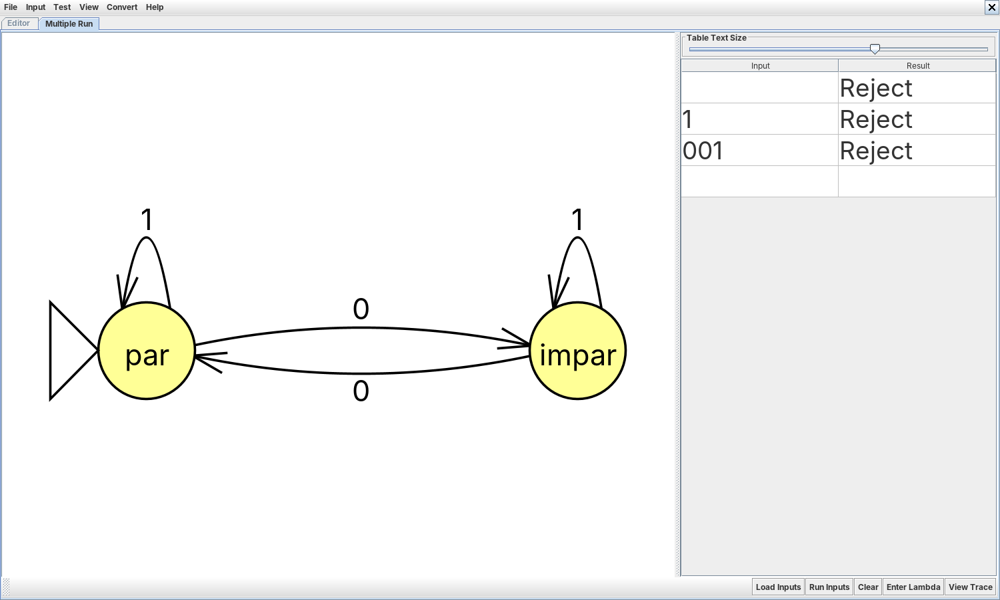

### Lista 2 · Ejercicio 127

**Enunciado.** Sea A un AFD. ¿Cuál es el lenguaje del autómata si F = Q?

**Diseño.** Ejemplo: el AFD de 139 con F = Q.

**Archivo.** `automatas/lista2/lista2-127.jff` · Σ = {0, 1} · \|Q\| = 2

| δ        | 0     | 1     | Qué recuerda del prefijo leído |
|----------|-------|-------|--------------------------------|
| →\* par  | impar | par   | número par de ceros            |
| \* impar | par   | impar | número impar de ceros          |

Tabla de transiciones (→ inicial, \* aceptación, — sin transición).

| Cadena | Longitud | Esperado | Obtenido | Tipo de caso |
|--------|:--------:|----------|----------|--------------|
| λ      |    0     | acepta   | acepta   | válida       |
| `1`    |    1     | acepta   | acepta   | válida       |
| `100`  |    3     | acepta   | acepta   | válida       |

Cadenas de prueba.

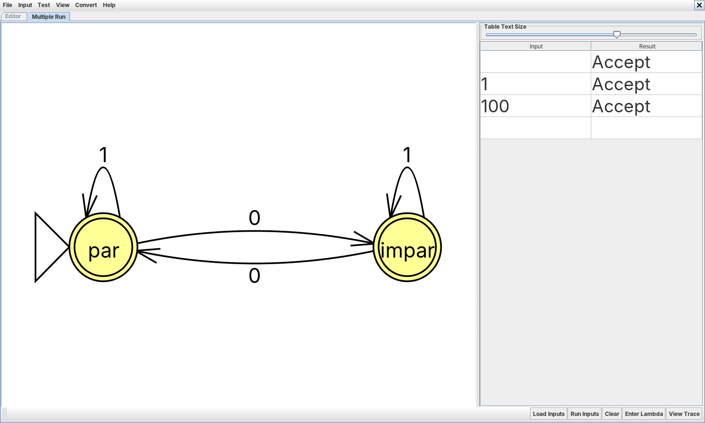

### Lista 2 · Ejercicio 128

**Enunciado.** Sea L el lenguaje del autómata del diagrama. Encuentre un AFD para L2 = {w : wa ∈ L para algún símbolo a}.

**Diseño.** Se conservan los estados y las transiciones; un estado q es de aceptación en el nuevo autómata si algún símbolo lo lleva a F. Como δ(D, 0) = F y δ(E, 1) = F, F’ = {D, E}.

**Archivo.** `automatas/lista2/lista2-128.jff` · Σ = {0, 1} · \|Q\| = 6

| δ    | 0   | 1   | Qué recuerda del prefijo leído           |
|------|-----|-----|------------------------------------------|
| → A  | B   | C   | mismo estado que en el autómata original |
| B    | C   | D   | mismo estado que en el autómata original |
| C    | D   | E   | mismo estado que en el autómata original |
| \* D | F   | E   | mismo estado que en el autómata original |
| \* E | E   | F   | mismo estado que en el autómata original |
| F    | D   | D   | mismo estado que en el autómata original |

Tabla de transiciones (→ inicial, \* aceptación, — sin transición).

| Cadena  | Longitud | Esperado | Obtenido | Tipo de caso |
|---------|:--------:|----------|----------|--------------|
| `10`    |    2     | acepta   | acepta   | válida       |
| `001`   |    3     | acepta   | acepta   | válida       |
| `10100` |    5     | acepta   | acepta   | válida       |
| λ       |    0     | rechaza  | rechaza  | inválida     |
| `1`     |    1     | rechaza  | rechaza  | inválida     |
| `111`   |    3     | rechaza  | rechaza  | inválida     |

Cadenas de prueba.

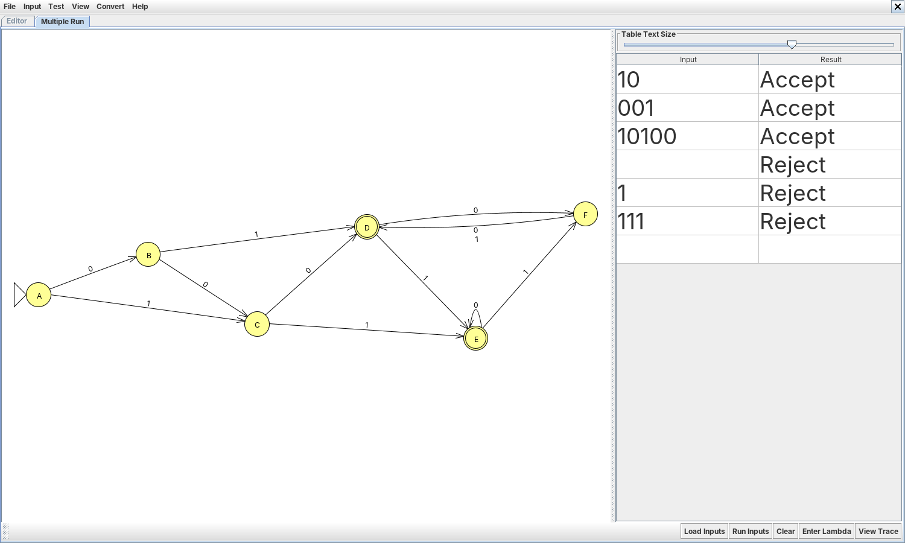

### Lista 2 · Ejercicio 131

**Enunciado.** AFD dado M = ({q1, q2}, {0, 1}, δ, q1, {q2}).

**Diseño.** q2 significa que el último símbolo leído es 1.

**Archivo.** `automatas/lista2/lista2-131.jff` · Σ = {0, 1} · \|Q\| = 2

| δ     | 0   | 1   |
|-------|-----|-----|
| → q1  | q1  | q2  |
| \* q2 | q1  | q2  |

Tabla de transiciones (→ inicial, \* aceptación, — sin transición).

| Cadena | Longitud | Esperado | Obtenido | Tipo de caso |
|--------|:--------:|----------|----------|--------------|
| `1`    |    1     | acepta   | acepta   | válida       |
| `11`   |    2     | acepta   | acepta   | válida       |
| `0111` |    4     | acepta   | acepta   | válida       |
| λ      |    0     | rechaza  | rechaza  | inválida     |
| `0`    |    1     | rechaza  | rechaza  | inválida     |
| `010`  |    3     | rechaza  | rechaza  | inválida     |

Cadenas de prueba.

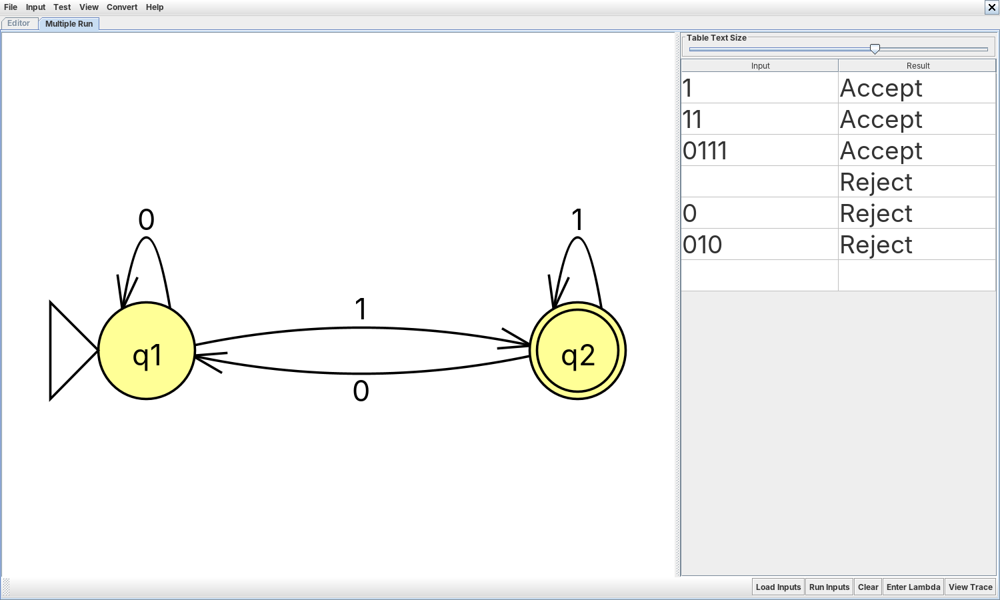

### Lista 2 · Ejercicio 133

**Enunciado.** AFD dado con Q = {q0, q1, q2, q3}, Σ = {a, b}, F = {q0}.

**Diseño.** q0 = (a par, b par), q1 = (a par, b impar), q2 = (a impar, b par), q3 = (a impar, b impar).

**Archivo.** `automatas/lista2/lista2-133.jff` · Σ = {a, b} · \|Q\| = 4

| δ      | a   | b   |
|--------|-----|-----|
| →\* q0 | q2  | q1  |
| q1     | q3  | q0  |
| q2     | q0  | q3  |
| q3     | q1  | q2  |

Tabla de transiciones (→ inicial, \* aceptación, — sin transición).

| Cadena | Longitud | Esperado | Obtenido | Tipo de caso |
|--------|:--------:|----------|----------|--------------|
| λ      |    0     | acepta   | acepta   | válida       |
| `baab` |    4     | acepta   | acepta   | válida       |
| `bbaa` |    4     | acepta   | acepta   | válida       |
| `a`    |    1     | rechaza  | rechaza  | inválida     |
| `ab`   |    2     | rechaza  | rechaza  | inválida     |
| `baaa` |    4     | rechaza  | rechaza  | inválida     |

Cadenas de prueba.

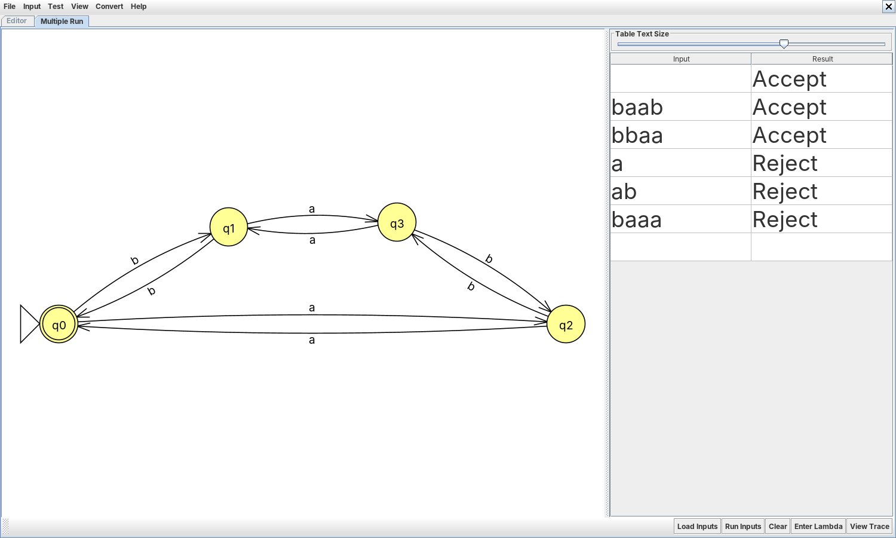

### Lista 2 · Ejercicio 135

**Enunciado.** Dado Σ = {a, b}, AFD para L = {bᵐabⁿ : m, n \> 0}.

**Diseño.** Cuatro fases; m \> 0 y n \> 0 exigen al menos una b en cada lado.

**Archivo.** `automatas/lista2/lista2-135.jff` · Σ = {a, b} · \|Q\| = 5

| δ        | a      | b      | Qué recuerda del prefijo leído |
|----------|--------|--------|--------------------------------|
| → ini    | muerto | b+     | no se ha leído nada            |
| muerto   | muerto | muerto | la cadena no tiene la forma    |
| b+       | b+a    | b+     | una o más bes iniciales        |
| b+a      | muerto | b+ab+  | bes y la a                     |
| \* b+ab+ | muerto | b+ab+  | bes, la a y una o más bes      |

Tabla de transiciones (→ inicial, \* aceptación, — sin transición).

| Cadena   | Longitud | Esperado | Obtenido | Tipo de caso                                     |
|----------|:--------:|----------|----------|--------------------------------------------------|
| `bab`    |    3     | acepta   | acepta   | válida                                           |
| `babb`   |    4     | acepta   | acepta   | válida                                           |
| `bbbbab` |    6     | acepta   | acepta   | válida                                           |
| λ        |    0     | rechaza  | rechaza  | inválida                                         |
| `b`      |    1     | rechaza  | rechaza  | inválida                                         |
| `bba`    |    3     | rechaza  | rechaza  | inválida                                         |
| `aa`     |    2     | rechaza  | rechaza  | frontera: justo por debajo de la longitud mínima |

Cadenas de prueba.

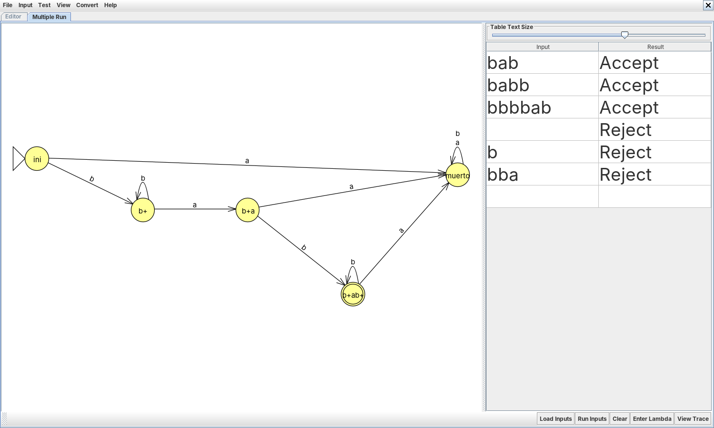

### Lista 2 · Ejercicio 137

**Enunciado.** AFD que reconozca las cadenas sobre {a, b} que comienzan con el prefijo ab.

**Diseño.** Se verifica el prefijo y después se acepta todo.

**Archivo.** `automatas/lista2/lista2-137.jff` · Σ = {a, b} · \|Q\| = 4

| δ      | a      | b      | Qué recuerda del prefijo leído             |
|--------|--------|--------|--------------------------------------------|
| → λ    | a      | muerto | se han leído los primeros 0 símbolos de ab |
| a      | muerto | ab     | se han leído los primeros 1 símbolos de ab |
| muerto | muerto | muerto | el prefijo leído no coincide con ab        |
| \* ab  | ab     | ab     | ya se leyó el prefijo ab                   |

Tabla de transiciones (→ inicial, \* aceptación, — sin transición).

| Cadena  | Longitud | Esperado | Obtenido | Tipo de caso                                     |
|---------|:--------:|----------|----------|--------------------------------------------------|
| `ab`    |    2     | acepta   | acepta   | válida                                           |
| `aba`   |    3     | acepta   | acepta   | válida                                           |
| `abbbb` |    5     | acepta   | acepta   | válida                                           |
| λ       |    0     | rechaza  | rechaza  | inválida                                         |
| `b`     |    1     | rechaza  | rechaza  | inválida                                         |
| `bab`   |    3     | rechaza  | rechaza  | inválida                                         |
| `a`     |    1     | rechaza  | rechaza  | frontera: justo por debajo de la longitud mínima |

Cadenas de prueba.

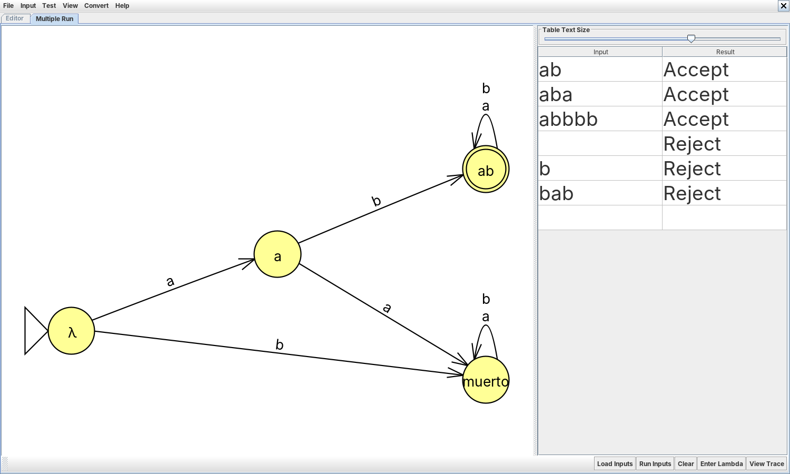

### Lista 2 · Ejercicio 139

**Enunciado.** Autómata que acepte las cadenas en {0, 1}\* con un número par de ceros.

**Diseño.** Paridad de ceros.

**Archivo.** `automatas/lista2/lista2-139.jff` · Σ = {0, 1} · \|Q\| = 2

| δ       | 0     | 1     | Qué recuerda del prefijo leído       |
|---------|-------|-------|--------------------------------------|
| →\* par | impar | par   | se ha leído un número par de ceros   |
| impar   | par   | impar | se ha leído un número impar de ceros |

Tabla de transiciones (→ inicial, \* aceptación, — sin transición).

| Cadena | Longitud | Esperado | Obtenido | Tipo de caso |
|--------|:--------:|----------|----------|--------------|
| λ      |    0     | acepta   | acepta   | válida       |
| `1`    |    1     | acepta   | acepta   | válida       |
| `010`  |    3     | acepta   | acepta   | válida       |
| `0`    |    1     | rechaza  | rechaza  | inválida     |
| `01`   |    2     | rechaza  | rechaza  | inválida     |
| `0100` |    4     | rechaza  | rechaza  | inválida     |

Cadenas de prueba.

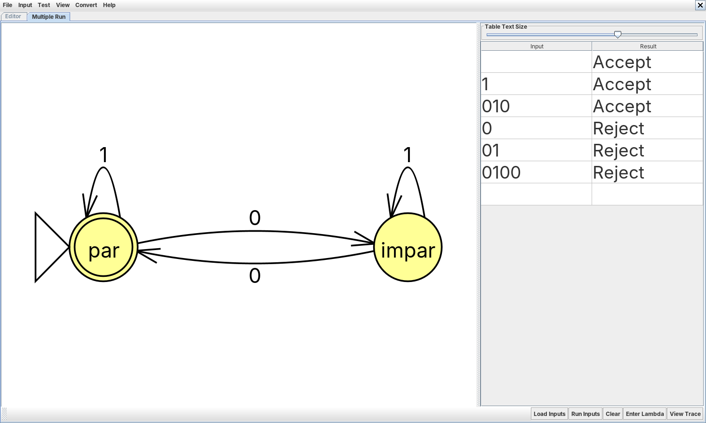

### Lista 2 · Ejercicio 141

**Enunciado.** L = {w ∈ {0, 1}\* : cada 0 en w tiene un 1 inmediatamente a su derecha}.

**Diseño.** Un estado de espera después de cada 0.

**Archivo.** `automatas/lista2/lista2-141.jff` · Σ = {0, 1} · \|Q\| = 3

| δ      | 0      | 1      | Qué recuerda del prefijo leído |
|--------|--------|--------|--------------------------------|
| →\* ok | 0?     | ok     | todo 0 leído ya tiene su 1     |
| 0?     | muerto | ok     | el último 0 aún espera su 1    |
| muerto | muerto | muerto | un 0 no fue seguido de 1       |

Tabla de transiciones (→ inicial, \* aceptación, — sin transición).

| Cadena | Longitud | Esperado | Obtenido | Tipo de caso |
|--------|:--------:|----------|----------|--------------|
| λ      |    0     | acepta   | acepta   | válida       |
| `1`    |    1     | acepta   | acepta   | válida       |
| `111`  |    3     | acepta   | acepta   | válida       |
| `0`    |    1     | rechaza  | rechaza  | inválida     |
| `00`   |    2     | rechaza  | rechaza  | inválida     |
| `0100` |    4     | rechaza  | rechaza  | inválida     |

Cadenas de prueba.

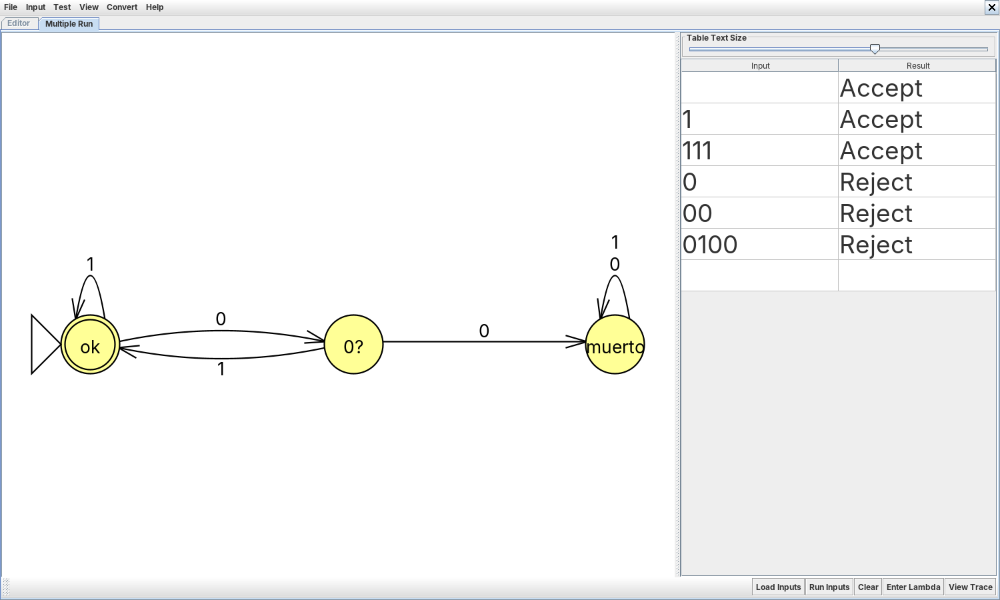

### Lista 2 · Ejercicio 143

**Enunciado.** Determine los lenguajes de los autómatas de las Figuras (a) y (b).

Las figuras del enunciado no aparecen en el PDF de la lista.

### Lista 2 · Ejercicio 145

**Enunciado.** AFD que lee un número binario de derecha a izquierda e identifica los múltiplos de 5.

**Diseño.** El primer bit leído es el menos significativo. Si los bits restantes forman (de derecha a izquierda) el número V, leer el bit b hace que el valor total sea b + 2V; así, si se necesita que el total sea ≡ t, el resto debe valer V ≡ (t − b)·2⁻¹ = 3(t − b) (mod 5). El estado guarda ese valor t pendiente: se empieza pidiendo t = 0 y se acepta si, al terminar, lo pendiente es 0. La cadena vacía no es un número y se rechaza.

**Archivo.** `automatas/lista2/lista2-145.jff` · Σ = {0, 1} · \|Q\| = 6

| δ     | 0   | 1   | Qué recuerda del prefijo leído                                                                    |
|-------|-----|-----|---------------------------------------------------------------------------------------------------|
| → ini | t0  | t2  | no se ha leído ningún bit                                                                         |
| \* t0 | t0  | t2  | los bits que faltan, leídos como número desde su bit menos significativo, deben valer ≡ 0 (mod 5) |
| t2    | t1  | t3  | los bits que faltan, leídos como número desde su bit menos significativo, deben valer ≡ 2 (mod 5) |
| t1    | t3  | t0  | los bits que faltan, leídos como número desde su bit menos significativo, deben valer ≡ 1 (mod 5) |
| t3    | t4  | t1  | los bits que faltan, leídos como número desde su bit menos significativo, deben valer ≡ 3 (mod 5) |
| t4    | t2  | t4  | los bits que faltan, leídos como número desde su bit menos significativo, deben valer ≡ 4 (mod 5) |

Tabla de transiciones (→ inicial, \* aceptación, — sin transición).

| Cadena | Longitud | Esperado | Obtenido | Tipo de caso |
|--------|:--------:|----------|----------|--------------|
| `0`    |    1     | acepta   | acepta   | válida       |
| `00`   |    2     | acepta   | acepta   | válida       |
| `1111` |    4     | acepta   | acepta   | válida       |
| λ      |    0     | rechaza  | rechaza  | inválida     |
| `1`    |    1     | rechaza  | rechaza  | inválida     |
| `111`  |    3     | rechaza  | rechaza  | inválida     |

Cadenas de prueba.

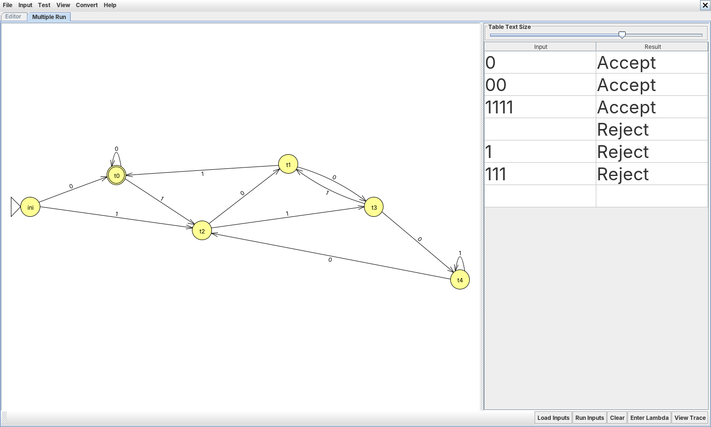

### Lista 2 · Ejercicio 147

**Enunciado.** AFD que lee un número binario de izquierda a derecha y lo acepta si es múltiplo de 6.

**Diseño.** Leer un bit b convierte el valor v en 2v + b, así que basta el residuo mod 6. La cadena vacía no representa un número y se rechaza. Este AFD de 7 estados se puede minimizar a 4: r y r + 3 tienen el mismo sucesor (2(r + 3) ≡ 2r), de modo que {r1, r4}, {r2, r5} e {ini, r3} son equivalentes; es la caracterización «múltiplo de 3 y par».

**Archivo.** `automatas/lista2/lista2-147.jff` · Σ = {0, 1} · \|Q\| = 7

| δ     | 0   | 1   | Qué recuerda del prefijo leído |
|-------|-----|-----|--------------------------------|
| → ini | r0  | r1  | no se ha leído ningún bit      |
| \* r0 | r0  | r1  | el número leído es ≡ 0 (mod 6) |
| r1    | r2  | r3  | el número leído es ≡ 1 (mod 6) |
| r2    | r4  | r5  | el número leído es ≡ 2 (mod 6) |
| r3    | r0  | r1  | el número leído es ≡ 3 (mod 6) |
| r4    | r2  | r3  | el número leído es ≡ 4 (mod 6) |
| r5    | r4  | r5  | el número leído es ≡ 5 (mod 6) |

Tabla de transiciones (→ inicial, \* aceptación, — sin transición).

| Cadena | Longitud | Esperado | Obtenido | Tipo de caso |
|--------|:--------:|----------|----------|--------------|
| `0`    |    1     | acepta   | acepta   | válida       |
| `00`   |    2     | acepta   | acepta   | válida       |
| `0000` |    4     | acepta   | acepta   | válida       |
| λ      |    0     | rechaza  | rechaza  | inválida     |
| `1`    |    1     | rechaza  | rechaza  | inválida     |
| `010`  |    3     | rechaza  | rechaza  | inválida     |

Cadenas de prueba.

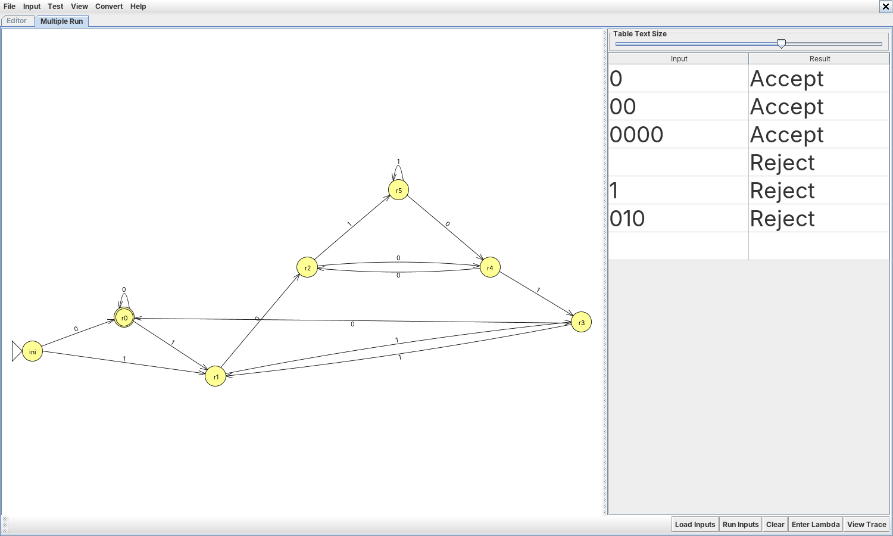

### Lista 2 · Ejercicio 148

**Enunciado.** AFD del progreso de un alumno en Teoría de la Computación (convocatorias de febrero, septiembre y diciembre; Σ = {P, N, A, S}; no más de dos presentaciones por año; termina al aprobar).

**Diseño.** Interpretación: en cada convocatoria el alumno no se presenta (N) o se presenta (P) y después aprueba (A) o suspende (S). Se cuentan las presentaciones del año; con dos, en la convocatoria restante sólo cabe N. Después de diciembre empieza un año nuevo con el contador en cero. APROBADO es el único estado de aceptación y cualquier símbolo posterior lleva a muerto.

**Archivo.** `automatas/lista2/lista2-148.jff` · Σ = {A, N, P, S} · \|Q\| = 13

| δ           | A        | N      | P      | S      | Qué recuerda del prefijo leído                                                            |
|-------------|----------|--------|--------|--------|-------------------------------------------------------------------------------------------|
| → feb0      | muerto   | sep0   | feb0?  | muerto | convocatoria de feb, 0 presentaciones usadas en el año; decide si se presenta             |
| muerto      | muerto   | muerto | muerto | muerto | secuencia inválida                                                                        |
| sep0        | muerto   | dic0   | sep0?  | muerto | convocatoria de sep, 0 presentaciones usadas en el año; decide si se presenta             |
| feb0?       | APROBADO | muerto | muerto | sep1   | convocatoria de feb, 0 presentaciones usadas en el año; se presentó y espera el resultado |
| dic0        | muerto   | feb0   | dic0?  | muerto | convocatoria de dic, 0 presentaciones usadas en el año; decide si se presenta             |
| sep0?       | APROBADO | muerto | muerto | dic1   | convocatoria de sep, 0 presentaciones usadas en el año; se presentó y espera el resultado |
| \* APROBADO | muerto   | muerto | muerto | muerto | aprobó el curso                                                                           |
| sep1        | muerto   | dic1   | sep1?  | muerto | convocatoria de sep, 1 presentaciones usadas en el año; decide si se presenta             |
| dic0?       | APROBADO | muerto | muerto | feb0   | convocatoria de dic, 0 presentaciones usadas en el año; se presentó y espera el resultado |
| dic1        | muerto   | feb0   | dic1?  | muerto | convocatoria de dic, 1 presentaciones usadas en el año; decide si se presenta             |
| sep1?       | APROBADO | muerto | muerto | dic2   | convocatoria de sep, 1 presentaciones usadas en el año; se presentó y espera el resultado |
| dic1?       | APROBADO | muerto | muerto | feb0   | convocatoria de dic, 1 presentaciones usadas en el año; se presentó y espera el resultado |
| dic2        | muerto   | feb0   | muerto | muerto | convocatoria de dic, 2 presentaciones usadas en el año; decide si se presenta             |

Tabla de transiciones (→ inicial, \* aceptación, — sin transición).

| Cadena  | Longitud | Esperado | Obtenido | Tipo de caso                                     |
|---------|:--------:|----------|----------|--------------------------------------------------|
| `PA`    |    2     | acepta   | acepta   | válida                                           |
| `NPA`   |    3     | acepta   | acepta   | válida                                           |
| `NPSPA` |    5     | acepta   | acepta   | válida                                           |
| λ       |    0     | rechaza  | rechaza  | inválida                                         |
| `N`     |    1     | rechaza  | rechaza  | inválida                                         |
| `PAS`   |    3     | rechaza  | rechaza  | inválida                                         |
| `P`     |    1     | rechaza  | rechaza  | frontera: justo por debajo de la longitud mínima |

Cadenas de prueba.

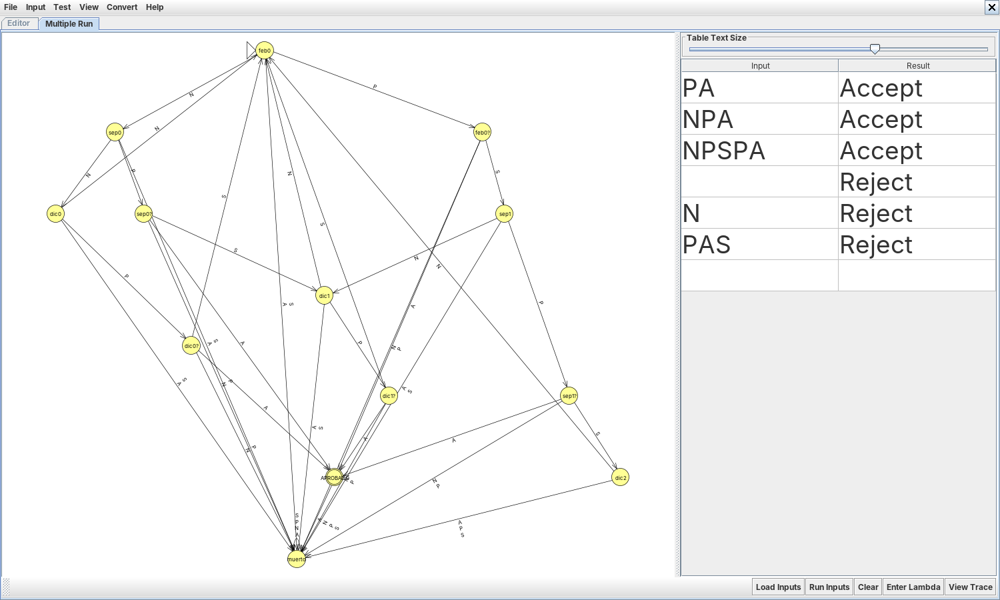

### Lista 2 · Ejercicio 149

**Enunciado.** AFD de la tabla (→A, C final). Halle δ(B, 0), δ(C, 1), δ̂(A, 1101), δ̂(A, 01001).

**Diseño.** Q = {A, B, C}, Σ = {0, 1}, A0 = A, F = {C}.

**Archivo.** `automatas/lista2/lista2-149.jff` · Σ = {0, 1} · \|Q\| = 3

| δ    | 0   | 1   |
|------|-----|-----|
| → A  | B   | C   |
| B    | A   | C   |
| \* C | C   | A   |

Tabla de transiciones (→ inicial, \* aceptación, — sin transición).

| Cadena | Longitud | Esperado | Obtenido | Tipo de caso |
|--------|:--------:|----------|----------|--------------|
| `1`    |    1     | acepta   | acepta   | válida       |
| `10`   |    2     | acepta   | acepta   | válida       |
| `1110` |    4     | acepta   | acepta   | válida       |
| λ      |    0     | rechaza  | rechaza  | inválida     |
| `0`    |    1     | rechaza  | rechaza  | inválida     |
| `011`  |    3     | rechaza  | rechaza  | inválida     |

Cadenas de prueba.

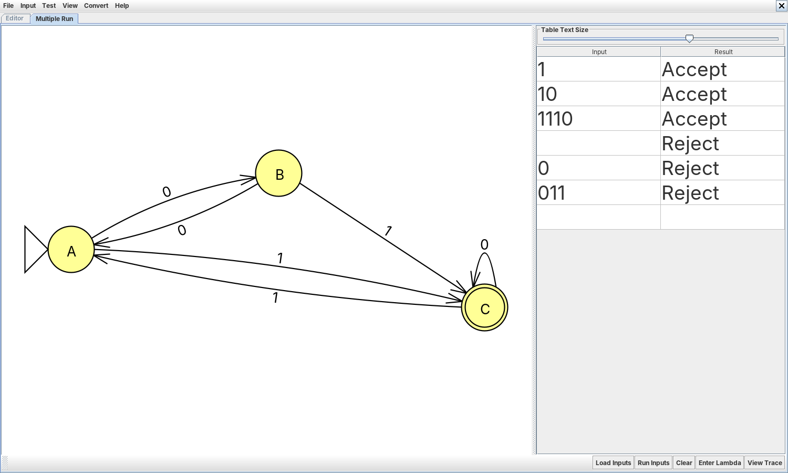

### Lista 2 · Ejercicio 150

**Enunciado.** AFD de la tabla (→A; B, C, D finales). Halle δ̂(B, 10a11), δ̂(B, aa1100), δ̂(A, a01a01), δ̂(C, a11a00).

**Diseño.** Q = {A, B, C, D}, Σ = {0, 1, a}, A0 = A, F = {B, C, D}.

**Archivo.** `automatas/lista2/lista2-150.jff` · Σ = {0, 1, a} · \|Q\| = 4

| δ    | 0   | 1   | a   |
|------|-----|-----|-----|
| → A  | B   | C   | D   |
| \* B | B   | C   | C   |
| \* C | A   | A   | D   |
| \* D | B   | B   | B   |

Tabla de transiciones (→ inicial, \* aceptación, — sin transición).

| Cadena    | Longitud | Esperado | Obtenido | Tipo de caso |
|-----------|:--------:|----------|----------|--------------|
| `1`       |    1     | acepta   | acepta   | válida       |
| `aa`      |    2     | acepta   | acepta   | válida       |
| `1a01`    |    4     | acepta   | acepta   | válida       |
| λ         |    0     | rechaza  | rechaza  | inválida     |
| `01011`   |    5     | rechaza  | rechaza  | inválida     |
| `0aa10a0` |    7     | rechaza  | rechaza  | inválida     |

Cadenas de prueba.

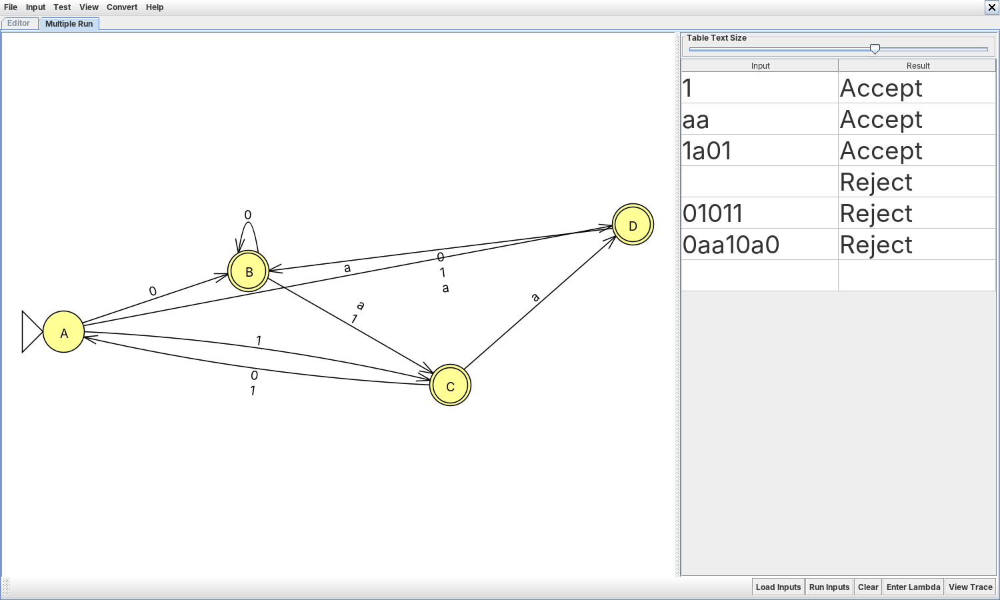

## Lista 3

### Lista 3 · Ejercicio 151

**Enunciado.** Diagrama y simplificación del AFD de la tabla 151.

**Diseño.** Primero se eliminan los estados que no se alcanzan desde el inicial; después se refina la partición {F, Q − F} hasta que se estabiliza.

**Archivo.** `automatas/lista3/lista3-151.jff` · Σ = {0, 1} · \|Q\| = 10

| δ    | 0   | 1   |
|------|-----|-----|
| → A  | C   | E   |
| B    | F   | E   |
| \* C | A   | G   |
| D    | C   | E   |
| \* E | I   | B   |
| \* F | D   | H   |
| G    | F   | I   |
| H    | C   | J   |
| I    | J   | E   |
| J    | I   | E   |

Tabla de transiciones (→ inicial, \* aceptación, — sin transición).

| Cadena      | Longitud | Esperado | Obtenido | Tipo de caso |
|-------------|:--------:|----------|----------|--------------|
| `1`         |    1     | acepta   | acepta   | válida       |
| `0111`      |    4     | acepta   | acepta   | válida       |
| `1001`      |    4     | acepta   | acepta   | válida       |
| λ           |    0     | rechaza  | rechaza  | inválida     |
| `001001000` |    9     | rechaza  | rechaza  | inválida     |
| `100100000` |    9     | rechaza  | rechaza  | inválida     |

Cadenas de prueba.

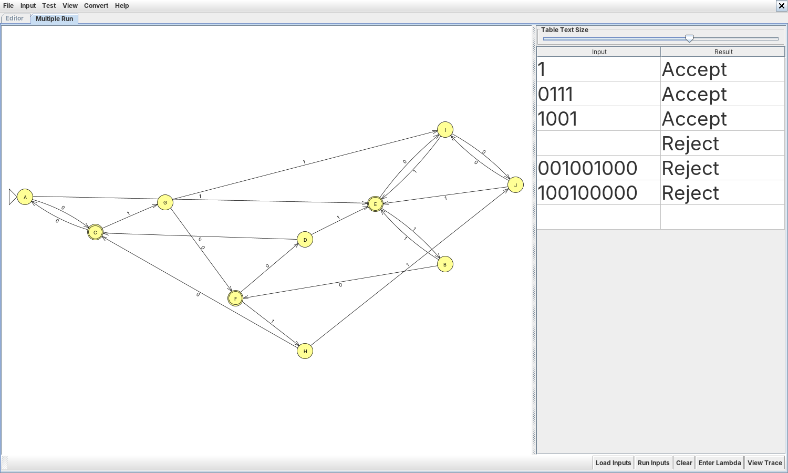

### Lista 3 · Ejercicio 152

**Enunciado.** Diagrama y simplificación del AFD de la tabla 152.

**Diseño.** Primero se eliminan los estados que no se alcanzan desde el inicial; después se refina la partición {F, Q − F} hasta que se estabiliza.

**Archivo.** `automatas/lista3/lista3-152.jff` · Σ = {0, 1, 2} · \|Q\| = 6

| δ    | 0   | 1   | 2   |
|------|-----|-----|-----|
| → A  | C   | E   | B   |
| B    | D   | E   | B   |
| C    | A   | D   | F   |
| \* D | F   | B   | C   |
| \* E | F   | B   | A   |
| \* F | D   | B   | C   |

Tabla de transiciones (→ inicial, \* aceptación, — sin transición).

| Cadena | Longitud | Esperado | Obtenido | Tipo de caso |
|--------|:--------:|----------|----------|--------------|
| `1`    |    1     | acepta   | acepta   | válida       |
| `02`   |    2     | acepta   | acepta   | válida       |
| `2021` |    4     | acepta   | acepta   | válida       |
| λ      |    0     | rechaza  | rechaza  | inválida     |
| `0`    |    1     | rechaza  | rechaza  | inválida     |
| `211`  |    3     | rechaza  | rechaza  | inválida     |

Cadenas de prueba.

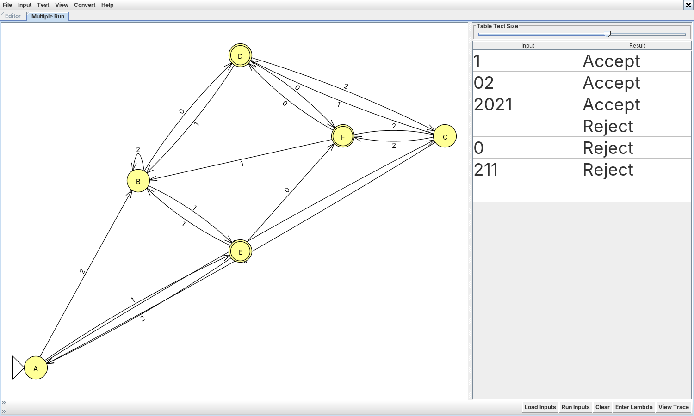

### Lista 3 · Ejercicio 153

**Enunciado.** Diagrama y simplificación del AFD de la tabla 153.

**Diseño.** Primero se eliminan los estados que no se alcanzan desde el inicial; después se refina la partición {F, Q − F} hasta que se estabiliza.

**Archivo.** `automatas/lista3/lista3-153.jff` · Σ = {0, 1} · \|Q\| = 7

| δ    | 0   | 1   |
|------|-----|-----|
| → A  | B   | C   |
| B    | D   | E   |
| C    | F   | G   |
| \* D | D   | E   |
| E    | F   | G   |
| \* F | E   | D   |
| \* G | F   | G   |

Tabla de transiciones (→ inicial, \* aceptación, — sin transición).

| Cadena  | Longitud | Esperado | Obtenido | Tipo de caso                                     |
|---------|:--------:|----------|----------|--------------------------------------------------|
| `10`    |    2     | acepta   | acepta   | válida                                           |
| `101`   |    3     | acepta   | acepta   | válida                                           |
| `01101` |    5     | acepta   | acepta   | válida                                           |
| λ       |    0     | rechaza  | rechaza  | inválida                                         |
| `1`     |    1     | rechaza  | rechaza  | inválida                                         |
| `100`   |    3     | rechaza  | rechaza  | inválida                                         |
| `0`     |    1     | rechaza  | rechaza  | frontera: justo por debajo de la longitud mínima |

Cadenas de prueba.

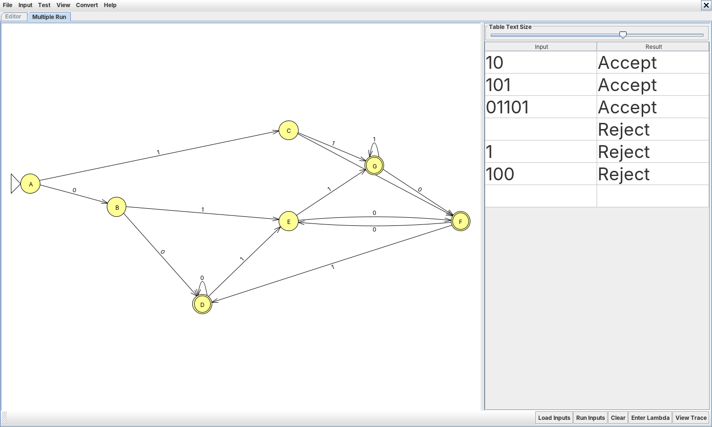

### Lista 3 · Ejercicio 154

**Enunciado.** Diagrama y simplificación del AFD de la tabla 154.

**Diseño.** Primero se eliminan los estados que no se alcanzan desde el inicial; después se refina la partición {F, Q − F} hasta que se estabiliza.

**Archivo.** `automatas/lista3/lista3-154.jff` · Σ = {0, 1} · \|Q\| = 11

| δ    | 0   | 1   |
|------|-----|-----|
| → A  | D   | K   |
| B    | H   | K   |
| C    | I   | E   |
| D    | C   | G   |
| \* E | K   | I   |
| F    | B   | E   |
| \* G | C   | I   |
| \* H | C   | B   |
| I    | G   | K   |
| \* J | F   | B   |
| K    | C   | F   |

Tabla de transiciones (→ inicial, \* aceptación, — sin transición).

| Cadena  | Longitud | Esperado | Obtenido | Tipo de caso |
|---------|:--------:|----------|----------|--------------|
| `01`    |    2     | acepta   | acepta   | válida       |
| `001`   |    3     | acepta   | acepta   | válida       |
| `10110` |    5     | acepta   | acepta   | válida       |
| λ       |    0     | rechaza  | rechaza  | inválida     |
| `1`     |    1     | rechaza  | rechaza  | inválida     |
| `100`   |    3     | rechaza  | rechaza  | inválida     |

Cadenas de prueba.

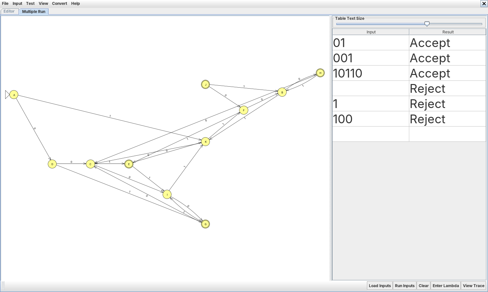

### Lista 3 · Ejercicio 155

**Enunciado.** Diagrama y simplificación del AFD de la tabla 155.

**Diseño.** Primero se eliminan los estados que no se alcanzan desde el inicial; después se refina la partición {F, Q − F} hasta que se estabiliza.

**Archivo.** `automatas/lista3/lista3-155.jff` · Σ = {0, 1} · \|Q\| = 12

| δ    | 0   | 1   |
|------|-----|-----|
| → A  | B   | C   |
| B    | D   | E   |
| C    | K   | G   |
| D    | H   | E   |
| E    | F   | D   |
| \* F | J   | G   |
| G    | E   | G   |
| H    | B   | K   |
| I    | C   | A   |
| J    | D   | G   |
| K    | F   | D   |
| L    | C   | J   |

Tabla de transiciones (→ inicial, \* aceptación, — sin transición).

| Cadena   | Longitud | Esperado | Obtenido | Tipo de caso                                     |
|----------|:--------:|----------|----------|--------------------------------------------------|
| `010`    |    3     | acepta   | acepta   | válida                                           |
| `1100`   |    4     | acepta   | acepta   | válida                                           |
| `101010` |    6     | acepta   | acepta   | válida                                           |
| λ        |    0     | rechaza  | rechaza  | inválida                                         |
| `0`      |    1     | rechaza  | rechaza  | inválida                                         |
| `110`    |    3     | rechaza  | rechaza  | inválida                                         |
| `01`     |    2     | rechaza  | rechaza  | frontera: justo por debajo de la longitud mínima |

Cadenas de prueba.

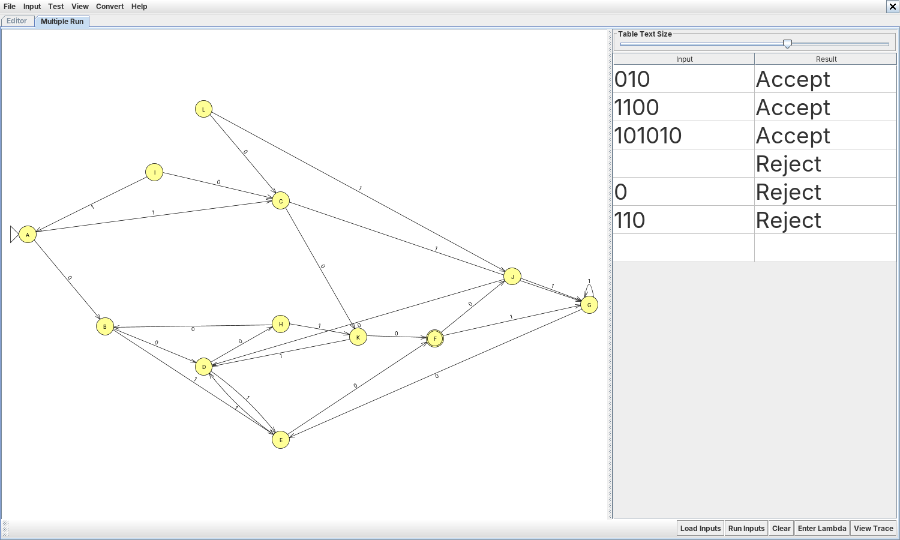

### Lista 3 · Ejercicio 156

**Enunciado.** Diagrama y simplificación del AFD de la tabla 156 (tabla transcrita del diagrama).

**Diseño.** Primero se eliminan los estados que no se alcanzan desde el inicial; después se refina la partición {F, Q − F} hasta que se estabiliza.

**Archivo.** `automatas/lista3/lista3-156.jff` · Σ = {0, 1} · \|Q\| = 5

| δ    | 0   | 1   |
|------|-----|-----|
| → A  | B   | C   |
| B    | C   | E   |
| C    | D   | C   |
| D    | C   | E   |
| \* E | B   | E   |

Tabla de transiciones (→ inicial, \* aceptación, — sin transición).

| Cadena  | Longitud | Esperado | Obtenido | Tipo de caso |
|---------|:--------:|----------|----------|--------------|
| `01`    |    2     | acepta   | acepta   | válida       |
| `011`   |    3     | acepta   | acepta   | válida       |
| `10001` |    5     | acepta   | acepta   | válida       |
| λ       |    0     | rechaza  | rechaza  | inválida     |
| `1`     |    1     | rechaza  | rechaza  | inválida     |
| `010`   |    3     | rechaza  | rechaza  | inválida     |

Cadenas de prueba.

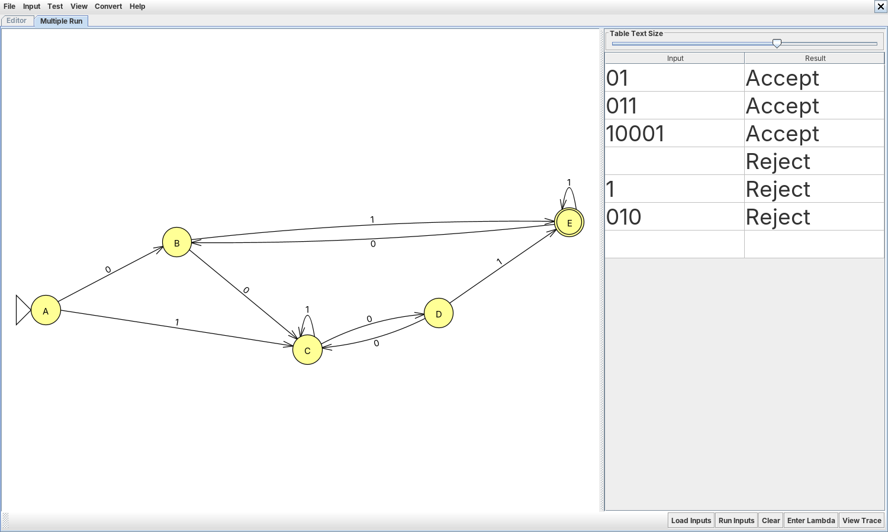

### Lista 3 · Ejercicio 157

**Enunciado.** Diagrama y simplificación del AFD de la tabla 157 (tabla transcrita del diagrama).

**Diseño.** Primero se eliminan los estados que no se alcanzan desde el inicial; después se refina la partición {F, Q − F} hasta que se estabiliza.

**Archivo.** `automatas/lista3/lista3-157.jff` · Σ = {0, 1} · \|Q\| = 6

| δ    | 0   | 1   |
|------|-----|-----|
| → A  | B   | F   |
| B    | C   | E   |
| C    | D   | E   |
| D    | B   | E   |
| E    | F   | D   |
| \* F | F   | B   |

Tabla de transiciones (→ inicial, \* aceptación, — sin transición).

| Cadena | Longitud | Esperado | Obtenido | Tipo de caso |
|--------|:--------:|----------|----------|--------------|
| `1`    |    1     | acepta   | acepta   | válida       |
| `10`   |    2     | acepta   | acepta   | válida       |
| `0100` |    4     | acepta   | acepta   | válida       |
| λ      |    0     | rechaza  | rechaza  | inválida     |
| `0`    |    1     | rechaza  | rechaza  | inválida     |
| `001`  |    3     | rechaza  | rechaza  | inválida     |

Cadenas de prueba.

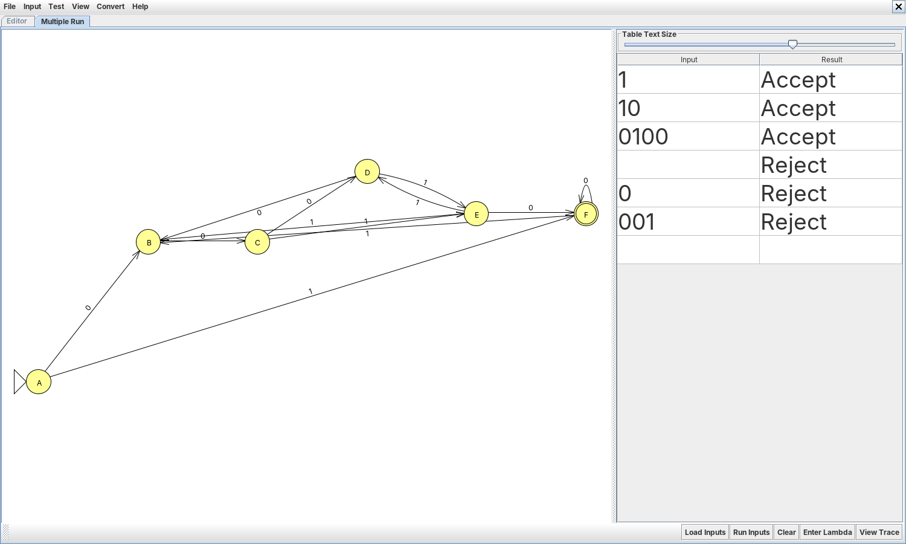

### Lista 3 · Ejercicio 158

**Enunciado.** Describa lo que hace el AFN del diagrama 158.

**Diseño.** El autómata acepta únicamente la cadena 01: L = {01}. Las transiciones que faltan llevan a un rechazo implícito.

**Archivo.** `automatas/lista3/lista3-158.jff` · Σ = {0, 1} · \|Q\| = 3

| δ     | 0   | 1   |
|-------|-----|-----|
| → q1  | q2  | —   |
| q2    | —   | q3  |
| \* q3 | —   | —   |

Tabla de transiciones (→ inicial, \* aceptación, — sin transición).

| Cadena | Longitud | Esperado | Obtenido | Tipo de caso |
|--------|:--------:|----------|----------|--------------|
| `01`   |    2     | acepta   | acepta   | válida       |
| λ      |    0     | rechaza  | rechaza  | inválida     |
| `1`    |    1     | rechaza  | rechaza  | inválida     |
| `111`  |    3     | rechaza  | rechaza  | inválida     |

Cadenas de prueba.

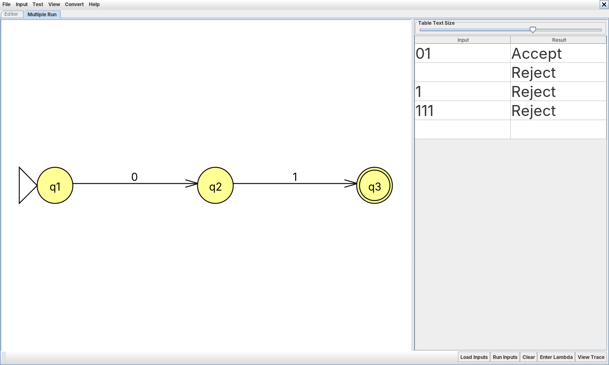

### Lista 3 · Ejercicio 159

**Enunciado.** Describa lo que hace el AFN del diagrama 159.

**Diseño.** El autómata acepta las cadenas formadas por unos seguidos de 01: L = 1\*01. Las transiciones que faltan llevan a un rechazo implícito.

**Archivo.** `automatas/lista3/lista3-159.jff` · Σ = {0, 1} · \|Q\| = 3

| δ     | 0   | 1   |
|-------|-----|-----|
| → q1  | q2  | q1  |
| q2    | —   | q3  |
| \* q3 | —   | —   |

Tabla de transiciones (→ inicial, \* aceptación, — sin transición).

| Cadena  | Longitud | Esperado | Obtenido | Tipo de caso                                     |
|---------|:--------:|----------|----------|--------------------------------------------------|
| `01`    |    2     | acepta   | acepta   | válida                                           |
| `101`   |    3     | acepta   | acepta   | válida                                           |
| `11101` |    5     | acepta   | acepta   | válida                                           |
| λ       |    0     | rechaza  | rechaza  | inválida                                         |
| `0`     |    1     | rechaza  | rechaza  | inválida                                         |
| `001`   |    3     | rechaza  | rechaza  | inválida                                         |
| `1`     |    1     | rechaza  | rechaza  | frontera: justo por debajo de la longitud mínima |

Cadenas de prueba.

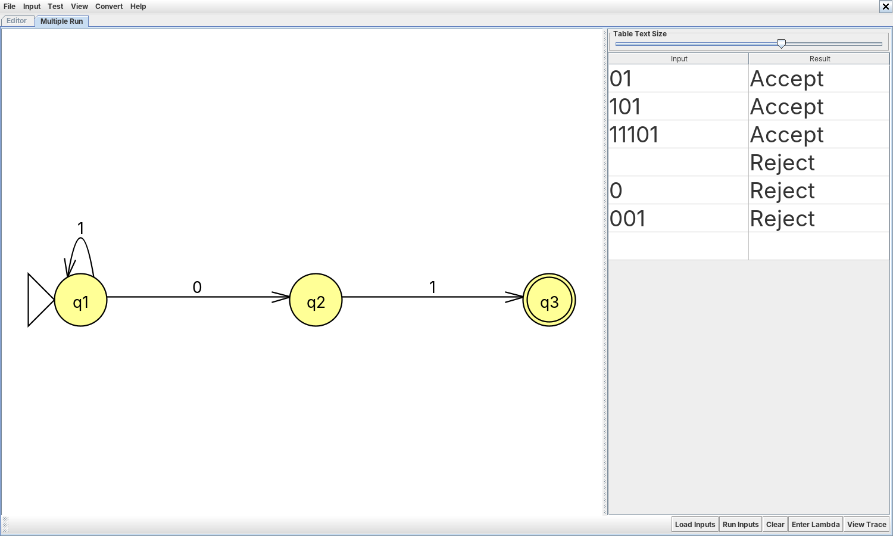

### Lista 3 · Ejercicio 160

**Enunciado.** Describa lo que hace el AFN del diagrama 160.

**Diseño.** El autómata acepta las cadenas que empiezan con 01: L = 01(0 + 1)\*. Las transiciones que faltan llevan a un rechazo implícito.

**Archivo.** `automatas/lista3/lista3-160.jff` · Σ = {0, 1} · \|Q\| = 3

| δ     | 0   | 1   |
|-------|-----|-----|
| → q1  | q2  | —   |
| q2    | —   | q3  |
| \* q3 | q3  | q3  |

Tabla de transiciones (→ inicial, \* aceptación, — sin transición).

| Cadena  | Longitud | Esperado | Obtenido | Tipo de caso |
|---------|:--------:|----------|----------|--------------|
| `01`    |    2     | acepta   | acepta   | válida       |
| `011`   |    3     | acepta   | acepta   | válida       |
| `01100` |    5     | acepta   | acepta   | válida       |
| λ       |    0     | rechaza  | rechaza  | inválida     |
| `1`     |    1     | rechaza  | rechaza  | inválida     |
| `101`   |    3     | rechaza  | rechaza  | inválida     |

Cadenas de prueba.

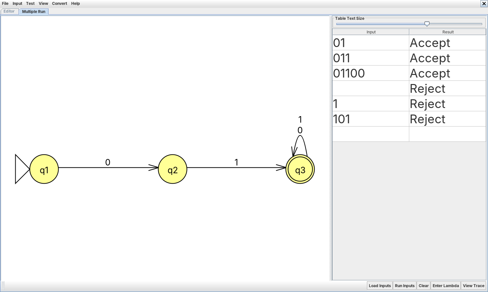

### Lista 3 · Ejercicio 161

**Enunciado.** Describa lo que hace el AFN del diagrama 161.

**Diseño.** El autómata acepta las repeticiones del bloque 010, incluida λ: L = (010)\*. Las transiciones que faltan llevan a un rechazo implícito.

**Archivo.** `automatas/lista3/lista3-161.jff` · Σ = {0, 1} · \|Q\| = 3

| δ      | 0   | 1   |
|--------|-----|-----|
| →\* q1 | q2  | —   |
| q2     | —   | q3  |
| q3     | q1  | —   |

Tabla de transiciones (→ inicial, \* aceptación, — sin transición).

| Cadena   | Longitud | Esperado | Obtenido | Tipo de caso |
|----------|:--------:|----------|----------|--------------|
| λ        |    0     | acepta   | acepta   | válida       |
| `010`    |    3     | acepta   | acepta   | válida       |
| `010010` |    6     | acepta   | acepta   | válida       |
| `0`      |    1     | rechaza  | rechaza  | inválida     |
| `01`     |    2     | rechaza  | rechaza  | inválida     |
| `0100`   |    4     | rechaza  | rechaza  | inválida     |

Cadenas de prueba.

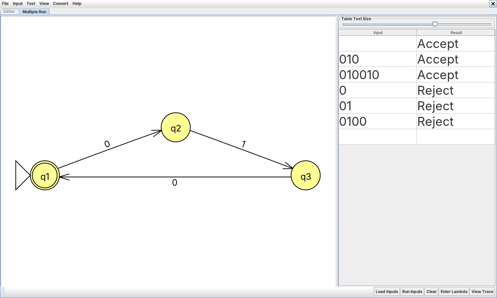

### Lista 3 · AFN del problema 097

**Enunciado.** AFN para el problema 97: Las palabras de Σ1 cuya longitud es un múltiplo de 3.

**Diseño.** No hay una versión no determinista más simple: el lenguaje depende de contar (longitud, apariciones o fases). Se presenta el AFD del problema sin el estado muerto; una función de transición parcial es un caso particular de AFN.

**Archivo.** `automatas/lista3/lista3-afn-097.jff` · Σ = {0, 1, 2} · \|Q\| = 3

| δ      | 0   | 1   | 2   |
|--------|-----|-----|-----|
| →\* r0 | r1  | r1  | r1  |
| r1     | r2  | r2  | r2  |
| r2     | r0  | r0  | r0  |

Tabla de transiciones (→ inicial, \* aceptación, — sin transición).

| Cadena | Longitud | Esperado | Obtenido | Tipo de caso |
|--------|:--------:|----------|----------|--------------|
| λ      |    0     | acepta   | acepta   | válida       |
| `120`  |    3     | acepta   | acepta   | válida       |
| `200`  |    3     | acepta   | acepta   | válida       |
| `1`    |    1     | rechaza  | rechaza  | inválida     |
| `21`   |    2     | rechaza  | rechaza  | inválida     |
| `2102` |    4     | rechaza  | rechaza  | inválida     |

Cadenas de prueba.

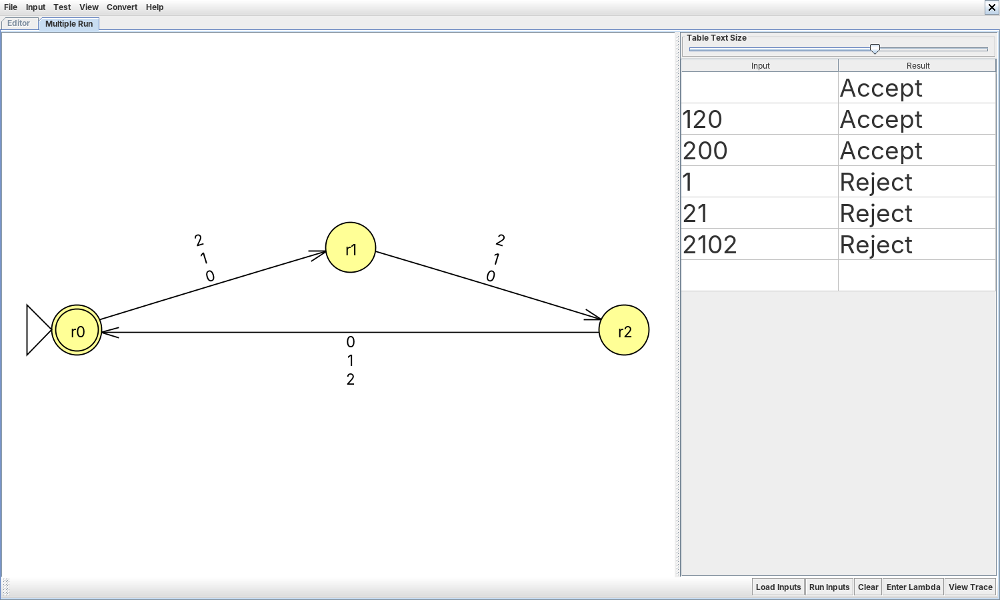

### Lista 3 · AFN del problema 099

**Enunciado.** AFN para el problema 99: Las palabras de Σ1 que terminan con la cadena 001001.

**Diseño.** Ciclo en c0 y una cadena que adivina dónde empieza el sufijo 001001. El enunciado se resuelve de forma natural con un AFN de 7 estados; el AFD equivalente se obtuvo con la construcción de subconjuntos y la minimización y tiene 7 estados.

**Archivo.** `automatas/lista3/lista3-afn-099.jff` · Σ = {0, 1, 2} · \|Q\| = 7

| δ     | 0   | 1   | 2   | Qué recuerda del prefijo leído |
|-------|-----|-----|-----|--------------------------------|
| → q0  | q1  | q0  | q0  | activos del AFN: {c0}          |
| q1    | q2  | q0  | q0  | activos del AFN: {c0,c1}       |
| q2    | q2  | q3  | q0  | activos del AFN: {c0,c1,c2}    |
| q3    | q4  | q0  | q0  | activos del AFN: {c0,c3}       |
| q4    | q5  | q0  | q0  | activos del AFN: {c0,c1,c4}    |
| q5    | q2  | q6  | q0  | activos del AFN: {c0,c1,c2,c5} |
| \* q6 | q4  | q0  | q0  | activos del AFN: {c0,c3,c6}    |

Tabla de transiciones (→ inicial, \* aceptación, — sin transición).

| Cadena      | Longitud | Esperado | Obtenido | Tipo de caso                                     |
|-------------|:--------:|----------|----------|--------------------------------------------------|
| `001001`    |    6     | acepta   | acepta   | válida                                           |
| `1001001`   |    7     | acepta   | acepta   | válida                                           |
| `121001001` |    9     | acepta   | acepta   | válida                                           |
| λ           |    0     | rechaza  | rechaza  | inválida                                         |
| `2`         |    1     | rechaza  | rechaza  | inválida                                         |
| `120`       |    3     | rechaza  | rechaza  | inválida                                         |
| `02210`     |    5     | rechaza  | rechaza  | frontera: justo por debajo de la longitud mínima |

Cadenas de prueba.

### Lista 3 · AFN del problema 102

**Enunciado.** AFN para el problema 102: Las palabras de Σ3 que contienen la cadena abbbab.

**Diseño.** El AFN adivina dónde empieza abbbab: ciclo inicial, el patrón y ciclo final. No necesita los retrocesos del autómata de Knuth-Morris-Pratt. El enunciado se resuelve de forma natural con un AFN de 7 estados; el AFD equivalente se obtuvo con la construcción de subconjuntos y la minimización y tiene 7 estados.

**Archivo.** `automatas/lista3/lista3-afn-102.jff` · Σ = {a, b} · \|Q\| = 7

| δ     | a   | b   | Qué recuerda del prefijo leído                                                               |
|-------|-----|-----|----------------------------------------------------------------------------------------------|
| → q0  | q1  | q0  | activos del AFN: {c0}                                                                        |
| q1    | q1  | q2  | activos del AFN: {c0,c1}                                                                     |
| q2    | q1  | q3  | activos del AFN: {c0,c2}                                                                     |
| q3    | q1  | q4  | activos del AFN: {c0,c3}                                                                     |
| q4    | q5  | q0  | activos del AFN: {c0,c4}                                                                     |
| q5    | q1  | q6  | activos del AFN: {c0,c1,c5}                                                                  |
| \* q6 | q6  | q6  | activos del AFN: {c0,c2,c6} o {c0,c1,c6} o {c0,c3,c6} o {c0,c4,c6} o {c0,c1,c5,c6} o {c0,c6} |

Tabla de transiciones (→ inicial, \* aceptación, — sin transición).

| Cadena      | Longitud | Esperado | Obtenido | Tipo de caso                                     |
|-------------|:--------:|----------|----------|--------------------------------------------------|
| `abbbab`    |    6     | acepta   | acepta   | válida                                           |
| `abbbabb`   |    7     | acepta   | acepta   | válida                                           |
| `abbbabaaa` |    9     | acepta   | acepta   | válida                                           |
| λ           |    0     | rechaza  | rechaza  | inválida                                         |
| `a`         |    1     | rechaza  | rechaza  | inválida                                         |
| `baa`       |    3     | rechaza  | rechaza  | inválida                                         |
| `aabab`     |    5     | rechaza  | rechaza  | frontera: justo por debajo de la longitud mínima |

Cadenas de prueba.

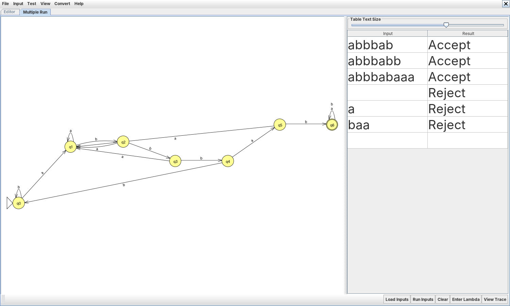

### Lista 3 · AFN del problema 103

**Enunciado.** AFN para el problema 103: Las palabras de Σ3 que contienen la cadena aabbba.

**Diseño.** El AFN adivina dónde empieza aabbba: ciclo inicial, el patrón y ciclo final. No necesita los retrocesos del autómata de Knuth-Morris-Pratt. El enunciado se resuelve de forma natural con un AFN de 7 estados; el AFD equivalente se obtuvo con la construcción de subconjuntos y la minimización y tiene 7 estados.

**Archivo.** `automatas/lista3/lista3-afn-103.jff` · Σ = {a, b} · \|Q\| = 7

| δ     | a   | b   | Qué recuerda del prefijo leído                                                               |
|-------|-----|-----|----------------------------------------------------------------------------------------------|
| → q0  | q1  | q0  | activos del AFN: {c0}                                                                        |
| q1    | q2  | q0  | activos del AFN: {c0,c1}                                                                     |
| q2    | q2  | q3  | activos del AFN: {c0,c1,c2}                                                                  |
| q3    | q1  | q4  | activos del AFN: {c0,c3}                                                                     |
| q4    | q1  | q5  | activos del AFN: {c0,c4}                                                                     |
| q5    | q6  | q0  | activos del AFN: {c0,c5}                                                                     |
| \* q6 | q6  | q6  | activos del AFN: {c0,c1,c6} o {c0,c1,c2,c6} o {c0,c6} o {c0,c3,c6} o {c0,c4,c6} o {c0,c5,c6} |

Tabla de transiciones (→ inicial, \* aceptación, — sin transición).

| Cadena      | Longitud | Esperado | Obtenido | Tipo de caso                                     |
|-------------|:--------:|----------|----------|--------------------------------------------------|
| `aabbba`    |    6     | acepta   | acepta   | válida                                           |
| `baabbba`   |    7     | acepta   | acepta   | válida                                           |
| `babaabbba` |    9     | acepta   | acepta   | válida                                           |
| λ           |    0     | rechaza  | rechaza  | inválida                                         |
| `a`         |    1     | rechaza  | rechaza  | inválida                                         |
| `aaa`       |    3     | rechaza  | rechaza  | inválida                                         |
| `ababb`     |    5     | rechaza  | rechaza  | frontera: justo por debajo de la longitud mínima |

Cadenas de prueba.

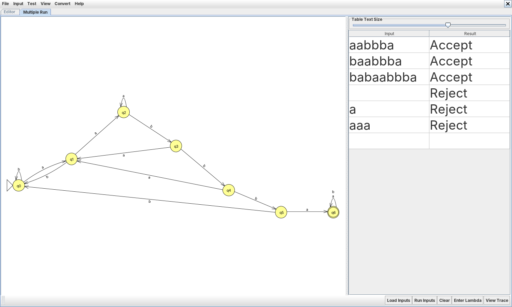

### Lista 3 · AFN del problema 106

**Enunciado.** AFN para el problema 106: Las palabras de Σ1 que incluyen la subcadena 1101001.

**Diseño.** El AFN adivina dónde empieza 1101001: ciclo inicial, el patrón y ciclo final. No necesita los retrocesos del autómata de Knuth-Morris-Pratt. El enunciado se resuelve de forma natural con un AFN de 8 estados; el AFD equivalente se obtuvo con la construcción de subconjuntos y la minimización y tiene 8 estados.

**Archivo.** `automatas/lista3/lista3-afn-106.jff` · Σ = {0, 1, 2} · \|Q\| = 8

| δ     | 0   | 1   | 2   | Qué recuerda del prefijo leído                                                                               |
|-------|-----|-----|-----|--------------------------------------------------------------------------------------------------------------|
| → q0  | q0  | q1  | q0  | activos del AFN: {c0}                                                                                        |
| q1    | q0  | q2  | q0  | activos del AFN: {c0,c1}                                                                                     |
| q2    | q3  | q2  | q0  | activos del AFN: {c0,c1,c2}                                                                                  |
| q3    | q0  | q4  | q0  | activos del AFN: {c0,c3}                                                                                     |
| q4    | q5  | q2  | q0  | activos del AFN: {c0,c1,c4}                                                                                  |
| q5    | q6  | q1  | q0  | activos del AFN: {c0,c5}                                                                                     |
| q6    | q0  | q7  | q0  | activos del AFN: {c0,c6}                                                                                     |
| \* q7 | q7  | q7  | q7  | activos del AFN: {c0,c1,c7} o {c0,c7} o {c0,c1,c2,c7} o {c0,c3,c7} o {c0,c1,c4,c7} o {c0,c5,c7} o {c0,c6,c7} |

Tabla de transiciones (→ inicial, \* aceptación, — sin transición).

| Cadena       | Longitud | Esperado | Obtenido | Tipo de caso                                     |
|--------------|:--------:|----------|----------|--------------------------------------------------|
| `1101001`    |    7     | acepta   | acepta   | válida                                           |
| `11010010`   |    8     | acepta   | acepta   | válida                                           |
| `1101001110` |    10    | acepta   | acepta   | válida                                           |
| λ            |    0     | rechaza  | rechaza  | inválida                                         |
| `2`          |    1     | rechaza  | rechaza  | inválida                                         |
| `210`        |    3     | rechaza  | rechaza  | inválida                                         |
| `221200`     |    6     | rechaza  | rechaza  | frontera: justo por debajo de la longitud mínima |

Cadenas de prueba.

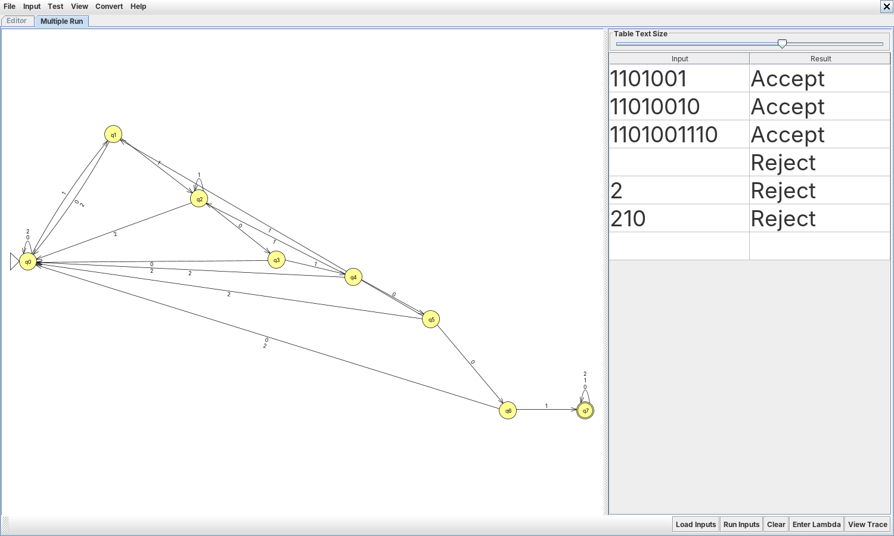

### Lista 3 · AFN del problema 107

**Enunciado.** AFN para el problema 107: Las palabras de Σ1 que incluyen al menos una vez 0101 y al menos una vez 021.

**Diseño.** Intersección de los AFN de «contiene 0101» y «contiene 021» con la construcción de producto; cada estado es un par cᵢcⱼ. Como las dos apariciones pueden traslaparse, no basta con concatenar los patrones. El enunciado se resuelve de forma natural con un AFN de 16 estados; el AFD equivalente se obtuvo con la construcción de subconjuntos y la minimización y tiene 13 estados.

**Archivo.** `automatas/lista3/lista3-afn-107.jff` · Σ = {0, 1, 2} · \|Q\| = 13

| δ      | 0   | 1   | 2   | Qué recuerda del prefijo leído                                                                                                                                                                                              |
|--------|-----|-----|-----|-----------------------------------------------------------------------------------------------------------------------------------------------------------------------------------------------------------------------------|
| → q0   | q1  | q0  | q0  | activos del AFN: {c0c0}                                                                                                                                                                                                     |
| q1     | q1  | q2  | q3  | activos del AFN: {c0c0,c0c1,c1c0,c1c1}                                                                                                                                                                                      |
| q2     | q4  | q0  | q0  | activos del AFN: {c0c0,c2c0}                                                                                                                                                                                                |
| q3     | q1  | q5  | q0  | activos del AFN: {c0c0,c0c2}                                                                                                                                                                                                |
| q4     | q1  | q6  | q3  | activos del AFN: {c0c0,c0c1,c1c0,c1c1,c3c0,c3c1}                                                                                                                                                                            |
| q5     | q7  | q5  | q5  | activos del AFN: {c0c0,c0c3} o {c0c0,c0c2,c0c3}                                                                                                                                                                             |
| q6     | q8  | q6  | q6  | activos del AFN: {c0c0,c2c0,c4c0} o {c0c0,c4c0}                                                                                                                                                                             |
| q7     | q7  | q9  | q5  | activos del AFN: {c0c0,c0c1,c1c0,c1c1,c0c3,c1c3}                                                                                                                                                                            |
| q8     | q8  | q6  | q10 | activos del AFN: {c0c0,c0c1,c1c0,c1c1,c3c0,c3c1,c4c0,c4c1} o {c0c0,c0c1,c1c0,c1c1,c4c0,c4c1}                                                                                                                                |
| q9     | q11 | q5  | q5  | activos del AFN: {c0c0,c2c0,c0c3,c2c3}                                                                                                                                                                                      |
| q10    | q8  | q12 | q6  | activos del AFN: {c0c0,c0c2,c4c0,c4c2}                                                                                                                                                                                      |
| q11    | q7  | q12 | q5  | activos del AFN: {c0c0,c0c1,c1c0,c1c1,c0c3,c3c0,c3c1,c1c3,c3c3}                                                                                                                                                             |
| \* q12 | q12 | q12 | q12 | activos del AFN: {c0c0,c0c3,c4c0,c4c3} o {c0c0,c2c0,c0c3,c4c0,c2c3,c4c3} o {c0c0,c0c1,c1c0,c1c1,c0c3,c1c3,c4c0,c4c1,c4c3} o {c0c0,c0c1,c1c0,c1c1,c0c3,c3c0,c3c1,c1c3,c4c0,c4c1,c3c3,c4c3} o {c0c0,c0c2,c0c3,c4c0,c4c2,c4c3} |

Tabla de transiciones (→ inicial, \* aceptación, — sin transición).

| Cadena       | Longitud | Esperado | Obtenido | Tipo de caso                                     |
|--------------|:--------:|----------|----------|--------------------------------------------------|
| `0101021`    |    7     | acepta   | acepta   | válida                                           |
| `20210101`   |    8     | acepta   | acepta   | válida                                           |
| `0212100101` |    10    | acepta   | acepta   | válida                                           |
| λ            |    0     | rechaza  | rechaza  | inválida                                         |
| `0`          |    1     | rechaza  | rechaza  | inválida                                         |
| `201`        |    3     | rechaza  | rechaza  | inválida                                         |
| `0210101`    |    7     | acepta   | acepta   | frontera: aceptada más corta                     |
| `101002`     |    6     | rechaza  | rechaza  | frontera: justo por debajo de la longitud mínima |

Cadenas de prueba.

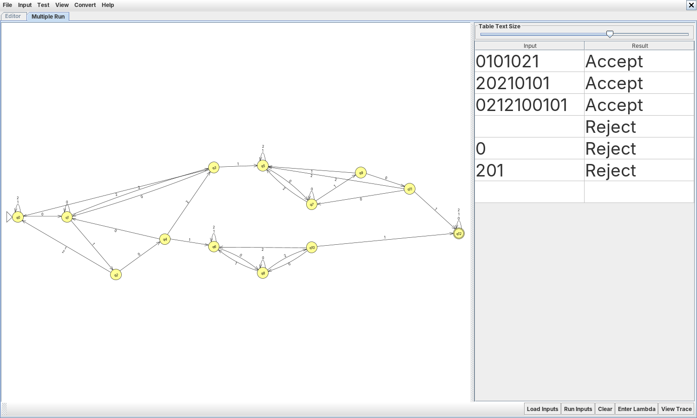

### Lista 3 · AFN del problema 109

**Enunciado.** AFN para el problema 109: Las palabras de Σ2 que incluyen abbcb y cbaabb, que sí se pueden traslapar.

**Diseño.** Intersección de los dos AFN «contiene» por la construcción de producto, que admite traslapes. El enunciado se resuelve de forma natural con un AFN de 26 estados; el AFD equivalente se obtuvo con la construcción de subconjuntos y la minimización y tiene 22 estados.

**Archivo.** `automatas/lista3/lista3-afn-109.jff` · Σ = {0, 1, a, b, c} · \|Q\| = 22

| δ      | 0   | 1   | a   | b   | c   | Qué recuerda del prefijo leído                                                                                                                                                                                                                                                                                                                                                                                       |
|--------|-----|-----|-----|-----|-----|----------------------------------------------------------------------------------------------------------------------------------------------------------------------------------------------------------------------------------------------------------------------------------------------------------------------------------------------------------------------------------------------------------------------|
| → q0   | q0  | q0  | q1  | q0  | q2  | activos del AFN: {c0c0}                                                                                                                                                                                                                                                                                                                                                                                              |
| q1     | q0  | q0  | q1  | q3  | q2  | activos del AFN: {c0c0,c1c0}                                                                                                                                                                                                                                                                                                                                                                                         |
| q2     | q0  | q0  | q1  | q4  | q2  | activos del AFN: {c0c0,c0c1}                                                                                                                                                                                                                                                                                                                                                                                         |
| q3     | q0  | q0  | q1  | q5  | q2  | activos del AFN: {c0c0,c2c0}                                                                                                                                                                                                                                                                                                                                                                                         |
| q4     | q0  | q0  | q6  | q0  | q2  | activos del AFN: {c0c0,c0c2}                                                                                                                                                                                                                                                                                                                                                                                         |
| q5     | q0  | q0  | q1  | q0  | q7  | activos del AFN: {c0c0,c3c0}                                                                                                                                                                                                                                                                                                                                                                                         |
| q6     | q0  | q0  | q8  | q3  | q2  | activos del AFN: {c0c0,c1c0,c0c3,c1c3}                                                                                                                                                                                                                                                                                                                                                                               |
| q7     | q0  | q0  | q1  | q9  | q2  | activos del AFN: {c0c0,c0c1,c4c0,c4c1}                                                                                                                                                                                                                                                                                                                                                                               |
| q8     | q0  | q0  | q1  | q10 | q2  | activos del AFN: {c0c0,c1c0,c0c4,c1c4}                                                                                                                                                                                                                                                                                                                                                                               |
| q9     | q11 | q11 | q12 | q11 | q13 | activos del AFN: {c0c0,c0c2,c5c0,c5c2}                                                                                                                                                                                                                                                                                                                                                                               |
| q10    | q0  | q0  | q1  | q14 | q2  | activos del AFN: {c0c0,c2c0,c0c5,c2c5}                                                                                                                                                                                                                                                                                                                                                                               |
| q11    | q11 | q11 | q11 | q11 | q13 | activos del AFN: {c0c0,c5c0} o {c0c0,c1c0,c5c0} o {c0c0,c2c0,c5c0} o {c0c0,c3c0,c5c0}                                                                                                                                                                                                                                                                                                                                |
| q12    | q11 | q11 | q15 | q11 | q13 | activos del AFN: {c0c0,c1c0,c0c3,c1c3,c5c0,c5c3}                                                                                                                                                                                                                                                                                                                                                                     |
| q13    | q11 | q11 | q11 | q9  | q13 | activos del AFN: {c0c0,c0c1,c5c0,c5c1} o {c0c0,c0c1,c4c0,c4c1,c5c0,c5c1}                                                                                                                                                                                                                                                                                                                                             |
| q14    | q16 | q16 | q17 | q16 | q18 | activos del AFN: {c0c0,c3c0,c0c6,c3c6}                                                                                                                                                                                                                                                                                                                                                                               |
| q15    | q11 | q11 | q11 | q19 | q13 | activos del AFN: {c0c0,c1c0,c0c4,c1c4,c5c0,c5c4}                                                                                                                                                                                                                                                                                                                                                                     |
| q16    | q16 | q16 | q17 | q16 | q16 | activos del AFN: {c0c0,c0c6} o {c0c0,c0c1,c0c6} o {c0c0,c0c2,c0c6}                                                                                                                                                                                                                                                                                                                                                   |
| q17    | q16 | q16 | q17 | q20 | q16 | activos del AFN: {c0c0,c1c0,c0c6,c1c6} o {c0c0,c1c0,c0c3,c1c3,c0c6,c1c6} o {c0c0,c1c0,c0c4,c1c4,c0c6,c1c6}                                                                                                                                                                                                                                                                                                           |
| q18    | q16 | q16 | q17 | q21 | q16 | activos del AFN: {c0c0,c0c1,c4c0,c4c1,c0c6,c4c6}                                                                                                                                                                                                                                                                                                                                                                     |
| q19    | q11 | q11 | q11 | q21 | q13 | activos del AFN: {c0c0,c2c0,c5c0,c0c5,c2c5,c5c5}                                                                                                                                                                                                                                                                                                                                                                     |
| q20    | q16 | q16 | q17 | q14 | q16 | activos del AFN: {c0c0,c2c0,c0c6,c2c6} o {c0c0,c2c0,c0c5,c2c5,c0c6,c2c6}                                                                                                                                                                                                                                                                                                                                             |
| \* q21 | q21 | q21 | q21 | q21 | q21 | activos del AFN: {c0c0,c0c2,c5c0,c5c2,c0c6,c5c6} o {c0c0,c3c0,c5c0,c0c6,c3c6,c5c6} o {c0c0,c5c0,c0c6,c5c6} o {c0c0,c1c0,c0c3,c1c3,c5c0,c5c3,c0c6,c1c6,c5c6} o {c0c0,c0c1,c5c0,c5c1,c0c6,c5c6} o {c0c0,c1c0,c5c0,c0c6,c1c6,c5c6} o {c0c0,c0c1,c4c0,c4c1,c5c0,c5c1,c0c6,c4c6,c5c6} o {c0c0,c1c0,c0c4,c1c4,c5c0,c0c6,c5c4,c1c6,c5c6} o {c0c0,c2c0,c5c0,c0c6,c2c6,c5c6} o {c0c0,c2c0,c5c0,c0c5,c2c5,c0c6,c5c5,c2c6,c5c6} |

Tabla de transiciones (→ inicial, \* aceptación, — sin transición).

| Cadena        | Longitud | Esperado | Obtenido | Tipo de caso                                     |
|---------------|:--------:|----------|----------|--------------------------------------------------|
| `cbaabbcb`    |    8     | acepta   | acepta   | válida                                           |
| `acbaabbcb`   |    9     | acepta   | acepta   | válida                                           |
| `1acbaabbcba` |    11    | acepta   | acepta   | válida                                           |
| λ             |    0     | rechaza  | rechaza  | inválida                                         |
| `a`           |    1     | rechaza  | rechaza  | inválida                                         |
| `1ac`         |    3     | rechaza  | rechaza  | inválida                                         |
| `abc0bca`     |    7     | rechaza  | rechaza  | frontera: justo por debajo de la longitud mínima |

Cadenas de prueba.

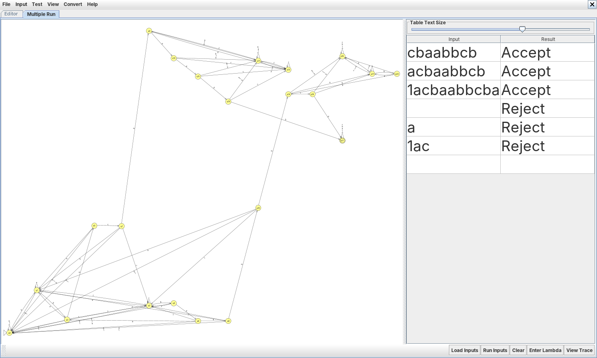

### Lista 3 · AFN del problema 111

**Enunciado.** AFN para el problema 111: Las palabras de Σ1 que contienen exactamente tres veces la subcadena 01002.

**Diseño.** No hay una versión no determinista más simple: el lenguaje depende de contar (longitud, apariciones o fases). Se presenta el AFD del problema sin el estado muerto; una función de transición parcial es un caso particular de AFN.

**Archivo.** `automatas/lista3/lista3-afn-111.jff` · Σ = {0, 1, 2} · \|Q\| = 20

| δ         | 0      | 1    | 2   |
|-----------|--------|------|-----|
| → 0·λ     | 0·0    | 0·λ  | 0·λ |
| 0·0       | 0·0    | 0·01 | 0·λ |
| 0·01      | 0·010  | 0·λ  | 0·λ |
| 0·010     | 0·0100 | 0·01 | 0·λ |
| 0·0100    | 0·0    | 0·01 | 1·λ |
| 1·λ       | 1·0    | 1·λ  | 1·λ |
| 1·0       | 1·0    | 1·01 | 1·λ |
| 1·01      | 1·010  | 1·λ  | 1·λ |
| 1·010     | 1·0100 | 1·01 | 1·λ |
| 1·0100    | 1·0    | 1·01 | 2·λ |
| 2·λ       | 2·0    | 2·λ  | 2·λ |
| 2·0       | 2·0    | 2·01 | 2·λ |
| 2·01      | 2·010  | 2·λ  | 2·λ |
| 2·010     | 2·0100 | 2·01 | 2·λ |
| 2·0100    | 2·0    | 2·01 | 3·λ |
| \* 3·λ    | 3·0    | 3·λ  | 3·λ |
| \* 3·0    | 3·0    | 3·01 | 3·λ |
| \* 3·01   | 3·010  | 3·λ  | 3·λ |
| \* 3·010  | 3·0100 | 3·01 | 3·λ |
| \* 3·0100 | 3·0    | 3·01 | —   |

Tabla de transiciones (→ inicial, \* aceptación, — sin transición).

| Cadena               | Longitud | Esperado | Obtenido | Tipo de caso                                     |
|----------------------|:--------:|----------|----------|--------------------------------------------------|
| `010020100201002`    |    15    | acepta   | acepta   | válida                                           |
| `0100200100201002`   |    16    | acepta   | acepta   | válida                                           |
| `010020201002010021` |    18    | acepta   | acepta   | válida                                           |
| λ                    |    0     | rechaza  | rechaza  | inválida                                         |
| `1`                  |    1     | rechaza  | rechaza  | inválida                                         |
| `022`                |    3     | rechaza  | rechaza  | inválida                                         |
| `21120022200202`     |    14    | rechaza  | rechaza  | frontera: justo por debajo de la longitud mínima |

Cadenas de prueba.

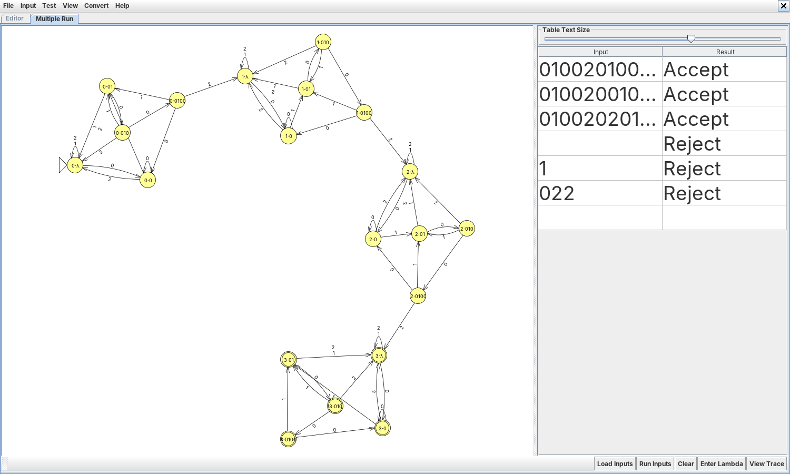

### Lista 3 · AFN del problema 112

**Enunciado.** AFN para el problema 112: Las palabras de Σ1 que contienen dos veces 010 sin traslaparse (01010 no pertenece, 010010 sí).

**Diseño.** Σ*010Σ*010Σ\*: dos copias de 010 separadas por un ciclo; la segunda empieza después de que termina la primera. El enunciado se resuelve de forma natural con un AFN de 7 estados; el AFD equivalente se obtuvo con la construcción de subconjuntos y la minimización y tiene 7 estados.

**Archivo.** `automatas/lista3/lista3-afn-112.jff` · Σ = {0, 1, 2} · \|Q\| = 7

| δ     | 0   | 1   | 2   | Qué recuerda del prefijo leído                                 |
|-------|-----|-----|-----|----------------------------------------------------------------|
| → q0  | q1  | q0  | q0  | activos del AFN: {i}                                           |
| q1    | q1  | q2  | q0  | activos del AFN: {i,a1}                                        |
| q2    | q3  | q0  | q0  | activos del AFN: {i,a2}                                        |
| q3    | q4  | q3  | q3  | activos del AFN: {i,a1,a3} o {i,a2,a3} o {i,a3}                |
| q4    | q4  | q5  | q3  | activos del AFN: {i,a1,a3,b1}                                  |
| q5    | q6  | q3  | q3  | activos del AFN: {i,a2,a3,b2}                                  |
| \* q6 | q6  | q6  | q6  | activos del AFN: {i,a1,a3,b1,b3} o {i,a2,a3,b2,b3} o {i,a3,b3} |

Tabla de transiciones (→ inicial, \* aceptación, — sin transición).

| Cadena      | Longitud | Esperado | Obtenido | Tipo de caso                                     |
|-------------|:--------:|----------|----------|--------------------------------------------------|
| `010010`    |    6     | acepta   | acepta   | válida                                           |
| `0100010`   |    7     | acepta   | acepta   | válida                                           |
| `100100100` |    9     | acepta   | acepta   | válida                                           |
| λ           |    0     | rechaza  | rechaza  | inválida                                         |
| `1`         |    1     | rechaza  | rechaza  | inválida                                         |
| `122`       |    3     | rechaza  | rechaza  | inválida                                         |
| `10002`     |    5     | rechaza  | rechaza  | frontera: justo por debajo de la longitud mínima |

Cadenas de prueba.

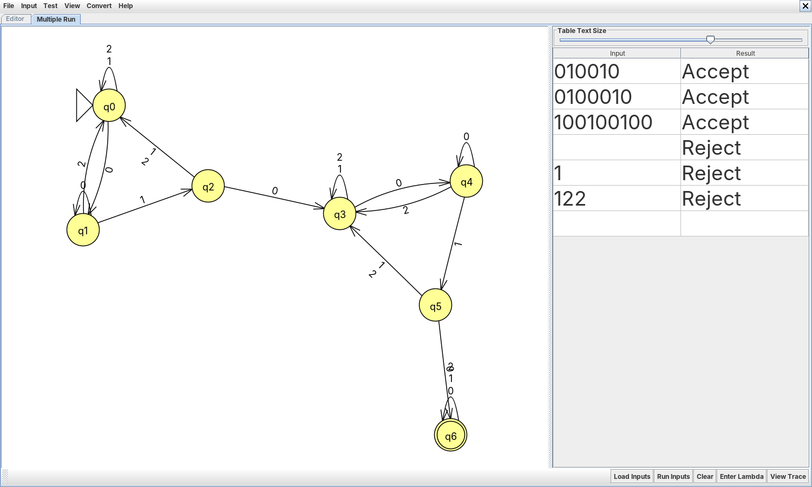

### Lista 3 · AFN del problema 113

**Enunciado.** AFN para el problema 113: Las palabras de Σ1 que contienen dos veces 010, que sí se pueden traslapar.

**Diseño.** Σ*(010Σ*010 + 01010)Σ\*: dos apariciones disjuntas o una sola cadena 01010 en la que comparten el 0 central. El enunciado se resuelve de forma natural con un AFN de 11 estados; el AFD equivalente se obtuvo con la construcción de subconjuntos y la minimización y tiene 7 estados.

**Archivo.** `automatas/lista3/lista3-afn-113.jff` · Σ = {0, 1, 2} · \|Q\| = 7

| δ     | 0   | 1   | 2   | Qué recuerda del prefijo leído                                                                                       |
|-------|-----|-----|-----|----------------------------------------------------------------------------------------------------------------------|
| → q0  | q1  | q0  | q0  | activos del AFN: {i}                                                                                                 |
| q1    | q1  | q2  | q0  | activos del AFN: {i,a1,o1}                                                                                           |
| q2    | q3  | q0  | q0  | activos del AFN: {i,a2,o2}                                                                                           |
| q3    | q3  | q4  | q5  | activos del AFN: {i,a1,a3,o1,o3} o {i,a1,a3,b1,o1}                                                                   |
| q4    | q6  | q5  | q5  | activos del AFN: {i,a2,a3,o2,o4} o {i,a2,a3,b2,o2}                                                                   |
| q5    | q3  | q5  | q5  | activos del AFN: {i,a3}                                                                                              |
| \* q6 | q6  | q6  | q6  | activos del AFN: {i,a1,a3,b1,b3,o1,o3} o {i,a1,a3,b1,b3,o1} o {i,a2,a3,b2,b3,o2,o4} o {i,a3,b3} o {i,a2,a3,b2,b3,o2} |

Tabla de transiciones (→ inicial, \* aceptación, — sin transición).

| Cadena     | Longitud | Esperado | Obtenido | Tipo de caso                                     |
|------------|:--------:|----------|----------|--------------------------------------------------|
| `01010`    |    5     | acepta   | acepta   | válida                                           |
| `010101`   |    6     | acepta   | acepta   | válida                                           |
| `20101001` |    8     | acepta   | acepta   | válida                                           |
| λ          |    0     | rechaza  | rechaza  | inválida                                         |
| `0`        |    1     | rechaza  | rechaza  | inválida                                         |
| `222`      |    3     | rechaza  | rechaza  | inválida                                         |
| `0111`     |    4     | rechaza  | rechaza  | frontera: justo por debajo de la longitud mínima |

Cadenas de prueba.

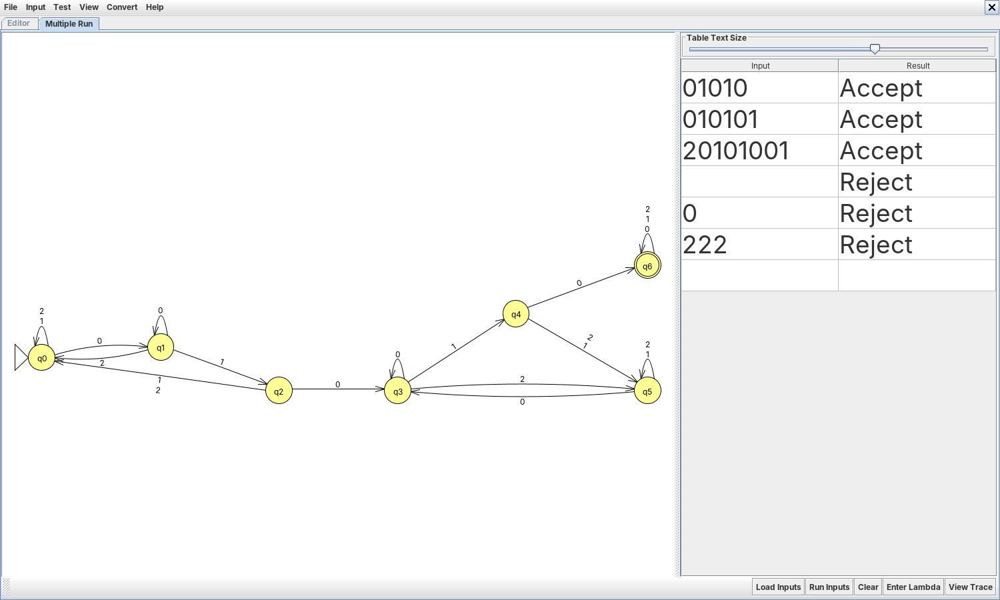

### Lista 3 · AFN del problema 116

**Enunciado.** AFN para el problema 116: L = {w ∈ Σ2\* : w = aⁿbᵐcⁿ⁺¹, m, n ∈ N}.

El lenguaje no es regular; tampoco existe AFN.

### Lista 3 · AFN del problema 118

**Enunciado.** AFN para el problema 118: L = {w ∈ Σ3\* : w = axabya, x, y ∈ Σ3\*}.

**Diseño.** Sigue literalmente axabya: a, ciclo x, ab, ciclo y, a final. El enunciado se resuelve de forma natural con un AFN de 5 estados; el AFD equivalente se obtuvo con la construcción de subconjuntos y la minimización y tiene 5 estados.

**Archivo.** `automatas/lista3/lista3-afn-118.jff` · Σ = {a, b} · \|Q\| = 5

| δ     | a   | b   | Qué recuerda del prefijo leído |
|-------|-----|-----|--------------------------------|
| → q0  | q1  | —   | activos del AFN: {q0}          |
| q1    | q2  | q1  | activos del AFN: {q1}          |
| q2    | q2  | q3  | activos del AFN: {q1,q2}       |
| q3    | q4  | q3  | activos del AFN: {q1,q3}       |
| \* q4 | q4  | q3  | activos del AFN: {q1,q2,q3,q4} |

Tabla de transiciones (→ inicial, \* aceptación, — sin transición).

| Cadena    | Longitud | Esperado | Obtenido | Tipo de caso |
|-----------|:--------:|----------|----------|--------------|
| `aaba`    |    4     | acepta   | acepta   | válida       |
| `aabba`   |    5     | acepta   | acepta   | válida       |
| `ababaaa` |    7     | acepta   | acepta   | válida       |
| λ         |    0     | rechaza  | rechaza  | inválida     |
| `a`       |    1     | rechaza  | rechaza  | inválida     |
| `baa`     |    3     | rechaza  | rechaza  | inválida     |

Cadenas de prueba.

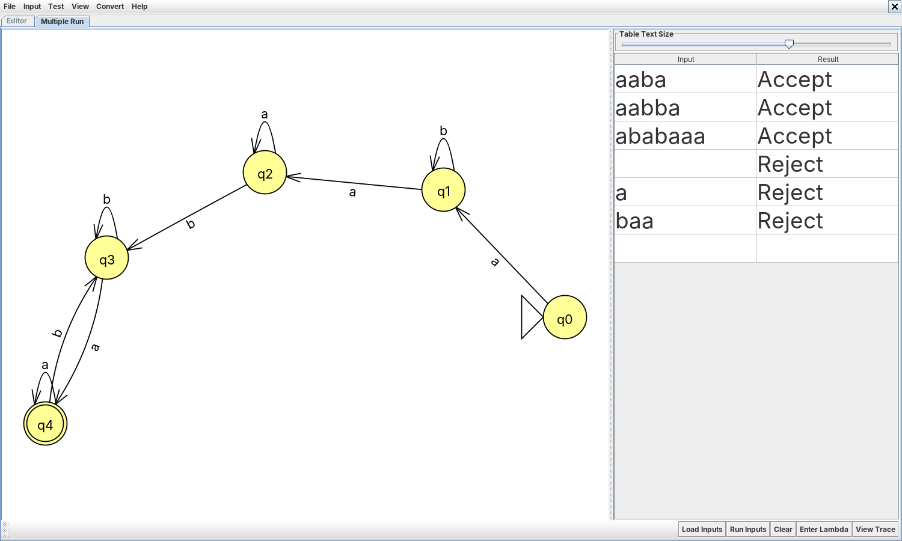

### Lista 3 · AFN del problema 120

**Enunciado.** AFN para el problema 120: Las palabras de Σ1 tales que el primer carácter y el último son distintos.

**Diseño.** El estado sₓ recuerda el primer símbolo x; el AFN adivina el último símbolo, que debe ser distinto de x. El enunciado se resuelve de forma natural con un AFN de 5 estados; el AFD equivalente se obtuvo con la construcción de subconjuntos y la minimización y tiene 7 estados.

**Archivo.** `automatas/lista3/lista3-afn-120.jff` · Σ = {0, 1, 2} · \|Q\| = 7

| δ     | 0   | 1   | 2   | Qué recuerda del prefijo leído |
|-------|-----|-----|-----|--------------------------------|
| → q0  | q1  | q2  | q3  | activos del AFN: {q0}          |
| q1    | q1  | q4  | q4  | activos del AFN: {s0}          |
| q2    | q5  | q2  | q5  | activos del AFN: {s1}          |
| q3    | q6  | q6  | q3  | activos del AFN: {s2}          |
| \* q4 | q1  | q4  | q4  | activos del AFN: {s0,f}        |
| \* q5 | q5  | q2  | q5  | activos del AFN: {s1,f}        |
| \* q6 | q6  | q6  | q3  | activos del AFN: {s2,f}        |

Tabla de transiciones (→ inicial, \* aceptación, — sin transición).

| Cadena  | Longitud | Esperado | Obtenido | Tipo de caso                                     |
|---------|:--------:|----------|----------|--------------------------------------------------|
| `12`    |    2     | acepta   | acepta   | válida                                           |
| `211`   |    3     | acepta   | acepta   | válida                                           |
| `12002` |    5     | acepta   | acepta   | válida                                           |
| λ       |    0     | rechaza  | rechaza  | inválida                                         |
| `1`     |    1     | rechaza  | rechaza  | inválida                                         |
| `222`   |    3     | rechaza  | rechaza  | inválida                                         |
| `02`    |    2     | acepta   | acepta   | frontera: aceptada más corta                     |
| `2`     |    1     | rechaza  | rechaza  | frontera: justo por debajo de la longitud mínima |

Cadenas de prueba.

### Lista 3 · AFN del problema 121

**Enunciado.** AFN para el problema 121: Las palabras de Σ1 de longitud 3n tales que cada bloque de longitud 3 tiene al menos un 0.

**Diseño.** No hay una versión no determinista más simple: el lenguaje depende de contar (longitud, apariciones o fases). Se presenta el AFD del problema sin el estado muerto; una función de transición parcial es un caso particular de AFN.

**Archivo.** `automatas/lista3/lista3-afn-121.jff` · Σ = {0, 1, 2} · \|Q\| = 5

| δ      | 0    | 1    | 2    |
|--------|------|------|------|
| →\* b0 | b1+0 | b1   | b1   |
| b1+0   | b2+0 | b2+0 | b2+0 |
| b1     | b2+0 | b2   | b2   |
| b2+0   | b0   | b0   | b0   |
| b2     | b0   | —    | —    |

Tabla de transiciones (→ inicial, \* aceptación, — sin transición).

| Cadena   | Longitud | Esperado | Obtenido | Tipo de caso |
|----------|:--------:|----------|----------|--------------|
| λ        |    0     | acepta   | acepta   | válida       |
| `021`    |    3     | acepta   | acepta   | válida       |
| `020001` |    6     | acepta   | acepta   | válida       |
| `2`      |    1     | rechaza  | rechaza  | inválida     |
| `01`     |    2     | rechaza  | rechaza  | inválida     |
| `0022`   |    4     | rechaza  | rechaza  | inválida     |

Cadenas de prueba.

### Lista 3 · AFN del problema 122

**Enunciado.** AFN para el problema 122: Las palabras de Σ1 tales que cualquier cadena de tres símbolos consecutivos tiene un 0.

**Diseño.** No hay una versión no determinista más simple: el lenguaje depende de contar (longitud, apariciones o fases). Se presenta el AFD del problema sin el estado muerto; una función de transición parcial es un caso particular de AFN.

**Archivo.** `automatas/lista3/lista3-afn-122.jff` · Σ = {0, 1, 2} · \|Q\| = 3

| δ           | 0       | 1       | 2       |
|-------------|---------|---------|---------|
| →\* 0 sin 0 | 0 sin 0 | 1 sin 0 | 1 sin 0 |
| \* 1 sin 0  | 0 sin 0 | 2 sin 0 | 2 sin 0 |
| \* 2 sin 0  | 0 sin 0 | —       | —       |

Tabla de transiciones (→ inicial, \* aceptación, — sin transición).

| Cadena   | Longitud | Esperado | Obtenido | Tipo de caso |
|----------|:--------:|----------|----------|--------------|
| λ        |    0     | acepta   | acepta   | válida       |
| `1`      |    1     | acepta   | acepta   | válida       |
| `012`    |    3     | acepta   | acepta   | válida       |
| `112`    |    3     | rechaza  | rechaza  | inválida     |
| `1120`   |    4     | rechaza  | rechaza  | inválida     |
| `202211` |    6     | rechaza  | rechaza  | inválida     |

Cadenas de prueba.

### Lista 3 · AFN del problema 123

**Enunciado.** AFN para el problema 123: Las palabras de Σ3 de la forma wxw donde w ∈ Σ3² y x ∈ Σ3\*.

**Diseño.** Una rama por cada w ∈ Σ3²: se lee w, un ciclo para x y otra vez w. El AFN adivina cuándo empieza la copia final. El enunciado se resuelve de forma natural con un AFN de 14 estados; el AFD equivalente se obtuvo con la construcción de subconjuntos y la minimización y tiene 15 estados.

**Archivo.** `automatas/lista3/lista3-afn-123.jff` · Σ = {a, b} · \|Q\| = 15

| δ      | a   | b   | Qué recuerda del prefijo leído |
|--------|-----|-----|--------------------------------|
| → q0   | q1  | q2  | activos del AFN: {q0}          |
| q1     | q3  | q4  | activos del AFN: {aa1,ab1}     |
| q2     | q5  | q6  | activos del AFN: {ba1,bb1}     |
| q3     | q7  | q3  | activos del AFN: {aa2}         |
| q4     | q8  | q4  | activos del AFN: {ab2}         |
| q5     | q5  | q9  | activos del AFN: {ba2}         |
| q6     | q6  | q10 | activos del AFN: {bb2}         |
| q7     | q11 | q3  | activos del AFN: {aa2,aa3}     |
| q8     | q8  | q12 | activos del AFN: {ab2,ab3}     |
| q9     | q13 | q9  | activos del AFN: {ba2,ba3}     |
| q10    | q6  | q14 | activos del AFN: {bb2,bb3}     |
| \* q11 | q11 | q3  | activos del AFN: {aa2,aa3,F}   |
| \* q12 | q8  | q4  | activos del AFN: {ab2,F}       |
| \* q13 | q5  | q9  | activos del AFN: {ba2,F}       |
| \* q14 | q6  | q14 | activos del AFN: {bb2,bb3,F}   |

Tabla de transiciones (→ inicial, \* aceptación, — sin transición).

| Cadena    | Longitud | Esperado | Obtenido | Tipo de caso                                     |
|-----------|:--------:|----------|----------|--------------------------------------------------|
| `abab`    |    4     | acepta   | acepta   | válida                                           |
| `aaaaa`   |    5     | acepta   | acepta   | válida                                           |
| `aababaa` |    7     | acepta   | acepta   | válida                                           |
| λ         |    0     | rechaza  | rechaza  | inválida                                         |
| `a`       |    1     | rechaza  | rechaza  | inválida                                         |
| `bba`     |    3     | rechaza  | rechaza  | inválida                                         |
| `aaaa`    |    4     | acepta   | acepta   | frontera: aceptada más corta                     |
| `aab`     |    3     | rechaza  | rechaza  | frontera: justo por debajo de la longitud mínima |

Cadenas de prueba.

### Lista 3 · Ejercicio 189

**Enunciado.** AFN sobre {0, 1} para las palabras que contienen 00101 o 00110; recorrido de 1001011.

**Diseño.** Los dos patrones comparten el prefijo 001, así que se escribe una sola vez y se bifurca en 01 y 10. El enunciado se resuelve de forma natural con un AFN de 7 estados; el AFD equivalente se obtuvo con la construcción de subconjuntos y la minimización y tiene 7 estados.

**Archivo.** `automatas/lista3/lista3-189.jff` · Σ = {0, 1} · \|Q\| = 7

| δ     | 0   | 1   | Qué recuerda del prefijo leído                                                      |
|-------|-----|-----|-------------------------------------------------------------------------------------|
| → q0  | q1  | q0  | activos del AFN: {i}                                                                |
| q1    | q2  | q0  | activos del AFN: {i,c1}                                                             |
| q2    | q2  | q3  | activos del AFN: {i,c1,c2}                                                          |
| q3    | q4  | q5  | activos del AFN: {i,c3}                                                             |
| q4    | q2  | q6  | activos del AFN: {i,c1,u4}                                                          |
| q5    | q6  | q0  | activos del AFN: {i,d4}                                                             |
| \* q6 | q6  | q6  | activos del AFN: {i,f} o {i,c1,f} o {i,c1,c2,f} o {i,c3,f} o {i,c1,u4,f} o {i,f,d4} |

Tabla de transiciones (→ inicial, \* aceptación, — sin transición).

| Cadena     | Longitud | Esperado | Obtenido | Tipo de caso                                     |
|------------|:--------:|----------|----------|--------------------------------------------------|
| `00110`    |    5     | acepta   | acepta   | válida                                           |
| `100110`   |    6     | acepta   | acepta   | válida                                           |
| `00101100` |    8     | acepta   | acepta   | válida                                           |
| λ          |    0     | rechaza  | rechaza  | inválida                                         |
| `0`        |    1     | rechaza  | rechaza  | inválida                                         |
| `101`      |    3     | rechaza  | rechaza  | inválida                                         |
| `00101`    |    5     | acepta   | acepta   | frontera: aceptada más corta                     |
| `0110`     |    4     | rechaza  | rechaza  | frontera: justo por debajo de la longitud mínima |

Cadenas de prueba.

### Lista 3 · Ejercicio 190

**Enunciado.** AFN sobre {0, 1} para las palabras que contienen 11010 y 10100; recorrido de 01101010100.

**Diseño.** Producto de los AFN «contiene 11010» y «contiene 10100»; los patrones pueden traslaparse (110100 contiene ambos), por eso no basta concatenarlos. El enunciado se resuelve de forma natural con un AFN de 26 estados; el AFD equivalente se obtuvo con la construcción de subconjuntos y la minimización y tiene 19 estados.

**Archivo.** `automatas/lista3/lista3-190.jff` · Σ = {0, 1} · \|Q\| = 19

| δ      | 0   | 1   | Qué recuerda del prefijo leído                                                                                                                                                                                                                                                                                                                                                                                                             |
|--------|-----|-----|--------------------------------------------------------------------------------------------------------------------------------------------------------------------------------------------------------------------------------------------------------------------------------------------------------------------------------------------------------------------------------------------------------------------------------------------|
| → q0   | q0  | q1  | activos del AFN: {c0c0}                                                                                                                                                                                                                                                                                                                                                                                                                    |
| q1     | q2  | q3  | activos del AFN: {c0c0,c0c1,c1c0,c1c1}                                                                                                                                                                                                                                                                                                                                                                                                     |
| q2     | q0  | q4  | activos del AFN: {c0c0,c0c2}                                                                                                                                                                                                                                                                                                                                                                                                               |
| q3     | q5  | q3  | activos del AFN: {c0c0,c0c1,c1c0,c1c1,c2c0,c2c1}                                                                                                                                                                                                                                                                                                                                                                                           |
| q4     | q6  | q3  | activos del AFN: {c0c0,c0c1,c1c0,c1c1,c0c3,c1c3}                                                                                                                                                                                                                                                                                                                                                                                           |
| q5     | q0  | q7  | activos del AFN: {c0c0,c0c2,c3c0,c3c2}                                                                                                                                                                                                                                                                                                                                                                                                     |
| q6     | q8  | q4  | activos del AFN: {c0c0,c0c2,c0c4}                                                                                                                                                                                                                                                                                                                                                                                                          |
| q7     | q9  | q3  | activos del AFN: {c0c0,c0c1,c1c0,c1c1,c0c3,c1c3,c4c0,c4c1,c4c3}                                                                                                                                                                                                                                                                                                                                                                            |
| q8     | q8  | q10 | activos del AFN: {c0c0,c0c5} o {c0c0,c0c2,c0c5} o {c0c0,c0c2,c0c4,c0c5}                                                                                                                                                                                                                                                                                                                                                                    |
| q9     | q11 | q12 | activos del AFN: {c0c0,c0c2,c0c4,c5c0,c5c2,c5c4}                                                                                                                                                                                                                                                                                                                                                                                           |
| q10    | q8  | q13 | activos del AFN: {c0c0,c0c1,c1c0,c1c1,c0c5,c1c5} o {c0c0,c0c1,c1c0,c1c1,c0c3,c1c3,c0c5,c1c5}                                                                                                                                                                                                                                                                                                                                               |
| \* q11 | q11 | q11 | activos del AFN: {c0c0,c0c5,c5c0,c5c5} o {c0c0,c0c1,c1c0,c1c1,c0c5,c5c0,c1c5,c5c1,c5c5} o {c0c0,c0c2,c0c5,c5c0,c5c2,c5c5} o {c0c0,c0c1,c1c0,c1c1,c2c0,c2c1,c0c5,c5c0,c1c5,c5c1,c5c5,c2c5} o {c0c0,c0c1,c1c0,c1c1,c0c3,c1c3,c0c5,c5c0,c1c5,c5c1,c5c3,c5c5} o {c0c0,c0c2,c3c0,c3c2,c0c5,c5c0,c5c2,c5c5,c3c5} o {c0c0,c0c2,c0c4,c0c5,c5c0,c5c2,c5c4,c5c5} o {c0c0,c0c1,c1c0,c1c1,c0c3,c1c3,c4c0,c4c1,c4c3,c0c5,c5c0,c1c5,c5c1,c5c3,c5c5,c4c5} |
| q12    | q9  | q14 | activos del AFN: {c0c0,c0c1,c1c0,c1c1,c0c3,c1c3,c5c0,c5c1,c5c3} o {c0c0,c0c1,c1c0,c1c1,c0c3,c1c3,c4c0,c4c1,c4c3,c5c0,c5c1,c5c3}                                                                                                                                                                                                                                                                                                            |
| q13    | q15 | q13 | activos del AFN: {c0c0,c0c1,c1c0,c1c1,c2c0,c2c1,c0c5,c1c5,c2c5}                                                                                                                                                                                                                                                                                                                                                                            |
| q14    | q16 | q14 | activos del AFN: {c0c0,c0c1,c1c0,c1c1,c2c0,c2c1,c5c0,c5c1} o {c0c0,c0c1,c1c0,c1c1,c5c0,c5c1}                                                                                                                                                                                                                                                                                                                                               |
| q15    | q8  | q17 | activos del AFN: {c0c0,c0c2,c3c0,c3c2,c0c5,c3c5}                                                                                                                                                                                                                                                                                                                                                                                           |
| q16    | q18 | q12 | activos del AFN: {c0c0,c0c2,c3c0,c3c2,c5c0,c5c2} o {c0c0,c0c2,c5c0,c5c2}                                                                                                                                                                                                                                                                                                                                                                   |
| q17    | q11 | q13 | activos del AFN: {c0c0,c0c1,c1c0,c1c1,c0c3,c1c3,c4c0,c4c1,c4c3,c0c5,c1c5,c4c5}                                                                                                                                                                                                                                                                                                                                                             |
| q18    | q18 | q14 | activos del AFN: {c0c0,c5c0}                                                                                                                                                                                                                                                                                                                                                                                                               |

Tabla de transiciones (→ inicial, \* aceptación, — sin transición).

| Cadena      | Longitud | Esperado | Obtenido | Tipo de caso                                     |
|-------------|:--------:|----------|----------|--------------------------------------------------|
| `110100`    |    6     | acepta   | acepta   | válida                                           |
| `1101001`   |    7     | acepta   | acepta   | válida                                           |
| `110100010` |    9     | acepta   | acepta   | válida                                           |
| λ           |    0     | rechaza  | rechaza  | inválida                                         |
| `0`         |    1     | rechaza  | rechaza  | inválida                                         |
| `001`       |    3     | rechaza  | rechaza  | inválida                                         |
| `00010`     |    5     | rechaza  | rechaza  | frontera: justo por debajo de la longitud mínima |

Cadenas de prueba.

### Lista 3 · Ejercicio 191

**Enunciado.** Instrucciones de 192-195: AFD equivalente, δ̂(Z, ω) y δ̂\_D(Z, ω).

Ejercicio de cálculo sobre un AFN dado; se resuelve en la Tarea 3.

### Lista 3 · Ejercicio 192

**Enunciado.** AFN de la tabla 192: AFD equivalente y δ̂(Z, ω).

**Diseño.** Construcción de subconjuntos (sólo alcanzables). El AFD asociado tiene un estado por subconjunto, así que δ̂\_D(Z, ω) es el subconjunto δ̂(Z, ω). El enunciado se resuelve de forma natural con un AFN de 3 estados; el AFD equivalente se obtuvo con la construcción de subconjuntos y la minimización y tiene 5 estados.

**Archivo.** `automatas/lista3/lista3-192.jff` · Σ = {0, 1} · \|Q\| = 5

| δ     | 0   | 1   | Qué recuerda del prefijo leído |
|-------|-----|-----|--------------------------------|
| → q0  | q1  | q2  | activos del AFN: {A}           |
| q1    | q3  | —   | activos del AFN: {B}           |
| \* q2 | q4  | —   | activos del AFN: {B,C}         |
| q3    | q3  | q2  | activos del AFN: {A,B}         |
| \* q4 | q4  | q2  | activos del AFN: {A,B,C}       |

Tabla de transiciones (→ inicial, \* aceptación, — sin transición).

| Cadena | Longitud | Esperado | Obtenido | Tipo de caso |
|--------|:--------:|----------|----------|--------------|
| `1`    |    1     | acepta   | acepta   | válida       |
| `10`   |    2     | acepta   | acepta   | válida       |
| `1010` |    4     | acepta   | acepta   | válida       |
| λ      |    0     | rechaza  | rechaza  | inválida     |
| `0`    |    1     | rechaza  | rechaza  | inválida     |
| `111`  |    3     | rechaza  | rechaza  | inválida     |

Cadenas de prueba.

### Lista 3 · Ejercicio 193

**Enunciado.** AFN de la tabla 193: AFD equivalente y δ̂(Z, ω).

**Diseño.** Construcción de subconjuntos (sólo alcanzables). El AFD asociado tiene un estado por subconjunto, así que δ̂\_D(Z, ω) es el subconjunto δ̂(Z, ω). El enunciado se resuelve de forma natural con un AFN de 4 estados; el AFD equivalente se obtuvo con la construcción de subconjuntos y la minimización y tiene 6 estados.

**Archivo.** `automatas/lista3/lista3-193.jff` · Σ = {0, 1} · \|Q\| = 6

| δ     | 0   | 1   | Qué recuerda del prefijo leído   |
|-------|-----|-----|----------------------------------|
| → q0  | —   | q1  | activos del AFN: {A}             |
| q1    | q2  | q3  | activos del AFN: {B,C} o {A,B,C} |
| \* q2 | q4  | q3  | activos del AFN: {A,C,D}         |
| \* q3 | q2  | q3  | activos del AFN: {A,B,C,D}       |
| q4    | q4  | q5  | activos del AFN: {C}             |
| q5    | q4  | q1  | activos del AFN: {A,C}           |

Tabla de transiciones (→ inicial, \* aceptación, — sin transición).

| Cadena  | Longitud | Esperado | Obtenido | Tipo de caso                                     |
|---------|:--------:|----------|----------|--------------------------------------------------|
| `11`    |    2     | acepta   | acepta   | válida                                           |
| `110`   |    3     | acepta   | acepta   | válida                                           |
| `10101` |    5     | acepta   | acepta   | válida                                           |
| λ       |    0     | rechaza  | rechaza  | inválida                                         |
| `1`     |    1     | rechaza  | rechaza  | inválida                                         |
| `000`   |    3     | rechaza  | rechaza  | inválida                                         |
| `10`    |    2     | acepta   | acepta   | frontera: aceptada más corta                     |
| `0`     |    1     | rechaza  | rechaza  | frontera: justo por debajo de la longitud mínima |

Cadenas de prueba.

### Lista 3 · Ejercicio 194

**Enunciado.** AFN de la tabla 194: AFD equivalente y δ̂(Z, ω).

**Diseño.** Construcción de subconjuntos (sólo alcanzables). El AFD asociado tiene un estado por subconjunto, así que δ̂\_D(Z, ω) es el subconjunto δ̂(Z, ω). El enunciado se resuelve de forma natural con un AFN de 4 estados; el AFD equivalente se obtuvo con la construcción de subconjuntos y la minimización y tiene 2 estados.

**Archivo.** `automatas/lista3/lista3-194.jff` · Σ = {0, 1, 2} · \|Q\| = 2

| δ     | 0   | 1   | 2   | Qué recuerda del prefijo leído     |
|-------|-----|-----|-----|------------------------------------|
| → q0  | q0  | q1  | q0  | activos del AFN: {A} o {A,B}       |
| \* q1 | q0  | q1  | q0  | activos del AFN: {A,C} o {A,B,C,D} |

Tabla de transiciones (→ inicial, \* aceptación, — sin transición).

| Cadena | Longitud | Esperado | Obtenido | Tipo de caso |
|--------|:--------:|----------|----------|--------------|
| `1`    |    1     | acepta   | acepta   | válida       |
| `11`   |    2     | acepta   | acepta   | válida       |
| `0011` |    4     | acepta   | acepta   | válida       |
| λ      |    0     | rechaza  | rechaza  | inválida     |
| `2`    |    1     | rechaza  | rechaza  | inválida     |
| `220`  |    3     | rechaza  | rechaza  | inválida     |

Cadenas de prueba.

### Lista 3 · Ejercicio 195

**Enunciado.** AFN de la tabla 195: AFD equivalente y δ̂(Z, ω).

**Diseño.** Construcción de subconjuntos (sólo alcanzables). El AFD asociado tiene un estado por subconjunto, así que δ̂\_D(Z, ω) es el subconjunto δ̂(Z, ω). El enunciado se resuelve de forma natural con un AFN de 5 estados; el AFD equivalente se obtuvo con la construcción de subconjuntos y la minimización y tiene 7 estados.

**Archivo.** `automatas/lista3/lista3-195.jff` · Σ = {0, 1} · \|Q\| = 7

| δ     | 0   | 1   | Qué recuerda del prefijo leído                   |
|-------|-----|-----|--------------------------------------------------|
| → q0  | q1  | q0  | activos del AFN: {A}                             |
| q1    | q1  | q2  | activos del AFN: {A,B}                           |
| \* q2 | q1  | q3  | activos del AFN: {A,C}                           |
| q3    | q3  | q4  | activos del AFN: {A,D} o {A,B,D}                 |
| \* q4 | q4  | q5  | activos del AFN: {A,E} o {A,C,E} o {A,B,E}       |
| \* q5 | q3  | q6  | activos del AFN: {A,C,D}                         |
| \* q6 | q6  | q6  | activos del AFN: {A,D,E} o {A,B,D,E} o {A,C,D,E} |

Tabla de transiciones (→ inicial, \* aceptación, — sin transición).

| Cadena  | Longitud | Esperado | Obtenido | Tipo de caso |
|---------|:--------:|----------|----------|--------------|
| `01`    |    2     | acepta   | acepta   | válida       |
| `101`   |    3     | acepta   | acepta   | válida       |
| `01110` |    5     | acepta   | acepta   | válida       |
| λ       |    0     | rechaza  | rechaza  | inválida     |
| `1`     |    1     | rechaza  | rechaza  | inválida     |
| `011`   |    3     | rechaza  | rechaza  | inválida     |

Cadenas de prueba.

### Lista 3 · Ejercicio 201-235

**Enunciado.** Indique si las afirmaciones 201-235 son verdaderas (V) o falsas (F).

Afirmaciones verdadero/falso sobre expresiones regulares; no piden autómata.

### Lista 3 · Ejercicio 236

**Enunciado.** Expresión regular sobre {0, 1} para: L = {x001y : x, y ∈ Σ\*}.

**Diseño.** La expresión se convierte en AFN-λ con la construcción de Thompson y se verifica contra la definición del lenguaje. El enunciado se resuelve de forma natural con un AFN-λ de 22 estados; el AFD equivalente se obtuvo con la construcción de subconjuntos y la minimización y tiene 4 estados.

**Archivo.** `automatas/lista3/lista3-236.jff` · Σ = {0, 1} · \|Q\| = 4

| δ     | 0   | 1   | Qué recuerda del prefijo leído                                                                                                                                                                                                                                                                    |
|-------|-----|-----|---------------------------------------------------------------------------------------------------------------------------------------------------------------------------------------------------------------------------------------------------------------------------------------------------|
| → q0  | q1  | q0  | activos del AFN: {q6} o {q4,q0,q2,q3,q5,q7,q8}                                                                                                                                                                                                                                                    |
| q1    | q2  | q0  | activos del AFN: {q4,q0,q1,q2,q5,q7,q8,q9,q10}                                                                                                                                                                                                                                                    |
| q2    | q2  | q3  | activos del AFN: {q4,q0,q1,q2,q5,q7,q8,q9,q10,q11,q12}                                                                                                                                                                                                                                            |
| \* q3 | q3  | q3  | activos del AFN: {q4,q0,q2,q3,q5,q7,q8,q13,q20,q18,q14,q16,q21} o {q4,q0,q1,q2,q5,q7,q8,q9,q10,q18,q14,q15,q16,q19,q21} o {q4,q0,q2,q3,q5,q7,q8,q18,q14,q16,q17,q19,q21} o {q4,q0,q1,q2,q5,q7,q8,q9,q10,q11,q12,q18,q14,q15,q16,q19,q21} o {q4,q0,q2,q3,q5,q7,q8,q13,q20,q18,q14,q16,q17,q19,q21} |

Tabla de transiciones (→ inicial, \* aceptación, — sin transición).

| Cadena   | Longitud | Esperado | Obtenido | Tipo de caso                                     |
|----------|:--------:|----------|----------|--------------------------------------------------|
| `001`    |    3     | acepta   | acepta   | válida                                           |
| `0001`   |    4     | acepta   | acepta   | válida                                           |
| `001010` |    6     | acepta   | acepta   | válida                                           |
| λ        |    0     | rechaza  | rechaza  | inválida                                         |
| `0`      |    1     | rechaza  | rechaza  | inválida                                         |
| `100`    |    3     | rechaza  | rechaza  | inválida                                         |
| `00`     |    2     | rechaza  | rechaza  | frontera: justo por debajo de la longitud mínima |

Cadenas de prueba.

### Lista 3 · Ejercicio 237

**Enunciado.** Expresión regular sobre {0, 1} para: L = {x010 : x ∈ Σ\*}.

**Diseño.** La expresión se convierte en AFN-λ con la construcción de Thompson y se verifica contra la definición del lenguaje. El enunciado se resuelve de forma natural con un AFN-λ de 14 estados; el AFD equivalente se obtuvo con la construcción de subconjuntos y la minimización y tiene 4 estados.

**Archivo.** `automatas/lista3/lista3-237.jff` · Σ = {0, 1} · \|Q\| = 4

| δ     | 0   | 1   | Qué recuerda del prefijo leído                     |
|-------|-----|-----|----------------------------------------------------|
| → q0  | q1  | q0  | activos del AFN: {q6} o {q4,q0,q2,q3,q5,q7,q8}     |
| q1    | q1  | q2  | activos del AFN: {q4,q0,q1,q2,q5,q7,q8,q9,q10}     |
| q2    | q3  | q0  | activos del AFN: {q4,q0,q2,q3,q5,q7,q8,q11,q12}    |
| \* q3 | q1  | q2  | activos del AFN: {q4,q0,q1,q2,q5,q7,q8,q9,q10,q13} |

Tabla de transiciones (→ inicial, \* aceptación, — sin transición).

| Cadena   | Longitud | Esperado | Obtenido | Tipo de caso                                     |
|----------|:--------:|----------|----------|--------------------------------------------------|
| `010`    |    3     | acepta   | acepta   | válida                                           |
| `0010`   |    4     | acepta   | acepta   | válida                                           |
| `111010` |    6     | acepta   | acepta   | válida                                           |
| λ        |    0     | rechaza  | rechaza  | inválida                                         |
| `0`      |    1     | rechaza  | rechaza  | inválida                                         |
| `110`    |    3     | rechaza  | rechaza  | inválida                                         |
| `11`     |    2     | rechaza  | rechaza  | frontera: justo por debajo de la longitud mínima |

Cadenas de prueba.

### Lista 3 · Ejercicio 238

**Enunciado.** Expresión regular sobre {0, 1} para: L = Σ³ ∪ Σ⁵.

**Diseño.** La expresión se convierte en AFN-λ con la construcción de Thompson y se verifica contra la definición del lenguaje. El enunciado se resuelve de forma natural con un AFN-λ de 34 estados; el AFD equivalente se obtuvo con la construcción de subconjuntos y la minimización y tiene 6 estados.

**Archivo.** `automatas/lista3/lista3-238.jff` · Σ = {0, 1} · \|Q\| = 6

| δ     | 0   | 1   | Qué recuerda del prefijo leído                                                                 |
|-------|-----|-----|------------------------------------------------------------------------------------------------|
| → q0  | q1  | q1  | activos del AFN: {q4}                                                                          |
| q1    | q2  | q2  | activos del AFN: {q1,q5,q10,q6,q8} o {q3,q5,q10,q6,q8}                                         |
| q2    | q3  | q3  | activos del AFN: {q7,q11,q16,q12,q14} o {q9,q11,q16,q12,q14}                                   |
| \* q3 | q4  | q4  | activos del AFN: {q13,q17,q32,q18,q19,q24,q20,q22,q33} o {q15,q17,q32,q18,q19,q24,q20,q22,q33} |
| q4    | q5  | q5  | activos del AFN: {q21,q25,q30,q26,q28} o {q23,q25,q30,q26,q28}                                 |
| \* q5 | —   | —   | activos del AFN: {q27,q31,q33} o {q29,q31,q33}                                                 |

Tabla de transiciones (→ inicial, \* aceptación, — sin transición).

| Cadena | Longitud | Esperado | Obtenido | Tipo de caso                                     |
|--------|:--------:|----------|----------|--------------------------------------------------|
| `000`  |    3     | acepta   | acepta   | válida                                           |
| `001`  |    3     | acepta   | acepta   | válida                                           |
| `101`  |    3     | acepta   | acepta   | válida                                           |
| λ      |    0     | rechaza  | rechaza  | inválida                                         |
| `0`    |    1     | rechaza  | rechaza  | inválida                                         |
| `0100` |    4     | rechaza  | rechaza  | inválida                                         |
| `00`   |    2     | rechaza  | rechaza  | frontera: justo por debajo de la longitud mínima |

Cadenas de prueba.

### Lista 3 · Ejercicio 239

**Enunciado.** Expresión regular sobre {0, 1} para: Cadenas que comienzan con 01 o terminan con 10.

**Diseño.** La expresión se convierte en AFN-λ con la construcción de Thompson y se verifica contra la definición del lenguaje. El enunciado se resuelve de forma natural con un AFN-λ de 26 estados; el AFD equivalente se obtuvo con la construcción de subconjuntos y la minimización y tiene 6 estados.

**Archivo.** `automatas/lista3/lista3-239.jff` · Σ = {0, 1} · \|Q\| = 6

| δ     | 0   | 1   | Qué recuerda del prefijo leído                                                                                                                                                                                                                                  |
|-------|-----|-----|-----------------------------------------------------------------------------------------------------------------------------------------------------------------------------------------------------------------------------------------------------------------|
| → q0  | q1  | q2  | activos del AFN: {q24}                                                                                                                                                                                                                                          |
| q1    | q3  | q4  | activos del AFN: {q1,q2,q16,q12,q13,q14,q17,q19,q20}                                                                                                                                                                                                            |
| q2    | q5  | q2  | activos del AFN: {q16,q12,q14,q15,q17,q19,q20,q21,q22}                                                                                                                                                                                                          |
| q3    | q3  | q2  | activos del AFN: {q16,q12,q13,q14,q17,q19,q20}                                                                                                                                                                                                                  |
| \* q4 | q4  | q4  | activos del AFN: {q3,q10,q8,q4,q6,q11,q16,q12,q14,q15,q17,q19,q20,q21,q22,q25} o {q8,q4,q5,q6,q9,q11,q16,q12,q13,q14,q17,q19,q20,q23,q25} o {q8,q4,q6,q7,q9,q11,q16,q12,q14,q15,q17,q19,q20,q21,q22,q25} o {q8,q4,q5,q6,q9,q11,q16,q12,q13,q14,q17,q19,q20,q25} |
| \* q5 | q3  | q2  | activos del AFN: {q16,q12,q13,q14,q17,q19,q20,q23,q25}                                                                                                                                                                                                          |

Tabla de transiciones (→ inicial, \* aceptación, — sin transición).

| Cadena  | Longitud | Esperado | Obtenido | Tipo de caso |
|---------|:--------:|----------|----------|--------------|
| `01`    |    2     | acepta   | acepta   | válida       |
| `010`   |    3     | acepta   | acepta   | válida       |
| `10010` |    5     | acepta   | acepta   | válida       |
| λ       |    0     | rechaza  | rechaza  | inválida     |
| `0`     |    1     | rechaza  | rechaza  | inválida     |
| `001`   |    3     | rechaza  | rechaza  | inválida     |

Cadenas de prueba.

### Lista 3 · Ejercicio 240

**Enunciado.** Expresión regular sobre {0, 1} para: Cadenas de longitud par que contienen 01.

**Diseño.** La expresión se convierte en AFN-λ con la construcción de Thompson y se verifica contra la definición del lenguaje. El enunciado se resuelve de forma natural con un AFN-λ de 78 estados; el AFD equivalente se obtuvo con la construcción de subconjuntos y la minimización y tiene 6 estados.

**Archivo.** `automatas/lista3/lista3-240.jff` · Σ = {0, 1} · \|Q\| = 6

| δ     | 0   | 1   | Qué recuerda del prefijo leído                                                                                                                                                                                                                                                                                                                                                                                                                                                                                                                                                                                                                                                                                                                                                                                                                                                                                                                                                 |
|-------|-----|-----|--------------------------------------------------------------------------------------------------------------------------------------------------------------------------------------------------------------------------------------------------------------------------------------------------------------------------------------------------------------------------------------------------------------------------------------------------------------------------------------------------------------------------------------------------------------------------------------------------------------------------------------------------------------------------------------------------------------------------------------------------------------------------------------------------------------------------------------------------------------------------------------------------------------------------------------------------------------------------------|
| → q0  | q1  | q2  | activos del AFN: {q76} o {q4,q0,q2,q9,q11,q13,q14,q41,q43,q48,q44,q46}                                                                                                                                                                                                                                                                                                                                                                                                                                                                                                                                                                                                                                                                                                                                                                                                                                                                                                         |
| q1    | q3  | q4  | activos del AFN: {q1,q5,q10,q6,q8,q15,q16,q33,q37,q50,q42,q38,q40,q51,q52} o {q1,q5,q10,q6,q8,q15,q16,q42,q38,q40,q45,q49,q51,q52}                                                                                                                                                                                                                                                                                                                                                                                                                                                                                                                                                                                                                                                                                                                                                                                                                                             |
| q2    | q3  | q0  | activos del AFN: {q3,q5,q10,q6,q8,q35,q37,q50,q42,q38,q40,q51,q52} o {q3,q5,q10,q6,q8,q42,q38,q40,q47,q49,q51,q52}                                                                                                                                                                                                                                                                                                                                                                                                                                                                                                                                                                                                                                                                                                                                                                                                                                                             |
| q3    | q1  | q5  | activos del AFN: {q4,q0,q2,q7,q11,q13,q14,q39,q43,q48,q44,q46,q53,q54}                                                                                                                                                                                                                                                                                                                                                                                                                                                                                                                                                                                                                                                                                                                                                                                                                                                                                                         |
| \* q4 | q5  | q5  | activos del AFN: {q4,q0,q2,q9,q11,q13,q14,q17,q30,q22,q18,q20,q31,q41,q43,q48,q44,q46,q77} o {q4,q0,q2,q7,q11,q13,q14,q39,q43,q48,q44,q46,q53,q54,q57,q61,q66,q62,q64,q71,q75,q77} o {q4,q0,q2,q9,q11,q13,q14,q41,q43,q48,q44,q46,q59,q61,q66,q62,q64,q73,q75,q77} o {q4,q0,q2,q7,q11,q13,q14,q22,q18,q20,q25,q29,q31,q39,q43,q48,q44,q46,q53,q54,q77} o {q4,q0,q2,q9,q11,q13,q14,q17,q30,q22,q18,q20,q27,q29,q31,q41,q43,q48,q44,q46,q77} o {q4,q0,q2,q9,q11,q13,q14,q22,q18,q20,q27,q29,q31,q41,q43,q48,q44,q46,q77} o {q4,q0,q2,q9,q11,q13,q14,q17,q30,q22,q18,q20,q31,q41,q43,q48,q44,q46,q59,q61,q66,q62,q64,q73,q75,q77} o {q4,q0,q2,q7,q11,q13,q14,q22,q18,q20,q25,q29,q31,q39,q43,q48,q44,q46,q53,q54,q57,q61,q66,q62,q64,q71,q75,q77} o {q4,q0,q2,q9,q11,q13,q14,q22,q18,q20,q27,q29,q31,q41,q43,q48,q44,q46,q59,q61,q66,q62,q64,q73,q75,q77} o {q4,q0,q2,q9,q11,q13,q14,q17,q30,q22,q18,q20,q27,q29,q31,q41,q43,q48,q44,q46,q59,q61,q66,q62,q64,q73,q75,q77}         |
| q5    | q4  | q4  | activos del AFN: {q3,q5,q10,q6,q8,q42,q38,q40,q47,q49,q51,q52,q55,q68,q60,q56,q58,q69,q74,q70,q72} o {q1,q5,q10,q6,q8,q15,q16,q19,q23,q28,q24,q26,q42,q38,q40,q45,q49,q51,q52} o {q3,q5,q10,q6,q8,q21,q23,q28,q24,q26,q42,q38,q40,q47,q49,q51,q52} o {q1,q5,q10,q6,q8,q15,q16,q42,q38,q40,q45,q49,q51,q52,q60,q56,q58,q63,q67,q69,q74,q70,q72} o {q3,q5,q10,q6,q8,q42,q38,q40,q47,q49,q51,q52,q55,q68,q60,q56,q58,q65,q67,q69,q74,q70,q72} o {q3,q5,q10,q6,q8,q42,q38,q40,q47,q49,q51,q52,q60,q56,q58,q65,q67,q69,q74,q70,q72} o {q3,q5,q10,q6,q8,q21,q23,q28,q24,q26,q42,q38,q40,q47,q49,q51,q52,q55,q68,q60,q56,q58,q69,q74,q70,q72} o {q1,q5,q10,q6,q8,q15,q16,q19,q23,q28,q24,q26,q42,q38,q40,q45,q49,q51,q52,q60,q56,q58,q63,q67,q69,q74,q70,q72} o {q3,q5,q10,q6,q8,q21,q23,q28,q24,q26,q42,q38,q40,q47,q49,q51,q52,q60,q56,q58,q65,q67,q69,q74,q70,q72} o {q3,q5,q10,q6,q8,q21,q23,q28,q24,q26,q42,q38,q40,q47,q49,q51,q52,q55,q68,q60,q56,q58,q65,q67,q69,q74,q70,q72} |

Tabla de transiciones (→ inicial, \* aceptación, — sin transición).

| Cadena     | Longitud | Esperado | Obtenido | Tipo de caso |
|------------|:--------:|----------|----------|--------------|
| `01`       |    2     | acepta   | acepta   | válida       |
| `100010`   |    6     | acepta   | acepta   | válida       |
| `00001001` |    8     | acepta   | acepta   | válida       |
| λ          |    0     | rechaza  | rechaza  | inválida     |
| `1`        |    1     | rechaza  | rechaza  | inválida     |
| `001`      |    3     | rechaza  | rechaza  | inválida     |

Cadenas de prueba.

### Lista 3 · Ejercicio 254

**Enunciado.** Expresión regular para el autómata de la tabla 254.

**Diseño.** Eliminación de estados sobre el autómata generalizado (inicial S y final F nuevos), en el orden de Q.

**Archivo.** `automatas/lista3/lista3-254.jff` · Σ = {0, 1} · \|Q\| = 2

| δ    | 0   | 1   |
|------|-----|-----|
| → A  | A   | B   |
| \* B | A   | B   |

Tabla de transiciones (→ inicial, \* aceptación, — sin transición).

| Cadena | Longitud | Esperado | Obtenido | Tipo de caso |
|--------|:--------:|----------|----------|--------------|
| `1`    |    1     | acepta   | acepta   | válida       |
| `01`   |    2     | acepta   | acepta   | válida       |
| `0001` |    4     | acepta   | acepta   | válida       |
| λ      |    0     | rechaza  | rechaza  | inválida     |
| `0`    |    1     | rechaza  | rechaza  | inválida     |
| `010`  |    3     | rechaza  | rechaza  | inválida     |

Cadenas de prueba.

### Lista 3 · Ejercicio 255

**Enunciado.** Expresión regular para el autómata de la tabla 255.

**Diseño.** Eliminación de estados sobre el autómata generalizado (inicial S y final F nuevos), en el orden de Q.

**Archivo.** `automatas/lista3/lista3-255.jff` · Σ = {0, 1} · \|Q\| = 2

| δ     | 0   | 1   |
|-------|-----|-----|
| →\* A | B   | B   |
| B     | A   | B   |

Tabla de transiciones (→ inicial, \* aceptación, — sin transición).

| Cadena    | Longitud | Esperado | Obtenido | Tipo de caso |
|-----------|:--------:|----------|----------|--------------|
| λ         |    0     | acepta   | acepta   | válida       |
| `00`      |    2     | acepta   | acepta   | válida       |
| `1111010` |    7     | acepta   | acepta   | válida       |
| `1`       |    1     | rechaza  | rechaza  | inválida     |
| `01`      |    2     | rechaza  | rechaza  | inválida     |
| `1101`    |    4     | rechaza  | rechaza  | inválida     |

Cadenas de prueba.

### Lista 3 · Ejercicio 256

**Enunciado.** Expresión regular para el autómata de la tabla 256.

**Diseño.** Eliminación de estados sobre el autómata generalizado (inicial S y final F nuevos), en el orden de Q.

**Archivo.** `automatas/lista3/lista3-256.jff` · Σ = {0, 1, 2} · \|Q\| = 2

| δ    | 0   | 1   | 2   |
|------|-----|-----|-----|
| → A  | B   | A   | A   |
| \* B | B   | B   | A   |

Tabla de transiciones (→ inicial, \* aceptación, — sin transición).

| Cadena | Longitud | Esperado | Obtenido | Tipo de caso |
|--------|:--------:|----------|----------|--------------|
| `0`    |    1     | acepta   | acepta   | válida       |
| `01`   |    2     | acepta   | acepta   | válida       |
| `0000` |    4     | acepta   | acepta   | válida       |
| λ      |    0     | rechaza  | rechaza  | inválida     |
| `2`    |    1     | rechaza  | rechaza  | inválida     |
| `202`  |    3     | rechaza  | rechaza  | inválida     |

Cadenas de prueba.

### Lista 3 · Ejercicio 257

**Enunciado.** Expresión regular para el autómata de la tabla 257.

**Diseño.** Eliminación de estados sobre el autómata generalizado (inicial S y final F nuevos), en el orden de Q.

**Archivo.** `automatas/lista3/lista3-257.jff` · Σ = {0, 1} · \|Q\| = 3

| δ    | 0   | 1   |
|------|-----|-----|
| → A  | B   | C   |
| \* B | C   | B   |
| \* C | A   | A   |

Tabla de transiciones (→ inicial, \* aceptación, — sin transición).

| Cadena     | Longitud | Esperado | Obtenido | Tipo de caso |
|------------|:--------:|----------|----------|--------------|
| `0`        |    1     | acepta   | acepta   | válida       |
| `00`       |    2     | acepta   | acepta   | válida       |
| `1101`     |    4     | acepta   | acepta   | válida       |
| λ          |    0     | rechaza  | rechaza  | inválida     |
| `001`      |    3     | rechaza  | rechaza  | inválida     |
| `00010001` |    8     | rechaza  | rechaza  | inválida     |

Cadenas de prueba.

### Lista 3 · Ejercicio 258

**Enunciado.** Expresión regular para el autómata de la tabla 258.

**Diseño.** Eliminación de estados sobre el autómata generalizado (inicial S y final F nuevos), en el orden de Q.

**Archivo.** `automatas/lista3/lista3-258.jff` · Σ = {0, 1} · \|Q\| = 3

| δ    | 0   | 1   |
|------|-----|-----|
| → A  | C   | C   |
| B    | A   | C   |
| \* C | B   | A   |

Tabla de transiciones (→ inicial, \* aceptación, — sin transición).

| Cadena       | Longitud | Esperado | Obtenido | Tipo de caso |
|--------------|:--------:|----------|----------|--------------|
| `1`          |    1     | acepta   | acepta   | válida       |
| `01100011`   |    8     | acepta   | acepta   | válida       |
| `1110100010` |    10    | acepta   | acepta   | válida       |
| λ            |    0     | rechaza  | rechaza  | inválida     |
| `0000101`    |    7     | rechaza  | rechaza  | inválida     |
| `00000100`   |    8     | rechaza  | rechaza  | inválida     |

Cadenas de prueba.

### Lista 3 · Ejercicio 260

**Enunciado.** AFD equivalente al AFN de la tabla 260; describa cómo se obtuvo.

**Diseño.** Construcción de subconjuntos: se parte de {q0} y, para cada subconjunto nuevo y cada símbolo, se reúnen los destinos; sólo se crean subconjuntos alcanzables. El enunciado se resuelve de forma natural con un AFN de 5 estados; el AFD equivalente se obtuvo con la construcción de subconjuntos y la minimización y tiene 6 estados.

**Archivo.** `automatas/lista3/lista3-260.jff` · Σ = {0, 1} · \|Q\| = 6

| δ     | 0   | 1   | Qué recuerda del prefijo leído           |
|-------|-----|-----|------------------------------------------|
| → q0  | —   | q1  | activos del AFN: {A}                     |
| q1    | q2  | q3  | activos del AFN: {B,C}                   |
| \* q2 | q2  | q2  | activos del AFN: {A,B,C,D} o {A,B,C,D,E} |
| \* q3 | q4  | q2  | activos del AFN: {A,C,D,E}               |
| q4    | q4  | q5  | activos del AFN: {A,C,E}                 |
| q5    | q2  | q2  | activos del AFN: {A,B,C,E}               |

Tabla de transiciones (→ inicial, \* aceptación, — sin transición).

| Cadena  | Longitud | Esperado | Obtenido | Tipo de caso |
|---------|:--------:|----------|----------|--------------|
| `10`    |    2     | acepta   | acepta   | válida       |
| `101`   |    3     | acepta   | acepta   | válida       |
| `10011` |    5     | acepta   | acepta   | válida       |
| λ       |    0     | rechaza  | rechaza  | inválida     |
| `1`     |    1     | rechaza  | rechaza  | inválida     |
| `011`   |    3     | rechaza  | rechaza  | inválida     |

Cadenas de prueba.

### Lista 3 · Ejercicio 261

**Enunciado.** AFD equivalente al AFN de la figura 261 (transcrito).

**Diseño.** Construcción de subconjuntos: se parte de {q0} y, para cada subconjunto nuevo y cada símbolo, se reúnen los destinos; sólo se crean subconjuntos alcanzables. El enunciado se resuelve de forma natural con un AFN de 5 estados; el AFD equivalente se obtuvo con la construcción de subconjuntos y la minimización y tiene 3 estados.

**Archivo.** `automatas/lista3/lista3-261.jff` · Σ = {0, 1} · \|Q\| = 3

| δ     | 0   | 1   | Qué recuerda del prefijo leído               |
|-------|-----|-----|----------------------------------------------|
| → q0  | q1  | q0  | activos del AFN: {q0} o {q0,q3} o {q0,q3,q4} |
| q1    | q2  | q0  | activos del AFN: {q0,q1}                     |
| \* q2 | q2  | q0  | activos del AFN: {q0,q1,q2}                  |

Tabla de transiciones (→ inicial, \* aceptación, — sin transición).

| Cadena  | Longitud | Esperado | Obtenido | Tipo de caso |
|---------|:--------:|----------|----------|--------------|
| `00`    |    2     | acepta   | acepta   | válida       |
| `000`   |    3     | acepta   | acepta   | válida       |
| `01000` |    5     | acepta   | acepta   | válida       |
| λ       |    0     | rechaza  | rechaza  | inválida     |
| `0`     |    1     | rechaza  | rechaza  | inválida     |
| `010`   |    3     | rechaza  | rechaza  | inválida     |

Cadenas de prueba.

### Lista 3 · Ejercicio 262

**Enunciado.** Diseñe un AFN que acepte {ab, ba} y obtenga un AFD.

**Diseño.** Construcción de subconjuntos: se parte de {q0} y, para cada subconjunto nuevo y cada símbolo, se reúnen los destinos; sólo se crean subconjuntos alcanzables. El AFN tiene dos ramas desde q0, una por palabra.

**Archivo.** `automatas/lista3/lista3-262.jff` · Σ = {a, b} · \|Q\| = 5

| δ     | a   | b   |
|-------|-----|-----|
| → q0  | q1  | q3  |
| q1    | —   | q2  |
| \* q2 | —   | —   |
| q3    | q4  | —   |
| \* q4 | —   | —   |

Tabla de transiciones (→ inicial, \* aceptación, — sin transición).

| Cadena | Longitud | Esperado | Obtenido | Tipo de caso                                     |
|--------|:--------:|----------|----------|--------------------------------------------------|
| `ab`   |    2     | acepta   | acepta   | válida                                           |
| `ba`   |    2     | acepta   | acepta   | válida                                           |
| λ      |    0     | rechaza  | rechaza  | inválida                                         |
| `a`    |    1     | rechaza  | rechaza  | inválida                                         |
| `bba`  |    3     | rechaza  | rechaza  | inválida                                         |
| `b`    |    1     | rechaza  | rechaza  | frontera: justo por debajo de la longitud mínima |

Cadenas de prueba.

### Lista 3 · Ejercicio 263

**Enunciado.** AFD equivalente al AFN de la figura 263 (transcrito).

**Diseño.** Construcción de subconjuntos: se parte de {q0} y, para cada subconjunto nuevo y cada símbolo, se reúnen los destinos; sólo se crean subconjuntos alcanzables. El enunciado se resuelve de forma natural con un AFN de 3 estados; el AFD equivalente se obtuvo con la construcción de subconjuntos y la minimización y tiene 3 estados.

**Archivo.** `automatas/lista3/lista3-263.jff` · Σ = {0, 1} · \|Q\| = 3

| δ     | 0   | 1   | Qué recuerda del prefijo leído |
|-------|-----|-----|--------------------------------|
| → q0  | q1  | q0  | activos del AFN: {q0}          |
| q1    | q1  | q2  | activos del AFN: {q0,q1}       |
| \* q2 | q1  | q0  | activos del AFN: {q0,q2}       |

Tabla de transiciones (→ inicial, \* aceptación, — sin transición).

| Cadena  | Longitud | Esperado | Obtenido | Tipo de caso |
|---------|:--------:|----------|----------|--------------|
| `01`    |    2     | acepta   | acepta   | válida       |
| `001`   |    3     | acepta   | acepta   | válida       |
| `00001` |    5     | acepta   | acepta   | válida       |
| λ       |    0     | rechaza  | rechaza  | inválida     |
| `0`     |    1     | rechaza  | rechaza  | inválida     |
| `100`   |    3     | rechaza  | rechaza  | inválida     |

Cadenas de prueba.

