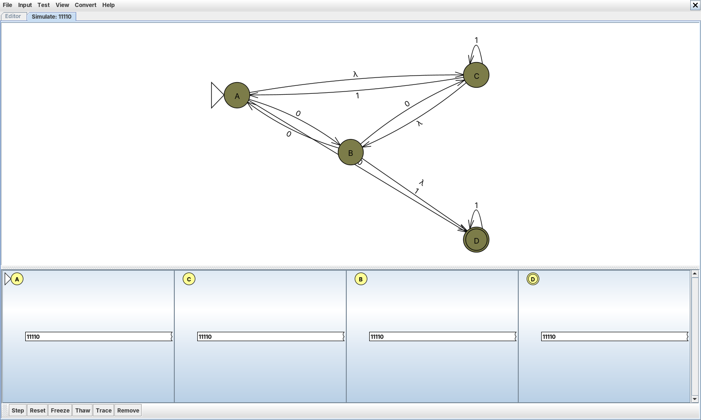

# Ejercicio 2. AFND y AFND-λ en JFLAP

## Clasificación y cobertura

Con los ejercicios de la Práctica 1 y los que se añaden aquí, las Listas 2 y 3 quedan implementadas por completo: **140 autómatas**. Cada uno se clasificó por la forma de su función de transición, no por cómo se llamaba en el enunciado:

- **AFD** si cada par (estado, símbolo) tiene a lo sumo un destino y no hay transiciones λ;
- **AFND** si algún par tiene dos o más destinos, pero no hay transiciones λ;
- **AFND-λ** si hay al menos una transición λ.

| Sección | Lista 2 | Lista 3 | Total | Carpeta                  |
|---------|:-------:|:-------:|:-----:|--------------------------|
| AFD     |   61    |   31    |  92   | `automatas/afd/`         |
| AFND    |    0    |   25    |  25   | `automatas/afnd/`        |
| AFND-λ  |    0    |   23    |  23   | `automatas/afnd-lambda/` |

Clasificación de los 140 autómatas.

Cinco ejercicios no producen autómata: 116 (y su versión AFN) describen un lenguaje que no es regular, 143 depende de figuras que no aparecen en la lista, 191 es un cálculo sobre un AFN dado y 201–235 son afirmaciones de verdadero o falso. El Anexo A justifica en una línea la sección de cada ejercicio. El patrón que se repite es claro: el no determinismo aparece cuando el enunciado obliga a *adivinar* una posición («termina en…», «el antepenúltimo símbolo es…») o a elegir entre dos condiciones; las transiciones λ, cuando el lenguaje se arma pegando piezas con unión, concatenación o estrella, como en las expresiones regulares 236–253.

## Diseño y validación

Los AFND se diseñaron aprovechando justamente esa capacidad de adivinar: para «contiene 00101 o 00110» (189) basta un lazo inicial que consume cualquier cosa y dos ramas que leen cada patrón, sin calcular el autómata de búsqueda que necesitaría un AFD. Cada autómata tiene en `docs/fichas.md` su ficha con el diseño, la tabla de transiciones y **cinco cadenas válidas y cinco inválidas** de longitudes crecientes, más los casos frontera; cuando el lenguaje o su complemento tienen menos de cinco palabras, se listan todas. El resultado esperado se obtuvo de la definición del lenguaje y el obtenido, del simulador del Ejercicio 3; además, cada autómata se comparó con la definición sobre todas las cadenas de longitud ≤ 14 (≤ 9 con tres símbolos).

El **recorrido completo** de cada cadena está en `docs/recorridos/<ejercicio>.md`. Por cada símbolo se muestran los estados activos antes y después, las transiciones usadas y si hubo bifurcación. Por ejemplo, en el AFN 192 con la palabra `1010`:

``` text
Inicio: {A}
Lee 1: {A} ⟶ {B, C}        [A→B, A→C]               (bifurcación)
Lee 0: {B, C} ⟶ {A, B, C}  [B→A, B→B, C→A, C→C]     (bifurcación)
Lee 1: {A, B, C} ⟶ {B, C}  [A→B, A→C]
Lee 0: {B, C} ⟶ {A, B, C}  [B→A, B→B, C→A, C→C]     (bifurcación)
Aceptada: queda {C} ∈ F.
```

En JFLAP se usó *Input → Step with Closure*, que muestra todas las configuraciones vivas a la vez; las capturas corresponden a cinco autómatas de distinta clase.





## Transiciones λ

En los 23 AFND-λ las transiciones λ cumplen tres papeles: **unir** dos subautómatas sin duplicar estados (de la unión r + s), **encadenar** el final de una pieza con el inicio de la siguiente (concatenación) y **regresar** o **saltar** en una cerradura (estrella). Están colocadas exactamente en esos puntos de unión; en ningún caso consumen un símbolo, sólo cambian de pieza.

La **λ-clausura** de q, λ-cl(q), es el conjunto de estados alcanzables desde q usando sólo transiciones λ, incluido q. Se calcula con un recorrido en profundidad sobre las aristas λ. Su papel en el reconocimiento es doble: la lectura no empieza en {q₀} sino en λ-cl(q₀), y después de mover el conjunto de activos con un símbolo hay que volver a cerrarlo. En el AFND-λ 197, por ejemplo, λ-cl(A) = {A, B, C, D} contiene al estado final D, de modo que λ se acepta aunque el estado inicial no sea final. El Anexo B lista la cerradura de cada estado de los 23 AFND-λ.

## Conversiones y análisis comparativo

Cada AFND se convirtió en AFD con *Convert → Convert to DFA* de JFLAP, y cada AFND-λ primero en AFND (eliminando λ) y después en AFD; los resultados están en `automatas/conversiones/` y se comprobaron con el simulador. El Anexo C da los tamaños de los 48 casos.

| Ejercicio | Clase  | Estados del AFND | Estados del AFD | AFD mínimo |  Cota 2ⁿ   |
|-----------|--------|:----------------:|:---------------:|:----------:|:----------:|
| 192       | AFND   |        3         |        5        |     5      |     8      |
| 193       | AFND   |        4         |        7        |     6      |     16     |
| 195       | AFND   |        5         |       12        |     7      |     32     |
| 189       | AFND   |        7         |       12        |     7      |    128     |
| 190       | AFND   |        26        |       32        |     19     | 67 108 864 |
| 199       | AFND-λ |        5         |        4        |     2      |     32     |
| 200       | AFND-λ |        6         |        6        |     2      |     64     |

Tamaño antes y después de la conversión.

**Número de estados.** El AFD nunca superó el 62.5 % de la cota (192: 5 de 8), y en los casos grandes queda muy lejos: en 190, 32 subconjuntos de 2²⁶ posibles. La construcción sólo genera los subconjuntos alcanzables desde λ-cl(q₀), y en un diseño típico los estados del AFND se activan en grupos correlacionados (si estoy en el tercer símbolo de un patrón, también estoy en el lazo inicial), de modo que la mayoría de los subconjuntos nunca aparecen.

**Complejidad de las transiciones.** El AFND tiene menos transiciones y cada una se lee en el enunciado («después de 0 puede empezar el patrón»); el AFD tiene exactamente una por par (estado, símbolo) y absorbe en ellas la lógica de los retrocesos.

**Facilidad de diseño e interpretación.** El AFND es más fácil de diseñar y de explicar; los estados del AFD son conjuntos y su significado hay que deducirlo.

**Eficiencia.** El AFD reconoce en tiempo O(\|ω\|) con una consulta por símbolo; simular el AFND cuesta O(\|ω\|·\|Q\|²) en el peor caso, porque en cada paso se mueve un conjunto de hasta \|Q\| estados. Convertir cuesta, en el peor caso, 2ⁿ estados: conviene cuando un mismo autómata se usará con muchas cadenas.

**Una familia en la que sí se alcanza la cota.** Sea Lₙ el lenguaje de las cadenas sobre {0, 1} cuyo n-ésimo símbolo desde el final es 1. Un AFND con n + 1 estados lo reconoce (adivina dónde está ese símbolo y cuenta n − 1 más), pero todo AFD necesita al menos 2ⁿ estados: dos prefijos distintos de longitud n difieren en alguna posición i, y añadirles i − 1 símbolos los separa, así que todos los 2ⁿ prefijos deben llevar a estados distintos (Hopcroft et al., 2007, Sección 2.3.6).
