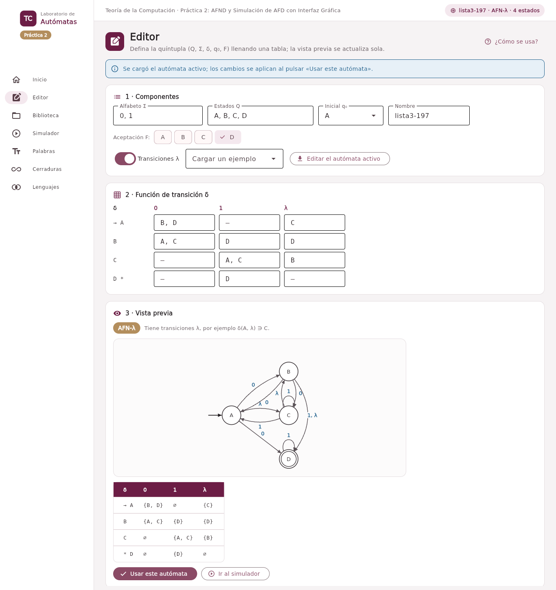
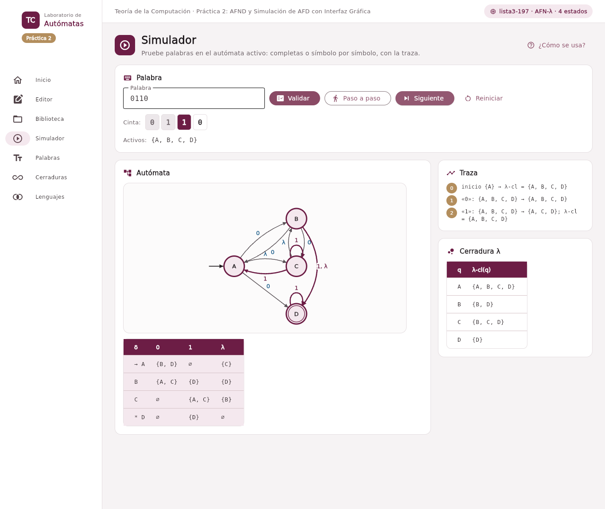
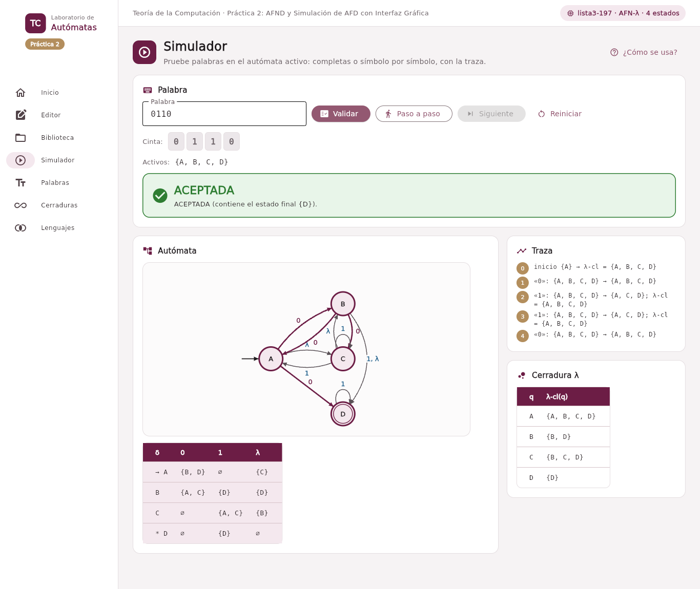
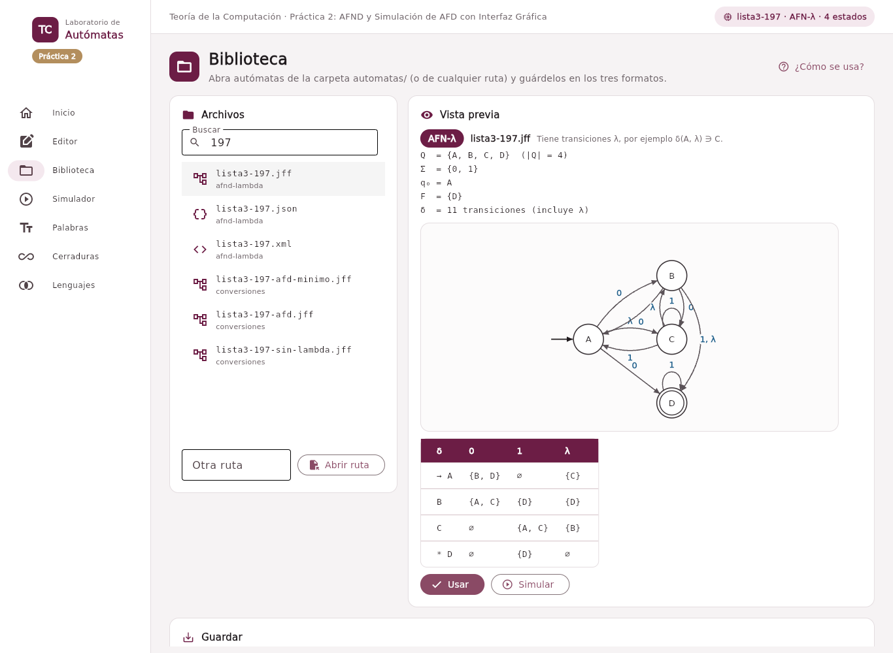

# Ejercicio 3. Simulador de autómatas con interfaz gráfica

## Organización del código

El núcleo (`src/nucleo/`) no importa Flet; la interfaz (`src/interfaz/`) sólo lo invoca.

| Módulo         | Clases                                                                                | Responsabilidad                                                                    |
|----------------|---------------------------------------------------------------------------------------|------------------------------------------------------------------------------------|
| `lenguajes.py` | `Alfabeto`, `Palabra`, `Lenguaje`, `Enumerador`                                       | Práctica 1, sin cambios.                                                           |
| `automata.py`  | `Automata` → `AFNLambda` → `AFN` → `AFD`                                              | Quíntupla, validación, cerradura λ, δ̂, tabla de transiciones.                      |
|                | `Arista`, `Paso`, `Recorrido`, `Simulacion`                                           | Una transición; un símbolo leído; el resultado completo; la ejecución interactiva. |
|                | `Clasificador`, `Disposicion`                                                         | Deducir el tipo y explicarlo; coordenadas para dibujar y para JFLAP.               |
| `formatos.py`  | `Serializador` → `SerializadorJFF`, `SerializadorJSON`, `SerializadorXML`; `Archivos` | Escribir y leer cada formato; elegir el formato por la extensión.                  |

Módulos del núcleo.

La jerarquía refleja la teoría: un AFD es un AFN en el que cada par tiene a lo sumo un destino, y un AFN es un AFN-λ sin transiciones λ. Cada subclase sólo **añade restricciones** en `_validar` (un `AFD` rechaza dos destinos para el mismo par; un `AFN`, las transiciones λ) y atajos (`AFN.cierre` devuelve el mismo conjunto, `AFD.siguiente` el único destino). El tipo no se declara: `Automata.crear` construye la quíntupla general y `Clasificador.clase_de` elige la clase más específica que la admite.

## 3.1 Definición interactiva

La sección **Editor** se divide en tres tarjetas numeradas. En *1 · Componentes* se escriben Σ y Q separados por comas, se elige q₀ en una lista y se marcan los estados de aceptación tocando sus pastillas; un interruptor agrega la columna λ. En *2 · Función de transición* aparece una rejilla con una fila por estado y una columna por símbolo; cada celda recibe los destinos separados por comas y una celda vacía significa «sin transición». La rejilla se rehace sola cuando cambian Σ o Q y conserva lo que ya estaba escrito. En *3 · Vista previa* se ven, mientras se escribe, el diagrama, la tabla completa y una etiqueta con el tipo deducido y su motivo («Hay elección: δ(q0, a) = {q0, q1}»); un error (un destino que no existe, un inicial fuera de Q) aparece en rojo en el mismo lugar. *Editar el autómata activo* vuelve a llenar las tres tarjetas para corregir una definición.



## 3.2 Importación desde archivos

La sección **Biblioteca** lista los archivos de `automatas/` con un buscador; al tocar uno se muestran su quíntupla (Q, Σ, q₀, F y número de transiciones), su diagrama y su tabla, sin cambiar el autómata activo hasta pulsar *Usar*. También acepta una ruta cualquiera.

**Esquemas.** El `.jff` es el de JFLAP 7.1. Para `.json` y `.xml` se definió un esquema propio que guarda la quíntupla completa, el tipo y las coordenadas:

``` json
{"formato": "automata-tc", "version": 1, "nombre": "anexo3", "tipo": "AFN-λ",
 "alfabeto": ["a", "b"], "estados": ["q0", "q1"], "inicial": "q0", "aceptacion": ["q1"],
 "delta": {"q0": {"a": ["q1"], "b": ["q0"], "": ["q1"]}, "q1": {}},
 "posiciones": {"q0": [100.0, 100.0], "q1": [270.0, 100.0]}}
```

``` xml
<automata formato="automata-tc" version="1" nombre="anexo3" tipo="AFN-λ">
  <alfabeto><simbolo>a</simbolo><simbolo>b</simbolo></alfabeto>
  <estados>
    <estado id="q0" inicial="si" aceptacion="no" x="100.0" y="100.0" />
    <estado id="q1" inicial="no" aceptacion="si" x="270.0" y="100.0" />
  </estados>
  <delta>
    <desde estado="q0">
      <con simbolo="a"><hacia>q1</hacia></con>
      <con simbolo="b"><hacia>q0</hacia></con>
      <con simbolo=""><hacia>q1</hacia></con>
    </desde>
  </delta>
</automata>
```

Ambos agrupan δ por estado y por símbolo, así que un par (q, a) aparece una sola vez con todos sus destinos. **Convención para λ**: en los tres formatos la transición λ se escribe con el símbolo vacío (`<read/>`, `""` y `simbolo=""`); al leer se aceptan también «λ», «ε», «lambda» y «eps». Para leer archivos de otras personas, los lectores aceptan además el esquema de ejemplo del Anexo 3 del enunciado (una lista de transiciones con `desde`, `lee` y `hacia`).

**Interpretación de la quíntupla.** Al leer se verifica que Q no sea vacío ni tenga repetidos, que Σ no contenga λ, que el inicial y los finales estén en Q y que cada transición use estados de Q y símbolos de Σ. Un archivo que se declara `AFD` pero no es determinista se rechaza indicando los pares que fallan. El `.jff` no guarda Σ: se infiere de los símbolos de las transiciones.

## 3.3 Simulación y validación

En **Simulador** se escribe la palabra (vacía o «λ» para la palabra vacía). *Validar* la procesa completa; *Paso a paso* prepara una cinta con un recuadro por símbolo y *Siguiente* lee uno a la vez: el símbolo actual se resalta en la cinta, los estados activos en el diagrama y en la tabla, y las transiciones que se acaban de usar se dibujan en guinda. La traza numerada muestra, por paso, el conjunto de activos antes, el conjunto al que se llega y, si cambió, su cierre λ. Al terminar aparece un recuadro verde (ACEPTADA) o rojo (RECHAZADA) con el motivo: qué estado final quedó activo, o que no quedó ninguno.

**Decisión de diseño: seguir todos los caminos.** Para los no deterministas se eligió simular el conjunto de estados activos en lugar de convertir a AFD. En cada paso se calcula S ← λ-cl(⋃\_{q∈S} δ(q, a)).

| Alternativa          | Costo de preparación                               | Costo por palabra | Ventaja                                                                 |
|----------------------|----------------------------------------------------|-------------------|-------------------------------------------------------------------------|
| Conjuntos de activos | Cerraduras: O(\|Q\|²) una vez                      | O(\|ω\|·\|Q\|²)   | Muestra las bifurcaciones y la cerradura tal como las define la teoría. |
| Convertir a AFD      | Hasta 2^\|Q\| estados y \|Σ\|·2^\|Q\| transiciones | O(\|ω\|)          | Conviene si el mismo autómata procesará muchísimas palabras.            |

Costo de las dos formas de simular un AFN.

Se eligió la primera porque el objetivo del simulador es mostrar el comportamiento del autómata que se diseñó, no el de otro equivalente, y porque nunca paga el costo exponencial; la conversión queda para la Práctica 3.





## 3.4 Exportación y operaciones sobre lenguajes

La tarjeta *Guardar* de **Biblioteca** escribe el autómata activo en `.jff`, `.json`, `.xml` o en los tres a la vez, en la carpeta `salidas/`. Las operaciones de la Práctica 1 (subcadenas, prefijos, sufijos, Σ\* y Σ⁺) siguen en las secciones **Palabras**, **Cerraduras** y **Lenguajes** de la misma ventana.



## 3.5 Pruebas

| Requisito                                                         | Prueba                                                                                                                         |
|-------------------------------------------------------------------|--------------------------------------------------------------------------------------------------------------------------------|
| Exportar e importar en los tres formatos son operaciones inversas | `test_ida_y_vuelta` (4 autómatas × 3 formatos): leer lo escrito da la misma quíntupla y volver a escribirlo da el mismo texto. |
| Aceptación y rechazo en un AFD                                    | `test_afd_acepta`, `test_afd_rechaza`, `test_afd_parcial_y_completado`.                                                        |
| AFND-λ que requiere la cerradura                                  | `test_afn_lambda_requiere_la_cerradura`: en un AFN-λ para a\*b\*, «b» sólo se acepta porque q1 ∈ λ-cl(q0).                     |

Requisitos mínimos de la suite.

Las 404 pruebas se aprueban en los tres contenedores (`docker compose run --rm py31x pytest -q`) y en GitHub Actions.
