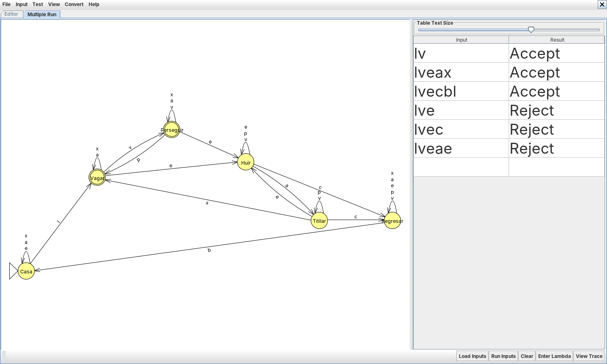

# Ejercicio 5. Del artículo al autómata

## La aplicación elegida

Se eligió el comportamiento de los fantasmas de Pac-Man de Gribkoff (2013, Sección 4, fig. 3). El documento lo describe como un AFD de cuatro estados —*Wander the Maze*, *Chase Pac-Man*, *Flee Pac-Man* y *Return to Base*— cuyas transiciones dependen de lo que pasa en el juego: ver o perder a Pac-Man, que Pac-Man coma una píldora de poder, que el poder expire, que el fantasma sea comido y que sus ojos lleguen a la base. Bourg & Seemann (2004, 9) usa el mismo ejemplo para introducir las máquinas de estados finitos en videojuegos. El enunciado pide ampliarlo con al menos dos estados y dos eventos.

**Ampliación.** El modelo original omite dos fases que cualquier jugador observa: el fantasma *empieza dentro de la casa central* y sale cuando un temporizador lo libera, y cuando el poder está por terminar el fantasma asustado *parpadea* como advertencia antes de volver a ser peligroso. Se agregan los estados **Casa** y **Titilar** y los eventos **l** (liberación) y **a** (aviso). Con ello cambian dos transiciones del original: los ojos ya no vuelven directamente a vagar, sino a la casa, de donde salen al ser liberados; y el miedo ya no termina de golpe, sino pasando por Titilar.

## Definición formal

M = (Q, Σ, δ, Casa, F) con:

| Estado             | Qué representa                                                              |
|--------------------|-----------------------------------------------------------------------------|
| **Casa** (inicial) | Espera dentro de la casa central; no persigue ni puede ser comido. *Nuevo.* |
| **Vagar**          | Recorre el laberinto sin haber visto a Pac-Man (*Wander the Maze*).         |
| **Perseguir**      | Ve a Pac-Man y lo sigue (*Chase Pac-Man*).                                  |
| **Huir**           | Está asustado: Pac-Man comió una píldora de poder (*Flee Pac-Man*).         |
| **Titilar**        | Sigue asustado, pero el poder está por terminar; parpadea. *Nuevo.*         |
| **Regresar**       | Pac-Man se lo comió; sólo los ojos vuelven a la casa (*Return to Base*).    |

Estados del modelo.

**Alfabeto.** Antes de dibujar hay que decidir qué es un símbolo. Aquí cada símbolo es un **evento del juego** que el fantasma percibe, no una tecla ni un instante de tiempo; una cadena es la bitácora de eventos de una partida, en orden.

| Símbolo | Evento                                                  |
|:-------:|---------------------------------------------------------|
|    l    | El temporizador libera al fantasma de la casa. *Nuevo.* |
|    v    | El fantasma ve a Pac-Man.                               |
|    p    | El fantasma pierde de vista a Pac-Man.                  |
|    e    | Pac-Man come una píldora de poder.                      |
|    a    | Aviso: al poder le quedan pocos segundos. *Nuevo.*      |
|    x    | El poder expira.                                        |
|    c    | Pac-Man se come al fantasma.                            |
|    b    | Los ojos llegan a la casa.                              |

Alfabeto Σ = {l, v, p, e, a, x, c, b}.

**Función de transición.** Un evento que no altera el comportamiento en un estado deja al fantasma donde está (por ejemplo, ver a Pac-Man mientras huye). Un evento que **no puede ocurrir** en un estado no tiene transición: no se puede perder de vista a quien no se ha visto (p en Vagar), comer a un fantasma que no está asustado (c en Vagar o Perseguir) ni que el poder expire sin el aviso previo (x en Huir).

| δ            | l     | v         | p        | e        | a         | x         | c        | b    |
|--------------|-------|-----------|----------|----------|-----------|-----------|----------|------|
| → Casa       | Vagar | —         | —        | Casa     | Casa      | Casa      | —        | —    |
| \* Vagar     | —     | Perseguir | —        | Huir     | Vagar     | Vagar     | —        | —    |
| \* Perseguir | —     | Perseguir | Vagar    | Huir     | Perseguir | Perseguir | —        | —    |
| Huir         | —     | Huir      | Huir     | Huir     | Titilar   | —         | Regresar | —    |
| Titilar      | —     | Titilar   | Titilar  | Huir     | —         | Vagar     | Regresar | —    |
| Regresar     | —     | Regresar  | Regresar | Regresar | Regresar  | Regresar  | —        | Casa |

Función de transición (— = el evento no puede ocurrir en ese estado).

**Aceptación.** F = {Vagar, Perseguir}: se aceptan las bitácoras que dejan al fantasma **peligroso para Pac-Man**. Es un AFD con δ parcial; una bitácora imposible deja vacío el conjunto de estados activos y se rechaza.

El modelo está en `automatas/aplicacion/fantasma-pacman.jff` (y `.json`, `.xml`); se cargó en la Biblioteca y se validó en el Simulador.

## Cadenas de prueba

| Bitácora  | Significado                                    | Esperado            | Obtenido | Estado final |
|-----------|------------------------------------------------|---------------------|----------|--------------|
| λ         | Nada ha ocurrido: el fantasma sigue en la casa | rechaza             | rechaza  | Casa         |
| `l`       | Sale de la casa                                | acepta              | acepta   | Vagar        |
| `lv`      | Ve a Pac-Man                                   | acepta              | acepta   | Perseguir    |
| `lvp`     | Lo pierde                                      | acepta              | acepta   | Vagar        |
| `lve`     | Pac-Man come una píldora                       | rechaza             | rechaza  | Huir         |
| `lveax`   | Aviso y fin del poder                          | acepta              | acepta   | Vagar        |
| `lvec`    | Pac-Man se lo come                             | rechaza             | rechaza  | Regresar     |
| `lvecb`   | Los ojos llegan a la casa                      | rechaza             | rechaza  | Casa         |
| `lvecbl`  | Se regenera y sale de nuevo                    | acepta              | acepta   | Vagar        |
| `lveae`   | Otra píldora mientras titila                   | rechaza             | rechaza  | Huir         |
| `lveaeax` | La segunda píldora también expira              | acepta              | acepta   | Vagar        |
| `lp`      | Perder a quien no ha visto                     | rechaza (imposible) | rechaza  | ∅            |
| `lc`      | Comer a un fantasma no asustado                | rechaza (imposible) | rechaza  | ∅            |
| `lvex`    | El poder expira sin aviso                      | rechaza (imposible) | rechaza  | ∅            |
| `v`       | Ver a Pac-Man desde la casa                    | rechaza (imposible) | rechaza  | ∅            |

Quince cadenas de prueba (`automatas/aplicacion/pruebas.txt`, verificadas en `tests/test_aplicacion.py`).

## La abstracción

El modelo captura con exactitud **el orden en que pueden ocurrir los cambios de comportamiento** del fantasma y, con ello, una propiedad útil para el diseño del juego: después de cualquier bitácora, sabemos si el fantasma puede dañar a Pac-Man, y sabemos qué secuencias de eventos son incoherentes (un fantasma comido sin haber estado asustado delataría un error en el motor del juego). También muestra por qué el original necesitaba ampliarse: con cuatro estados, un fantasma recién comido volvía a vagar sin pasar por la casa, algo que no ocurre en el juego.

Deja fuera casi todo lo que hace interesante al juego. No hay **posiciones** ni laberinto: «ver a Pac-Man» es un evento atómico, cuando en el juego depende de la geometría. No hay **tiempo**: el aviso y la expiración son eventos, no cuentas regresivas, y el modelo no puede expresar «el poder dura seis segundos» sin un estado por cada tic. No distingue entre los **cuatro fantasmas**, que en el juego tienen estrategias de persecución distintas, ni modela la **dispersión** periódica en la que los fantasmas se retiran a las esquinas. Tampoco hay **salidas**: un AFD sólo acepta o rechaza, de modo que la acción del fantasma (hacia dónde moverse) tendría que modelarse con una máquina de Mealy o de Moore. Esos límites no son defectos del diseño sino del modelo: un autómata finito tiene memoria acotada y sin salida, y cualquier cosa que dependa de cantidades no acotadas o de producir respuestas exige otro modelo.
