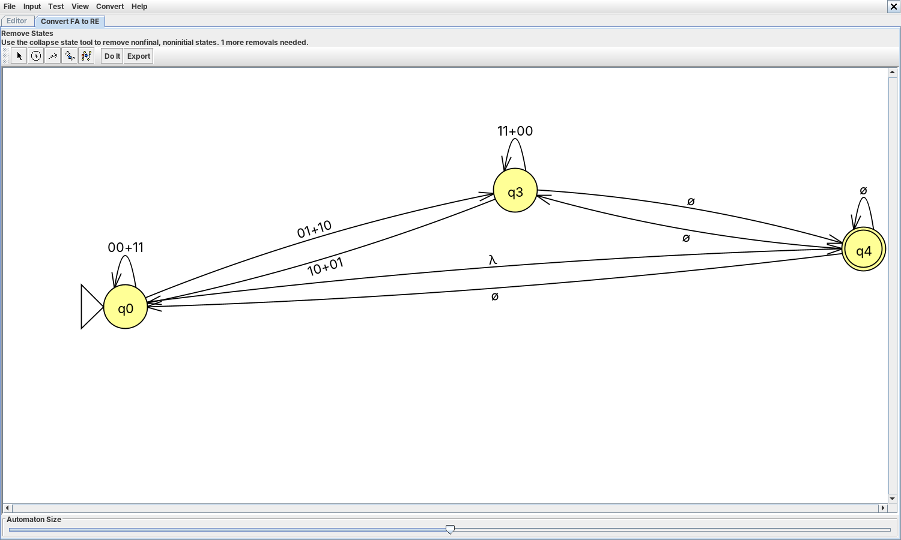
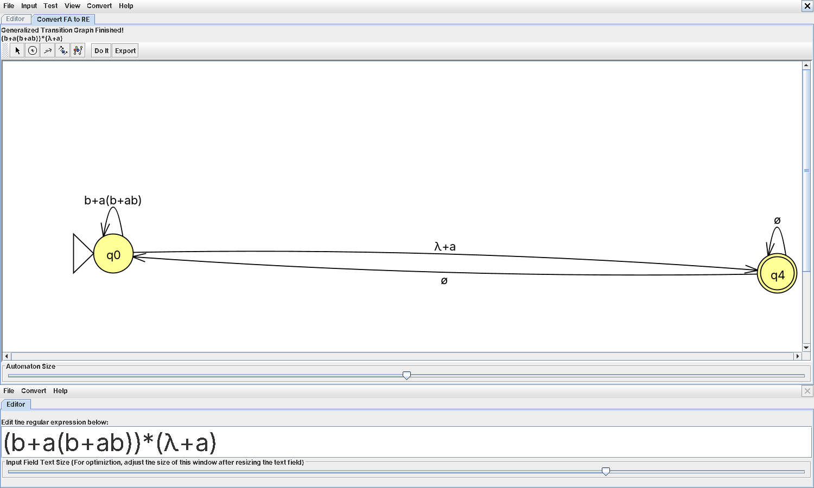
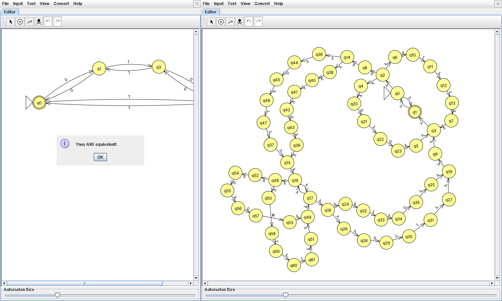

# Ejercicio 1. Conversión de AFD a expresiones regulares

## 1.1 Conversión con JFLAP

### Los cinco autómatas

Se eligieron cinco AFD de la Lista 2 con estructuras distintas: dos con estado sumidero (119 y 142a), uno con alfabeto de tres símbolos (122), un contador módulo 3 (138) y un producto de dos contadores módulo 2 (140b). Sus estados se renombraron q0, q1, … en orden de recorrido para que coincidan con los nombres que JFLAP asigna; los archivos están en `automatas/practica3/afd-a-er/`.

| AFD  | Lenguaje                                                 | Ciclos y ramas que anticipan la expresión                                                                                                                                                   |
|------|----------------------------------------------------------|---------------------------------------------------------------------------------------------------------------------------------------------------------------------------------------------|
| 119  | Sobre {a, b}: después de cada `aa` aparece una `b`       | Todo regresa a q0 con `b`; desde q0 se sale con `a` (q1) o `aa` (q2) y se vuelve con `b`. El sumidero q3 no aporta términos. Se anticipa (b + ab + aab)\* seguida de un final opcional `a`. |
| 122  | Sobre {0, 1, 2}: todo bloque de tres símbolos tiene un 0 | Igual estructura con 0 como «regreso» y 1, 2 como avance; dos finales extra (q1, q2) dan la cola opcional.                                                                                  |
| 138  | Sobre {a, b}: el número de `b` es múltiplo de 3          | Un ciclo de tres `b` con lazos `a` en cada estado: (a + ba\*ba\*b)\*.                                                                                                                       |
| 140b | Sobre {0, 1}: número par de 0 y par de 1                 | Cuatro estados en un ciclo de paridades; los pares `00`, `11` regresan y `01`, `10` cruzan.                                                                                                 |
| 142a | (ab)\*                                                   | Un solo ciclo q0 → q1 → q0 con `ab`; q2 es sumidero.                                                                                                                                        |

Análisis previo.

### Estados eliminados

JFLAP (*Convert → Convert FA to RE*) agrega un estado final único con transiciones λ, une las transiciones paralelas y pide eliminar los estados uno por uno; al quitar k, cada par de aristas p → k → q se reemplaza por $R_{pq} + R_{pk} R_{kk}^* R_{kq}$ (Rodger & Finley, 2006, 3). Conviene eliminar primero el sumidero (no tiene camino al final, así que desaparece sin dejar términos) y después los estados con menos aristas entrantes y salientes. JFLAP no deja eliminar el estado inicial ni el final que agrega: al terminar quedan q0 y el final nuevo T (JFLAP lo nombra q4), y la expresión se lee como $(R_{00})^* R_{0T}$. La tabla documenta cada eliminación tal como la hizo JFLAP; la última columna es la expresión que JFLAP muestra al terminar, con espacios alrededor de + para que se pueda leer.

| AFD  | Orden      | Lo que queda después de cada eliminación                                                                                                        | Expresión de JFLAP                                    |
|------|------------|-------------------------------------------------------------------------------------------------------------------------------------------------|-------------------------------------------------------|
| 119  | q3, q2, q1 | q3: nada (es sumidero). q2: R(q1,q0) = b + ab. q1: R(q0,q0) = b + a(b + ab), R(q0,T) = λ + a.                                                   | (b + a(b + ab))\*(λ + a)                              |
| 122  | q3, q2, q1 | q3: nada. q2: R(q1,q0) = 0 + (1 + 2)0, R(q1,T) = λ + 1 + 2. q1: R(q0,q0) = 0 + (1 + 2)(0 + (1 + 2)0), R(q0,T) = λ + (1 + 2)(λ + 1 + 2).         | (0 + (1 + 2)(0 + (1 + 2)0))\*(λ + (1 + 2)(λ + 1 + 2)) |
| 138  | q1, q2     | q1: R(q0,q2) = ba\*b. q2: R(q0,q0) = a + ba\*ba\*b, R(q0,T) = λ.                                                                                | (a + ba\*ba\*b)\*                                     |
| 140b | q1, q2, q3 | q1, q2: R(q0,q0) = 00 + 11, R(q0,q3) = 01 + 10, R(q3,q0) = 10 + 01, R(q3,q3) = 11 + 00. q3: R(q0,q0) = 00 + 11 + (01 + 10)(11 + 00)\*(10 + 01). | (00 + 11 + (01 + 10)(11 + 00)\*(10 + 01))\*           |
| 142a | q2, q1     | q2: nada. q1: R(q0,q0) = ab, R(q0,T) = λ.                                                                                                       | (ab)\*                                                |

Eliminación de estados en JFLAP.

El orden importa: en JFLAP, eliminar 140b en el orden q3, q2, q1 da (1(00)\*1 + (0 + 1(00)\*01)(11 + 10(00)\*01)\*(0 + 10(00)\*1))\*, y en el software del Ejercicio 2, que sí puede quitar q0 porque agrega también un inicial I, eliminar en el orden de Q (q0 primero) produce para 140b una expresión de 234 caracteres y para 122 una de 145, aunque todas describen los mismos lenguajes.

### Verificación

Cada expresión se volvió a convertir en autómata con *Convert to NFA* y se comparó con el AFD original con *Test → Compare Equivalence*; en las cinco JFLAP responde que son equivalentes. El software del Ejercicio 2 confirma lo mismo con la prueba de equivalencia por AFD mínimos. Además se probaron cinco cadenas en ambos formalismos:

| AFD  | Cadenas (✓ aceptada, ✗ rechazada; mismo resultado en el AFD y en la expresión) |
|------|--------------------------------------------------------------------------------|
| 119  | λ ✓, `a` ✓, `ababa` ✓, `aa` ✗, `abbaa` ✗                                       |
| 122  | λ ✓, `100` ✓, `22010` ✓, `112` ✗, `0122` ✗                                     |
| 138  | λ ✓, `aaa` ✓, `aabbb` ✓, `ba` ✗, `abba` ✗                                      |
| 140b | λ ✓, `0000` ✓, `01100110` ✓, `10` ✗, `0100` ✗                                  |
| 142a | λ ✓, `abab` ✓, `abababababab` ✓, `aa` ✗, `abba` ✗                              |

Cadenas de prueba.

### Simplificación

Las leyes algebraicas que se usan son las de Hopcroft et al. (2007, Sección 3.4): conmutatividad y asociatividad de +, idempotencia (R + R = R), distributividad (R(S + T) = RS + RT), ∅ como neutro de + y absorbente de la concatenación, λ como neutro de la concatenación, (R\*)\* = R\*, λ + RR\* = R\* y la ley de desplazamiento R(SR)\* = (RS)\*R.

- **119.** b + a(b + ab) = b + ab + aab por distributividad, así que la expresión es (b + ab + aab)\*(λ + a): bloques que terminan en `b` con a lo sumo dos `a` antes, y al final, opcionalmente, una `a` suelta. Es la que se anticipó en el análisis.
- **122.** Igual que 119, con 0 en el papel de `b` y (1 + 2) en el de `a`: (0 + (1 + 2)0 + (1 + 2)(1 + 2)0)\*(λ + (1 + 2) + (1 + 2)(1 + 2)).
- **138** y **142a** ya están en su forma más simple; en 142a, la expresión que resulta de eliminar en el orden de Q es λ + a(ba)\*b, y por desplazamiento a(ba)\*b = (ab)\*ab, de modo que λ + (ab)\*ab = λ + (ab)⁺ = (ab)\*.
- **140b.** Por conmutatividad, 11 + 00 = 00 + 11 y 10 + 01 = 01 + 10; queda la forma clásica (00 + 11 + (01 + 10)(00 + 11)\*(01 + 10))\*.

## 1.2 Comparación de métodos

Para 142a y 138 la expresión se obtuvo a mano por tres métodos.

### AFD 142a: (ab)\*

**Eliminación de estados.** Ya documentada: tres pasos, uno por estado, con resultado (ab)\*.

**Expresiones $R_{ij}^{(k)}$** (Hopcroft et al., 2007, Sección 3.2.1). Con q0 = 1, q1 = 2, q2 = 3, $R_{ij}^{(k)}$ describe los caminos de i a j que sólo pasan por estados intermedios ≤ k, y $R_{ij}^{(k)} = R_{ij}^{(k-1)} + R_{ik}^{(k-1)}\big(R_{kk}^{(k-1)}\big)^* R_{kj}^{(k-1)}$.

|       | R11          | R12     | R13                 | R21     | R22    | R23            | R31 | R32 | R33       |
|-------|--------------|---------|---------------------|---------|--------|----------------|-----|-----|-----------|
| k = 0 | λ            | a       | b                   | b       | λ      | a              | ∅   | ∅   | λ + a + b |
| k = 1 | λ            | a       | b                   | b       | λ + ba | a + bb         | ∅   | ∅   | λ + a + b |
| k = 2 | λ + a(ba)\*b | a(ba)\* | b + a(ba)\*(a + bb) | (ba)\*b | (ba)\* | (ba)\*(a + bb) | ∅   | ∅   | λ + a + b |

$R_{ij}^{(k)}$ para 142a, simplificadas en cada paso.

Como F = {q0}, la expresión es $R_{11}^{(3)} = R_{11}^{(2)} + R_{13}^{(2)}\big(R_{33}^{(2)}\big)^* R_{31}^{(2)}$ = λ + a(ba)\*b, porque $R_{31}^{(2)}$ = ∅ anula el segundo término. Por desplazamiento, λ + a(ba)\*b = (ab)\*.

**Lema de Arden** (Arden, 1961; Schreiner, 2013). Con una ecuación por estado, $X_i = \sum_{a} a\, X_{\delta(i,a)}$ (más λ si i ∈ F):

X0 = aX1 + bX2 + λ, X1 = bX0 + aX2, X2 = (a + b)X2.

La última tiene la forma X = AX + B con B = ∅, así que X2 = (a + b)\*∅ = ∅. Queda X1 = bX0, y al sustituir, X0 = abX0 + λ; por Arden, X0 = (ab)\*λ = (ab)\*.

### AFD 138: número de b múltiplo de 3

**Eliminación de estados** (q1, q2, q0): (a + ba\*ba\*b)\*.

**$R_{ij}^{(k)}$.** Con q0 = 1, q1 = 2, q2 = 3: $R_{11}^{(0)}$ = $R_{22}^{(0)}$ = $R_{33}^{(0)}$ = λ + a, $R_{12}^{(0)}$ = $R_{23}^{(0)}$ = $R_{31}^{(0)}$ = b y las demás ∅. Simplificando con (λ + a)\* = a\*:

- k = 1: R11 = a\*, R12 = a\*b, R31 = ba\*, R32 = ba\*b, R33 = λ + a.
- k = 2: R13 = a\*b·a\*·b = a\*ba\*b, R33 = λ + a + ba\*ba\*b, R11 = a\*, R31 = ba\*.
- k = 3: $R_{11}^{(3)}$ = a\* + a\*ba\*b(a + ba\*ba\*b)\*ba\*.

La equivalencia con (a + ba\*ba\*b)\* se sigue de (R + S)\* = R\*(SR\*)\* con R = a y S = ba\*ba\*b: ambas describen palabras formadas por bloques de `a` y grupos de exactamente tres `b`. La prueba de equivalencia del software lo confirma.

**Lema de Arden.** X0 = aX0 + bX1 + λ, X1 = aX1 + bX2, X2 = aX2 + bX0. Por Arden, X2 = a\*bX0; sustituyendo, X1 = aX1 + ba\*bX0 ⇒ X1 = a\*ba\*bX0; y X0 = aX0 + ba\*ba\*bX0 + λ = (a + ba\*ba\*b)X0 + λ ⇒ X0 = (a + ba\*ba\*b)\*.

### Comparación

| Método                 | Longitud (142a / 138)   | Pasos                        | Facilidad                                               | Base                                                          |
|------------------------|-------------------------|------------------------------|---------------------------------------------------------|---------------------------------------------------------------|
| Eliminación de estados | 5 / 14 caracteres       | uno por estado               | La más visual; el orden decide el tamaño.               | Hopcroft et al. (2007, Sección 3.2.2); Rodger & Finley (2006) |
| $R_{ij}^{(k)}$         | 11 / 28 sin simplificar | n³ expresiones (27 en ambos) | Mecánica pero larga; obliga a simplificar en cada paso. | Hopcroft et al. (2007, Sección 3.2.1)                         |
| Lema de Arden          | 5 / 14                  | una sustitución por estado   | Algebraica y corta si se despeja en buen orden.         | Schreiner (2013, Sección 2.4, teorema 4); Arden (1961)        |

Comparación de los tres métodos.

Los tres dan expresiones equivalentes, como garantiza el teorema de Kleene, pero de forma distinta. $R_{ij}^{(k)}$ es el método que se usa para *demostrar* el teorema, porque es uniforme, pero a mano es el más largo; la eliminación de estados y Arden son el mismo cálculo visto como grafo o como sistema de ecuaciones, y ambos dan la expresión más corta cuando se eliminan primero el sumidero y los estados con menos conexiones.
