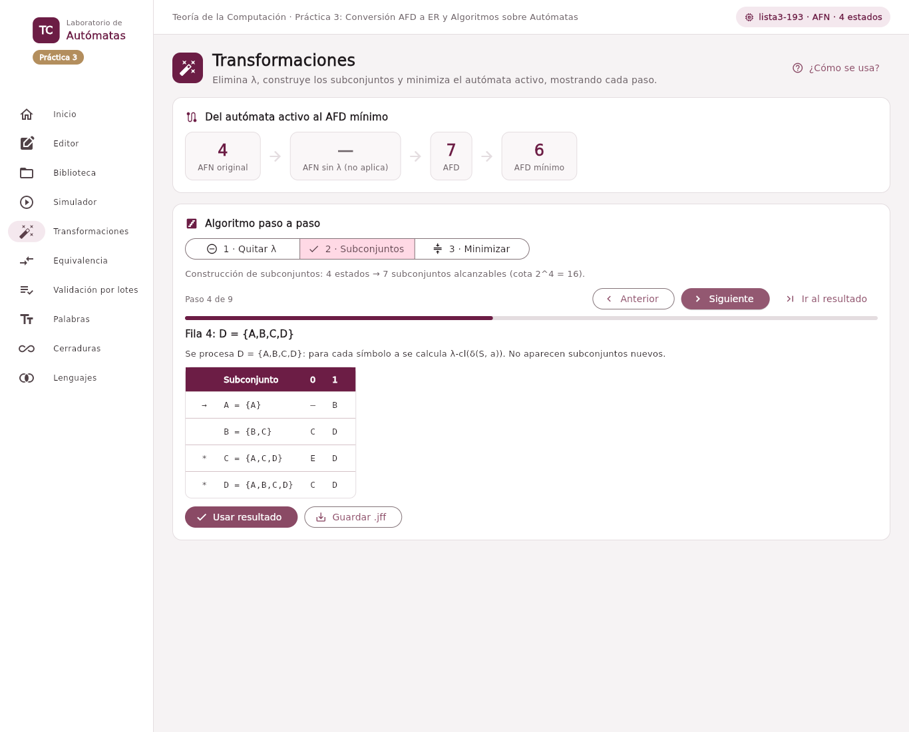
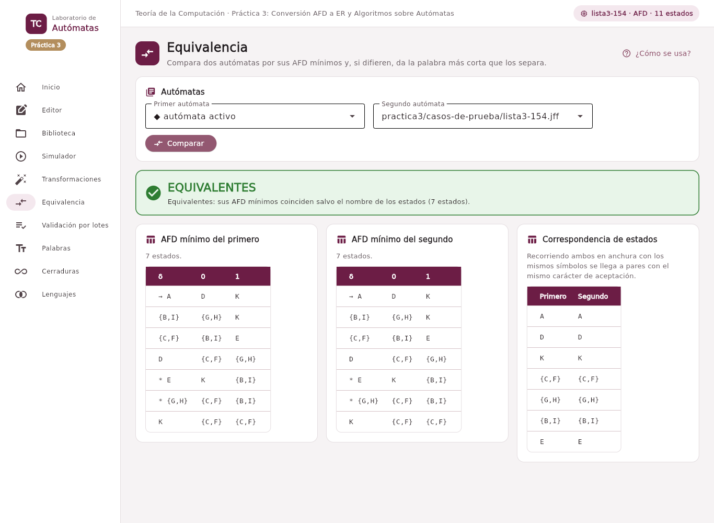

# Ejercicio 2. Extensión del software interactivo

El núcleo gana el módulo `src/nucleo/algoritmos.py`, en Python puro y sin dependencias de Flet, y la interfaz tres secciones: **Transformaciones**, **Equivalencia** y **Validación por lotes**. Todos los algoritmos comparten una misma forma: una clase que recibe el autómata y un método `resolver()` que devuelve un `Resultado` con la entrada, la salida, un resumen y la lista de `Etapa` (título, explicación, tabla y, si corresponde, el autómata parcial). La interfaz no sabe nada de cada algoritmo; sólo recorre etapas con un visor común de «Anterior / Siguiente» y una barra de avance. Así cada algoritmo se ejecuta y se prueba sin abrir la interfaz.

| Clase          | Entrada → salida          | Etapas que muestra                                                                                        |
|----------------|---------------------------|-----------------------------------------------------------------------------------------------------------|
| `QuitarLambda` | AFN-λ → AFN               | Cerraduras; Δ’(q, a) con los destinos añadidos; estados que pasan a F; AFN resultante.                    |
| `Subconjuntos` | AFN → AFD                 | Una fila por subconjunto procesado, con los nuevos que aparecen; subconjuntos de aceptación; AFD.         |
| `Minimizacion` | AFD → AFD mínimo          | Inaccesibles; complemento con sumidero si δ es parcial; tabla de pares en cada ronda; clases; AFD mínimo. |
| `HaciaMinimo`  | cualquiera → AFD mínimo   | Encadena sólo los pasos necesarios.                                                                       |
| `Equivalencia` | dos autómatas → veredicto | Los dos mínimos, la correspondencia de estados o el contraejemplo más corto.                              |
| `Lote`         | autómata + texto → filas  | Una fila por palabra; informe exportable.                                                                 |

Algoritmos de la Práctica 3.

Todos trabajan con autómatas importados de `.jff`: la Biblioteca los abre y los deja como autómata activo, y las demás secciones parten de él.

## 2.1 Cerradura λ y simulación directa

`Automata.cierre(S)` calcula λ-cl(S) y `cierres()` la de cada estado. El **Simulador** de la Práctica 2 ya simulaba los AFN-λ sin convertirlos; en esta práctica se agregó a su lado una tarjeta con la cerradura de cada estado y la traza separa, en cada paso, el conjunto que se alcanza al leer el símbolo y el que queda después de cerrarlo. Los ejercicios 196 a 200 de la Lista 3 se usan como casos de prueba.

## 2.2 Eliminación de transiciones λ

`QuitarLambda` aplica Δ’(q, a) = λ-cl(δ(λ-cl(q), a)) y F’ = {q : λ-cl(q) ∩ F ≠ ∅}. La segunda etapa muestra la tabla de Δ’ y, entre paréntesis, los destinos que no estaban en δ(q, a); la tercera, los estados que se vuelven de aceptación y por qué (qué estado final contiene su cerradura).

## 2.3 Construcción de subconjuntos

`Subconjuntos` parte de λ-cl({q₀}) y procesa una cola: por cada subconjunto y cada símbolo calcula λ-cl(δ(S, a)) y lo agrega si es nuevo. Sólo existen, por tanto, los subconjuntos **alcanzables**. Cada subconjunto recibe una letra (A, B, …) y la tabla muestra ambos («B = {q0, q2}»), de modo que el AFD resultante tiene nombres cortos sin perder la información. Una etapa por fila deja ver la tabla **conforme se genera**, y la penúltima explica qué subconjuntos son de aceptación: los que contienen algún estado de F. Por omisión no se agrega el subconjunto ∅ (como JFLAP); el parámetro `incluir_vacio` lo agrega. Casos de prueba: Lista 3, ejercicios 192 a 194 y 260 a 263 (el 191 no tiene autómata propio en la lista).

## 2.4 Minimización y equivalencia

`Minimizacion` usa la **tabla de pares distinguibles**. Primero elimina los inaccesibles con un recorrido en anchura; si δ es parcial agrega un sumidero para que todo par tenga sucesor. En la ronda 0 marca los pares {p, q} con exactamente un estado final; en la ronda k marca {p, q} si para algún símbolo los sucesores forman un par marcado antes. Cada ronda se muestra como la tabla triangular, con `×k` en los pares marcados en la ronda k y `·` en los que siguen sin marcar, y la explicación dice qué par se marcó y con qué símbolo. Al estabilizarse, los pares sin marcar forman las clases de equivalencia. Si se agregó el sumidero, su clase se retira al final para que el resultado nunca tenga más estados que la entrada. Casos de prueba: Lista 3, ejercicios 151 a 157.

La sección **Equivalencia** lleva los dos autómatas a AFD mínimos completos sobre la unión de sus alfabetos y busca un isomorfismo recorriéndolos en paralelo desde los iniciales; son equivalentes si los mínimos coinciden salvo el nombre de los estados, y en ese caso se muestra la correspondencia. Si no, una búsqueda en anchura sobre el producto da la **palabra más corta** que acepta uno y rechaza el otro.

## 2.5 Validación de varias cadenas

En **Validación por lotes** se escribe o se carga un archivo de texto con una palabra por línea (las líneas vacías y las que empiezan con `#` se ignoran; `λ` es la palabra vacía). *Validar todo* muestra una tabla con el resultado de cada palabra y contadores de aceptadas, rechazadas y con error (por ejemplo, un símbolo fuera de Σ); *Guardar informe* escribe `salidas/informe-<autómata>.txt`. El archivo de ejemplo es `automatas/practica3/cadenas-ejemplo.txt`.

## 2.6 Pruebas automatizadas

`tests/test_algoritmos.py` (69 pruebas) comprueba, para cada uno de los 20 casos de prueba de `automatas/practica3/casos-de-prueba/`, que **el autómata original, el AFN sin λ, el AFD de subconjuntos y el AFD mínimo aceptan exactamente las mismas palabras**, y que el mínimo no tiene más estados que el AFD del que procede.

**Longitud de la comparación.** La comparación recorre *todas* las palabras de longitud ≤ L con L = n₁ + n₂ − 2, donde n₁ y n₂ son los estados del AFD de subconjuntos y del AFD mínimo una vez completados. La elección se justifica con el teorema de Moore: si dos AFD completos de n₁ y n₂ estados aceptan distinto alguna palabra, la más corta de ellas mide a lo sumo n₁ + n₂ − 2, porque el autómata producto distingue sus estados en a lo sumo ese número de rondas de refinamiento (Hopcroft et al., 2007, Sección 4.4; Moore, 1956). Con ese L la prueba exhaustiva no es un muestreo sino una demostración. Se usa además L ≥ 8 para que los casos pequeños no queden triviales; el mayor L es 17 (ejercicio 195). Para que el costo no crezca con L, las palabras se recorren como un árbol, actualizando los estados activos símbolo a símbolo.

Otras pruebas comprueban los resultados conocidos de la Lista 3 (por ejemplo, que 154 se reduce a 7 estados y que tiene inaccesibles), que minimizar el mínimo no lo reduce, el número de rondas, que Δ’ coincide con su definición en cada estado de 196 a 200, que sólo se generan subconjuntos alcanzables, el contraejemplo más corto y el informe del lote. La suite completa (176 aprobadas, 1 omitida que corresponde a la Práctica 4) se aprueba con Python 3.11, 3.12 y 3.13 en los contenedores y en GitHub Actions.

