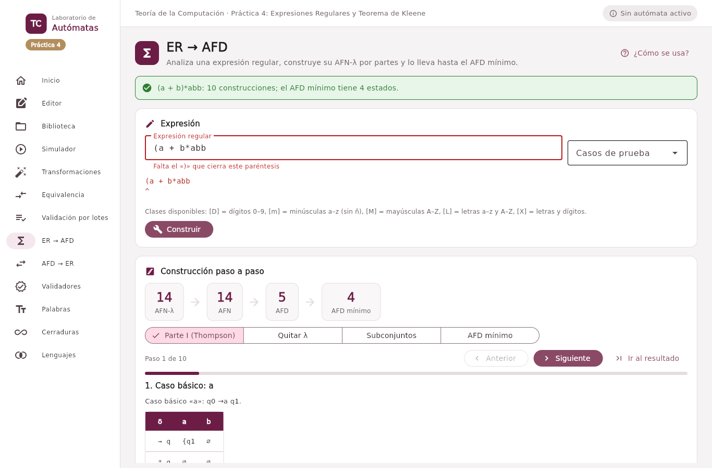

# Ejercicio 2. De expresión regular a autómata

## Notación aceptada

El analizador (`src/nucleo/expresiones.py`) acepta la notación del curso:

| Escritura                     | Significado                                                                                                                                  |
|-------------------------------|----------------------------------------------------------------------------------------------------------------------------------------------|
| `a`, `0`, `@`, …              | Cualquier carácter que no sea operador es un símbolo.                                                                                        |
| `\x`                          | El carácter x literal aunque sea operador (por ejemplo `\+`, `\(`).                                                                          |
| `λ` o `ε`                     | Palabra vacía.                                                                                                                               |
| `∅` o `Ø`                     | Lenguaje vacío.                                                                                                                              |
| `r + s`                       | Unión (precedencia más baja).                                                                                                                |
| `rs`                          | Concatenación por yuxtaposición.                                                                                                             |
| `r*`                          | Cerradura de Kleene (precedencia más alta).                                                                                                  |
| `( r )`                       | Agrupación.                                                                                                                                  |
| `[D]` `[m]` `[M]` `[L]` `[X]` | Clases declaradas: dígitos 0–9, minúsculas a–z, mayúsculas A–Z, letras y letras con dígitos. Se pueden registrar más con `Clases.registrar`. |

Notación del analizador. Los espacios se ignoran.

Una clase es una abreviatura de la unión de sus símbolos: \[D\] = 0 + 1 + … + 9.

## Análisis: *shunting-yard* con posiciones

El análisis tiene cuatro pasos, y cada ficha conserva la posición del carácter que la originó:

1.  **Léxico.** `Lexico` convierte el texto en fichas: símbolo, clase, λ, ∅, `+`, `*`, `(` y `)`.
2.  **Concatenación implícita.** Entre una ficha que puede terminar un operando (símbolo, clase, λ, ∅, `)` o `*`) y una que puede empezarlo (símbolo, clase, λ, ∅ o `(`) se inserta un operador explícito `·`. En este mismo recorrido se detectan los errores de forma: un `+` sin operando, una `*` que no se aplica a nada o paréntesis vacíos.
3.  **Posfija.** El algoritmo *shunting-yard* de Dijkstra pasa la secuencia a notación posfija con una pila de operadores, respetando `*` \> `·` \> `+` y los paréntesis; aquí se detectan los paréntesis desbalanceados.
4.  **Árbol.** La posfija se reduce con una pila de nodos: `Simbolo`, `Clase`, `Lambda`, `Vacio`, `Union`, `Concatenacion` y `Estrella`.

Cada nodo sabe escribirse en la notación del curso con los paréntesis mínimos (`notacion()`), traducirse a la sintaxis de `re` (`python()`), decir si es anulable y qué símbolos usa.

| Entrada   | Mensaje                                                     |
|-----------|-------------------------------------------------------------|
| `(a + b`  | Falta el «)» que cierra este paréntesis (posición 1)        |
| `a + * b` | La «\*» no se aplica a nada (posición 5)                    |
| `ab)`     | «)» sin un «(» que lo abra (posición 3)                     |
| `a()`     | Paréntesis vacíos; use λ para la palabra vacía (posición 2) |
| `[Z]a`    | La clase «\[Z\]» no está declarada (posición 1)             |
| `a +`     | Al «+» le falta el operando derecho (posición 3)            |

Expresiones mal formadas y su mensaje.

En la interfaz la revisión ocurre **mientras se escribe**: el campo muestra el mensaje y debajo aparece la expresión con un `^` bajo el carácter culpable.

## Parte I del teorema de Kleene, paso a paso

`ConstruccionThompson` recorre el árbol en posorden y produce un **fragmento** (estado inicial, estado final, estados y aristas) por nodo. Los estados se numeran q0, q1, … en el orden en que se crean, de modo que un estado conserva su nombre en todas las etapas.

| Nodo  | Construcción                                                           |
|-------|------------------------------------------------------------------------|
| ∅     | Dos estados nuevos i, f sin transiciones.                              |
| λ     | i →λ f.                                                                |
| a     | i →a f.                                                                |
| Clase | i → f con una transición por cada símbolo de la clase.                 |
| r + s | Nuevos i, f; i →λ inicio(r), i →λ inicio(s); fin(r) →λ f, fin(s) →λ f. |
| rs    | fin(r) →λ inicio(s); el inicial es el de r y el final el de s.         |
| r\*   | Nuevos i, f; i →λ inicio(r), i →λ f, fin(r) →λ inicio(r), fin(r) →λ f. |

Casos básicos y construcciones (Sipser, 2013, Sección 1.3, lema 1.55; Hopcroft et al., 2007, Sección 3.2.3).

Cada construcción queda registrada como una etapa con su autómata parcial; la sección **ER → AFD** las recorre con «Anterior / Siguiente», dibuja cada fragmento y escribe qué pieza se está construyendo («Unión: a + b», «Estrella: (a + b)\*»). Para (ab)\*a (272b) las seis etapas son: caso básico a; caso básico b; concatenación ab; estrella (ab)\*; caso básico a; concatenación (ab)\*a, con 8 estados en total.

A ese AFN-λ se le aplican los algoritmos de la Práctica 3 —eliminación de λ, subconjuntos y minimización— y la misma barra de etapas permite ver cada uno. Cada autómata (AFN-λ, AFN, AFD y AFD mínimo) se exporta a `.jff` con *Guardar .jff* o los cuatro a la vez con *Guardar las cuatro*.

## Validación de palabras

La tarjeta *Probar palabras* valida mientras se escribe con el AFD mínimo y muestra también el resultado de `re.fullmatch` con la traducción de la expresión; si alguna vez difirieran, aparecería una advertencia.

## Casos de prueba

| Caso    | Expresión                                  | Construcciones | AFN-λ | AFD | AFD mínimo |
|---------|--------------------------------------------|:--------------:|:-----:|:---:|:----------:|
| L3-241  | 0 + 1                                      |       3        |   6   |  3  |     2      |
| L3-242  | 0\* + 1                                    |       4        |   8   |  3  |     3      |
| L3-243  | (0 + 1)\*                                  |       4        |   8   |  3  |     1      |
| L3-244  | 0(0 + 1)                                   |       5        |   8   |  4  |     3      |
| L3-245  | 0(0 + 1)\*                                 |       6        |  10   |  4  |     2      |
| L3-246  | 0\*(0 + 1)                                 |       6        |  10   |  3  |     3      |
| L3-247  | (01)\* + 1\*                               |       7        |  12   |  4  |     4      |
| L3-248  | (0\* + 1)0                                 |       6        |  10   |  4  |     4      |
| L3-249  | (0\* + 1)0\*                               |       7        |  12   |  4  |     2      |
| L3-250  | 0\*1\* + 1\*0                              |       10       |  16   |  6  |     5      |
| L3-251  | (0 + 1\*)0 + 1\*1                          |       11       |  18   |  4  |     4      |
| L3-252  | (0 + 1)\*(00 + 11) + (00 + 11)(0 + 1)\*    |       25       |  38   | 13  |     8      |
| L3-253  | (0 + (11 + 00)\*)(11 + 10 + 01)\*(λ + 110) |       31       |  44   | 22  |     17     |
| L4-272a | a + b\*                                    |       4        |   8   |  3  |     3      |
| L4-272b | (ab)\*a                                    |       6        |   8   |  3  |     2      |
| L4-272c | (a + b)\*abb                               |       10       |  14   |  5  |     4      |
| L4-272d | a(ba)\* + b                                |       8        |  12   |  5  |     4      |
| L4-272e | (a + λ)(b + ∅)                             |       7        |  12   |  3  |     3      |
| L4-278  | (a + b)\*b                                 |       6        |  10   |  3  |     2      |

Tamaño de los autómatas en cada etapa (los AFD no incluyen el subconjunto ∅).

**Lista 4, 273.** Procesando por λ-clausuras el AFN-λ de (ab)\*a se aceptan `aba` y se rechazan `ab` y `abab`; con el de (a + b)\*abb se acepta `babb` y se rechazan `aba`, `ab` y `abab`. Por ejemplo, en el segundo la lectura de `babb` empieza en λ-cl(q6) = {q0, q2, q4, q6, q7, q8} y termina en un conjunto que contiene al final q13.

**Lista 4, 278.** Para (a + b)\*b: el AFN-λ tiene 10 estados; al quitar λ queda un AFN de 10 estados; la construcción de subconjuntos da 3 estados alcanzables y la minimización 2 (uno para «la última letra fue b», final, y otro para el resto). La eliminación de estados sobre ese AFD mínimo da a\*b(b + aa\*b)\* y el lema de Arden (a + bb\*a)\*bb\*; las dos son equivalentes a (a + b)\*b según la prueba de equivalencia, con lo que se cierra el ciclo.

**Pruebas.** `tests/test_expresiones.py` (81 pruebas) comprueba la precedencia, la notación con paréntesis mínimos (y que es estable al volver a analizarla), quince expresiones mal formadas con su posición exacta, la traducción a `re`, la forma de los autómatas de Thompson (un final sin salidas, a lo sumo dos estados por nodo) y, para cada uno de los 19 casos, que **el AFN-λ, el AFN, el AFD y el AFD mínimo coinciden en todas las palabras de longitud ≤ 10** y que el AFD mínimo coincide con `re.fullmatch` en todas las de longitud ≤ 7.
