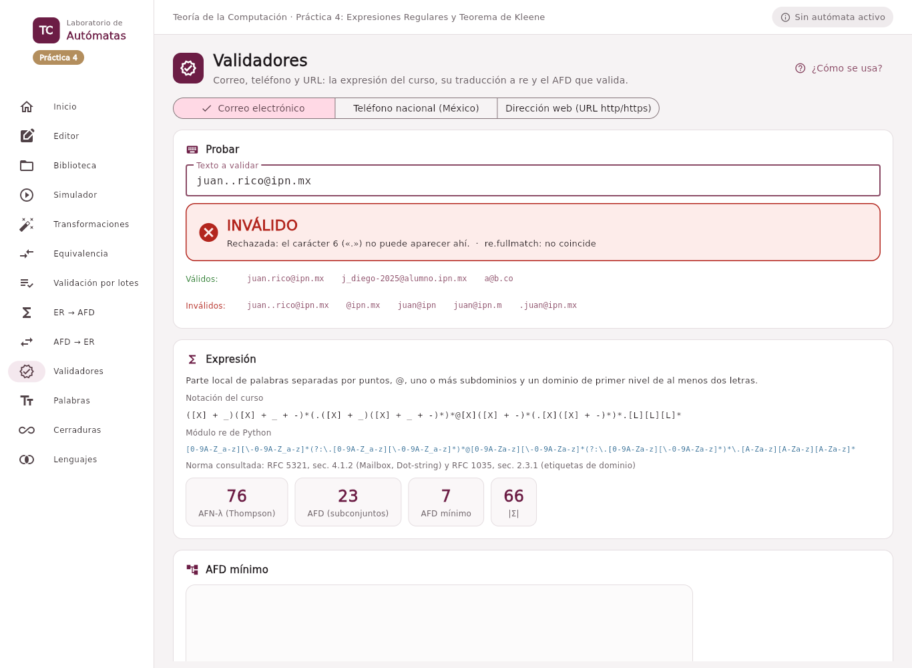

# Ejercicio 4. Aplicaciones: validadores

Se implementaron tres validadores: **correo electrónico**, **teléfono en formato nacional** y **URL**. Cada uno es un objeto `Validador` (`src/nucleo/validadores.py`) que guarda la expresión en la notación del curso; la traducción a `re` se genera del árbol sintáctico, y el texto se valida con el **AFD mínimo** que produce el Ejercicio 2 (Thompson, eliminación de λ, subconjuntos y minimización). La sección **Validadores** muestra la expresión, su traducción, el número de estados antes y después de minimizar, el diagrama del AFD mínimo y la lista de lo que queda fuera; el texto se valida mientras se escribe e indica en qué carácter falla.

Los alfabetos grandes se escriben con las clases del Ejercicio 2: \[D\] (dígitos), \[m\] (minúsculas), \[L\] (letras) y \[X\] (letras y dígitos).

## Correo electrónico

**Notación del curso.**

``` text
([X] + _)([X] + _ + -)*(.([X] + _)([X] + _ + -)*)*@[X]([X] + -)*(.[X]([X] + -)*)*.[L][L][L]*
```

**Módulo `re`.**

``` text
[0-9A-Z_a-z][\-0-9A-Z_a-z]*(?:\.[0-9A-Z_a-z][\-0-9A-Z_a-z]*)*@[0-9A-Za-z][\-0-9A-Za-z]*(?:\.[0-9A-Za-z][\-0-9A-Za-z]*)*\.[A-Za-z][A-Za-z][A-Za-z]*
```

La parte local son palabras (letras, dígitos, `_` y `-`, sin empezar con guion) separadas por un punto; después vienen `@`, uno o más subdominios y un dominio de primer nivel de al menos dos letras. Válidos: `juan.rico@ipn.mx`, `j_diego-2025@alumno.ipn.mx`, `a@b.co`; inválidos: `juan..rico@ipn.mx` (dos puntos seguidos), `@ipn.mx`, `juan@ipn` (sin dominio de primer nivel), `.juan@ipn.mx`.

**Norma consultada y lo que queda fuera.** Se tomó como referencia la forma *Dot-string* de la parte local del RFC 5321 (Klensin, 2008, Sección 4.1.2) y la sintaxis de etiquetas de dominio del RFC 1035 (Mockapetris, 1987, Sección 2.3.1). Quedan fuera, a propósito: las partes locales entre comillas y caracteres como `! # $ % & ' * + / = ? ^ { | } ~` que el estándar sí admite; los dominios internacionalizados (con ñ o acentos) y las direcciones IP entre corchetes. Al revés, la expresión acepta etiquetas que terminan en guion o que pasan de 63 caracteres, que el RFC 1035 prohíbe. Una expresión regular para correos siempre es una aproximación: la gramática completa del estándar admite comentarios anidados, que no son regulares.

## Teléfono en formato nacional (México)

**Notación del curso.**

``` text
(\+52 + λ)([D][D](-[D][D][D][D]-[D][D][D][D] + .[D][D][D][D].[D][D][D][D] + [D][D][D][D][D][D][D][D])
          + [D][D][D]-[D][D][D]-[D][D][D][D] + \([D][D]\)[D][D][D][D]-[D][D][D][D])
```

**Módulo `re`.**

``` text
(?:\+52|)(?:(?:[0-9][0-9](?:(?:\-[0-9][0-9][0-9][0-9]\-[0-9][0-9][0-9][0-9]|\.[0-9][0-9][0-9][0-9]\.[0-9][0-9][0-9][0-9])|[0-9][0-9][0-9][0-9][0-9][0-9][0-9][0-9])|[0-9][0-9][0-9]\-[0-9][0-9][0-9]\-[0-9][0-9][0-9][0-9])|\([0-9][0-9]\)[0-9][0-9][0-9][0-9]\-[0-9][0-9][0-9][0-9])
```

Diez dígitos, con el prefijo de país +52 opcional, en cinco presentaciones: sin separadores, 2-4-4 con guiones o con puntos, 3-3-4 con guiones y la clave de dos dígitos entre paréntesis. La expresión obliga a usar el **mismo** separador en todo el número. Válidos: `5512345678`, `55-1234-5678`, `+52222-123-4567`, `(55)1234-5678`, `55.1234.5678`; inválidos: `55-1234.5678` (separadores mezclados), `551234567` (nueve dígitos), `55 1234 5678`, `(55)12345678`.

**Norma consultada y lo que queda fuera.** El Plan Técnico Fundamental de Numeración del Instituto Federal de Telecomunicaciones, que desde 2019 fija la marcación nacional a 10 dígitos (Instituto Federal de Telecomunicaciones, 2019). Quedan fuera los números con espacios (el alfabeto del autómata no incluye el espacio, para no confundirlo con el separador de los formatos de archivo), los prefijos antiguos 01, 044 y 045, y cualquier verificación de que la clave de larga distancia exista: la expresión acepta cualquier combinación de dígitos.

## URL (http y https)

**Notación del curso.**

``` text
http(s + λ)://([m] + [D])([m] + [D] + -)*(.([m] + [D])([m] + [D] + -)*)*.[m][m][m]*(:[D][D]* + λ)(/([X] + - + _ + . + ~)*)*
```

**Módulo `re`.**

``` text
http(?:s|)://[0-9a-z][\-0-9a-z]*(?:\.[0-9a-z][\-0-9a-z]*)*\.[a-z][a-z][a-z]*(?::[0-9][0-9]*|)(?:/[\-.0-9A-Z_a-z~]*)*
```

Esquema `http` o `https`, nombre de host en minúsculas con dominio de primer nivel, puerto opcional y una ruta de segmentos con caracteres no reservados. Válidos: `https://www.ipn.mx`, `http://escom.ipn.mx:8080/tc/practica4`, `https://a.io/`; inválidos: `ftp://ipn.mx`, `https//ipn.mx`, `https://ipn`, `https://IPN.mx`, `https://ipn.mx:/x`.

**Norma consultada y lo que queda fuera.** RFC 3986, secciones 3.1 a 3.3 (*scheme*, *authority* y *path*) (Berners-Lee et al., 2005). Quedan fuera las consultas (`?a=1`), los fragmentos (`#sec`), los caracteres codificados con `%`, los hosts en mayúsculas o como direcciones IP, la información de usuario (`usuario@host`) y los demás esquemas.

## Tamaño de los autómatas

| Validador | \|Σ\| | AFN-λ (Thompson) | AFD (subconjuntos) | AFD mínimo |
|-----------|:-----:|:----------------:|:------------------:|:----------:|
| Correo    |  66   |        76        |         23         |     7      |
| Teléfono  |  15   |       128        |         56         |     27     |
| URL       |  68   |       106        |         31         |     16     |

Estados de cada validador antes y después de la minimización.

La minimización reduce el correo de 23 a 7 estados porque los subconjuntos que sólo difieren en qué copia de la clase \[X\] están activas se comportan igual; el teléfono conserva más estados porque cada posición de los diez dígitos, en cada formato, es una situación distinta.




## Congruencia entre modelos

`tests/test_validadores.py` compara, para cada validador, el AFD con `re.fullmatch` (Python Software Foundation, 2026) sobre un conjunto generado por `GeneradorDePruebas`:

1.  **300 palabras válidas** obtenidas recorriendo el árbol de la expresión al azar (con semilla fija, para que la prueba sea reproducible): en una unión se elige una rama, en una clase un símbolo y en una estrella entre 0 y 4 repeticiones.
2.  **300 mutaciones** de esas palabras: una o dos operaciones elegidas al azar entre insertar, borrar, sustituir o duplicar un carácter, o intercambiar dos vecinos. La mitad de los caracteres nuevos salen del alfabeto del autómata y la otra mitad de un «ruido» fijo con espacio, ñ y signos (`@ . - _ / : + ( ) #`).
3.  Los **casos frontera** escritos a mano: la cadena vacía, un espacio y los ejemplos válidos e inválidos de cada validador.

Tras quitar repetidas quedan más de 600 palabras por validador, con al menos 100 válidas y 100 inválidas según `re` (en la última ejecución: correo 464 / 143, teléfono 328 / 281, URL 432 / 175). El autómata y `re.fullmatch` coinciden en **todas**. Las pruebas pasan con Python 3.11, 3.12 y 3.13.
